# vexsim

A VEX V5 robot simulator for testing localization and motion-control code before it runs on the robot. It models:
- **drive physics**: wheel slip and drift on omni, traction and mecanum wheels; tank drives, X-drives, mecanum drives and H-drives; weight transfer; collisions with the field walls;
- **the V5 motor**: its torque-speed curve, firmware velocity, position and hold loops, current limiting, heating and thermal derating, and battery sag;
- **mechanisms**: lifts, intakes and arms, with loads, friction and hard stops;
- **sensors**: motor encoders, IMU, rotation sensors (tracking wheels), distance sensors and the GPS, with realistic latency, noise and per-device errors;
- **game elements**: fixed obstacles (some low enough to drive over) and pieces the robot pushes around.

You can write robot programs in Python against a PROS 4-style API, or **run your PROS 4 C++ project, LemLib included, without changing it**. You can benchmark algorithms over hundreds of randomized trials, and calibrate the physics to your own robot from a log of a short drive.

This README is the complete guide: how to use every feature, and what every module does. The [`docs/`](docs/) folder goes deeper on a few topics (where each physics parameter comes from, worked examples, a real team's port), and each section links to it.

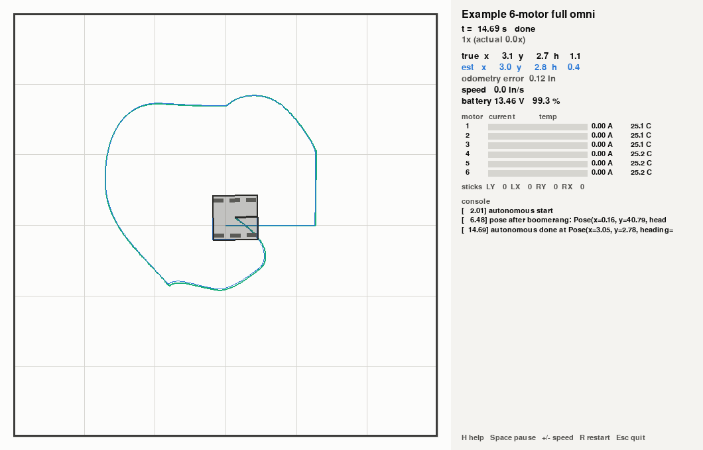

## Contents
1. [Install](#1-install)
2. [Quick start](#2-quick-start)
3. [Concepts: units, frames, time, randomness](#3-concepts-units-frames-time-randomness)
4. [Describing a robot](#4-describing-a-robot)
5. [Describing a field](#5-describing-a-field)
6. [Running a simulation: `vexsim run`](#6-running-a-simulation-vexsim-run)
7. [The browser app: `vexsim ui`](#7-the-browser-app-vexsim-ui)
8. [Writing robot programs in Python](#8-writing-robot-programs-in-python)
9. [Running PROS 4 and LemLib C++ code](#9-running-pros-4-and-lemlib-c-code)
10. [Analysis commands: motor curves, drift, odometry](#10-analysis-commands-motor-curves-drift-odometry)
11. [Benchmarking algorithms: `vexsim bench`](#11-benchmarking-algorithms-vexsim-bench)
12. [Calibrating to your robot](#12-calibrating-to-your-robot)
13. [Porting a team's code](#13-porting-a-teams-code)
14. [Using vexsim as a Python library](#14-using-vexsim-as-a-python-library)
15. [Module reference: what each part does](#15-module-reference-what-each-part-does)
16. [The physics models](#16-the-physics-models)
17. [Limits: what isn't modeled](#17-limits-what-isnt-modeled)
18. [Developing vexsim](#18-developing-vexsim)

---

## 1. Install
vexsim needs **Python 3.11 or newer**.

**Windows (PowerShell)**
```powershell
py -3.11 -m venv .venv
.venv\Scripts\Activate.ps1
python -m pip install -e ".[dev,viz,ui]"
```

**Linux / macOS**
```bash
python3 -m venv .venv
source .venv/bin/activate
python -m pip install -e ".[dev,viz,ui]"
```

| Extra | Adds | Needed for |
|---|---|---|
| (none) | numpy, pydantic, PyYAML | everything headless: configs, simulation, benchmarks, calibration fits |
| `viz` | matplotlib, pygame | the live viewer, screenshots, every plot and chart |
| `ui` | FastAPI, uvicorn, websockets | the browser app, [`vexsim ui`](#7-the-browser-app-vexsim-ui) |
| `dev` | pytest, ruff, and the browser app's server packages | running the tests and the linter |

The `vexsim` command is installed with the package (`python -m vexsim` works too).

### C++ toolchain (only for running PROS C++ code)
vexsim compiles PROS projects for your PC with g++ 11 or newer.
- **Windows:** install MSYS2 from https://www.msys2.org (default folder `C:\msys64`). In the "MSYS2 UCRT64" terminal, run `pacman -S --needed mingw-w64-ucrt-x86_64-gcc`. vexsim finds it in `msys64` or `msys2` at the top of any drive. Otherwise add `...\ucrt64\bin` to your PATH, or set `VEXSIM_CXX` to the full path of `g++.exe`.
- **Linux:** `sudo apt install g++` (or your distribution's equivalent).
- **macOS:** `brew install gcc`, then set `VEXSIM_CXX=g++-14` (or the version you installed).

Then check it:
```
vexsim doctor
```
```
[ ok ] compiler   /usr/bin/g++
                  g++ 13.3.0, target x86_64-linux-gnu, thread model posix
[ ok ] build      test program compiled and linked in 2.0 s
[ ok ] run        tasks, delays and mutexes run in lockstep with simulated time
```

| Environment variable | Effect |
|---|---|
| `VEXSIM_CXX` | the g++ to use |
| `VEXSIM_CACHE_DIR` | where builds go (default `%LOCALAPPDATA%\vexsim\build` on Windows, `~/.cache/vexsim/build` elsewhere) |
| `VEXSIM_LEMLIB_SOURCE` | a LemLib source checkout to build from, instead of downloading the release (for working offline) |

---

## 2. Quick start
Every command below runs from the repository root, with the example files.

**Or use the browser app** for the same runs, picked from lists instead of typed ([section 7](#7-the-browser-app-vexsim-ui)):
```
vexsim ui            # in your browser; or --window, in a window of its own
vexsim vscode        # once: then "vexsim: Open the app" in VS Code shows it beside your code
```

**Check a robot config and see what the simulator builds from it:**
```
vexsim validate-config examples/robots/full_omni_6m.yaml --field examples/fields/v5rc_empty.yaml
```
```
Robot  examples/robots/full_omni_6m.yaml
  name        Example 6-motor full omni
  body        6.50 kg (14.3 lb), footprint 15.0 x 15.0 in, CG (0.0, 0.0, 3.5) in
              yaw inertia 0.157 kg*m^2 (auto: uniform box)
  drivetrain  differential, 6 wheels (6 omni)
    left      motors 1, 2, 3 | blue 600 rpm | ratio 36:48 -> 450 rpm | 3.25 in -> 76.6 in/s free speed
    right     motors -4, -5, -6 | blue 600 rpm | ratio 36:48 -> 450 rpm | 3.25 in -> 76.6 in/s free speed
    top speed forward 76.6 in/s, turning 731 deg/s (kinematic, rated motor speed)
  sensors     port 10  imu       at (0.0, 0.0) in, mount yaw 0 deg, noise default
              ...
Result: OK (0 error(s), 0 warning(s))
```

**Drive the robot yourself** in the viewer (W/S throttle, A/D turn; press H for every key):
```
vexsim run examples/robots/full_omni_6m.yaml
```

**Run the example Python program**, a tour of every chassis motion:
```
vexsim run examples/robots/full_omni_6m.yaml --program examples/programs/tour.py
```

**Run a PROS 4 C++ project** (needs the toolchain above):
```
vexsim run examples/robots/full_omni_6m.yaml --program examples/pros_projects/minimal_pros4 --start 0,0,90
vexsim run examples/robots/lemlib_example.yaml --program examples/pros_projects/lemlib_template --start 0,0,90
```

**Run without a window**, log telemetry, save the last frame, and plot the log:
```
vexsim run examples/robots/full_omni_6m.yaml --program examples/programs/tour.py --headless --record tour.csv --screenshot tour.png
vexsim plot tour.csv --out telemetry.png
```

**Try the other drivetrains, and a field with game elements:**
```
vexsim run examples/robots/mecanum_4m.yaml --input examples/inputs/strafe_square.csv --start=-12,12,0
vexsim run examples/robots/full_omni_6m.yaml --field examples/fields/practice_elements.yaml --start=-48,-24,0
```

**Benchmark two path followers over 20 randomized trials each:**
```
vexsim bench examples/scenarios/s_curve.yaml --seeds 20
```

### The example files
| Folder | Contents |
|---|---|
| `examples/robots/` | `full_omni_6m` (6-motor full-omni tank with tracking wheels, IMU and a distance sensor: the main example), `traction_6m` (traction wheels in the middle), `xdrive_4m`, `mecanum_4m`, `hdrive_5m`, `lemlib_example` (the robot LemLib's example program configures), `1239e_2026-27` (a real team's robot, with mechanisms) |
| `examples/fields/` | `v5rc_empty` (walls only), `practice_elements` (a barrier, two goals, six balls), `1239e_2026-27` (the 2026-27 field as team 1239E models it) |
| `examples/programs/` | `tour.py`: a Python program that runs every chassis motion, and numbers its stops on the field; `tank_drive.py`: tank driver control only, to drive or to follow a log |
| `examples/inputs/` | `strafe_square.csv`: scripted controller input |
| `examples/pros_projects/` | `minimal_pros4` (its own tracking-wheel odometry, driving a square), `lemlib_template` (LemLib's own example program), `lemlib_bench` (LemLib motions as benchmark controllers), `calibration` (the calibration routine for `full_omni_6m`), `1239e_2026-27` (a real team's code, and a route, `routes/left_start.yaml`) |
| `examples/scenarios/` | benchmark scenarios: `s_curve`, `pose_approach`, `lemlib_vs_python` |
| `examples/scripts/` | `evaluate_1239e.py`: runs every 1239E routine and measures its localization |
| `examples/logs/` | `full_omni_routine.csv`: the calibration routine as a robot logs it, recorded in the simulator by `full_omni_6m` with its wheels' friction and its battery changed, to fit the parameters back ([section 12](#12-calibrating-to-your-robot)); `left40_simulated.1239e`: an MCL log in 1239E's format, written by the simulated 1239E robot running Left 40, to play and replay ([section 7](#7-the-browser-app-vexsim-ui)) |
| `.vexsim/` | for `vexsim ui` ([section 7](#7-the-browser-app-vexsim-ui)): `launch.yaml`, the saved runs (every example and 1239E routine, and two that replay MCL logs), and `sweeps.yaml`, the 1239E evaluation as sweeps |

---

## 3. Concepts: units, frames, time, randomness
### Units
| Where | Units |
|---|---|
| Physics, sensors, internal math | SI: m, kg, s, rad, N, N·m, V, A |
| Config files, CLI output, logs, robot-code API | VEX: inches, degrees, rpm, mV; kg for mass |

Conversions happen only at those boundaries (`vexsim/units.py`).

### Frames and angles
- **Robot frame:** origin at the center of the footprint (or wherever a `shape` puts it: its parts are placed around the origin), **+x forward, +y left**, +z up. Angles are counter-clockwise from +x, seen from above. Everything you place on the robot (`pos_in`, `cg_in`) uses this frame.
- **Field frame:** origin at the field center, axes parallel to the walls, angles counter-clockwise from +x. The walls' inside faces are at `x = ±size_in[0]/2` and `y = ±size_in[1]/2` (144 × 144 in by default).
- **Poses** in vexsim (`--start`, Python programs, scenarios, telemetry) are `x, y` in inches and a heading in degrees **counter-clockwise from +x**.
- **PROS and LemLib** use heading **clockwise from +y**. Robot code never sees vexsim's frame: the IMU reads clockwise-positive as on the V5, and a pose reported by C++ code (LemLib's, or `vexsim::report_pose`) is converted. To start the simulated robot where LemLib's `chassis.setPose(x, y, theta)` says it is, use `--start x,y,(90 - theta)`. LemLib's (0, 0, 0) faces +y, so it is `--start 0,0,90`.

### Time and determinism
- Simulated time is an integer number of **microseconds**, so long runs never drift. The physics steps every **1 ms**.
- Each tick at time `t`: every due event fires in priority order (sensors at -100, controllers at 0, recorders at 100; ties in registration order), so a controller sees that tick's readings; then every physics system steps from `t` to `t + 1 ms`.
- Robot code takes no simulated time: Python programs run between `yield`s, and C++ tasks run until they block (`pros::delay`, mutexes, notifications). So a run is **identical every time** for the same seed, at any speed, console output included.

### Randomness
- Every random number comes from a named stream derived from the run's seed (`--seed`, default 0): `sensor.imu.10`, `sensor.rotation.11.static`, and so on. Adding or removing a sensor never changes the noise another sensor sees, which keeps comparisons between robot configs fair.
- The same seed with the same versions of numpy and vexsim gives bit-identical runs. Results can differ across platforms or library versions.

### Truth and belief
The simulator always knows where the robot really is (the **true pose**, drawn solid in the viewer). Robot code and localizers only see sensor readings and produce an **estimated pose** (the blue outline). Every comparison vexsim makes (in the viewer, telemetry, benchmarks and `vexsim run`'s headless summary) is the estimate against the truth.

---

## 4. Describing a robot
A robot is a YAML file. Copy `examples/robots/full_omni_6m.yaml`; its comments explain every field. Or let the browser app write it: its *New robot…* draws the robot and fills in its drive, mechanisms and sensors with forms ([section 7](#7-the-browser-app-vexsim-ui)). Here is every section:

```yaml
version: 1
name: Example 6-motor full omni

body:
  mass_kg: 6.5
  inertia_kgm2: auto            # auto = uniform box over the footprint, m(L^2 + W^2)/12; or a number in kg*m^2
  footprint_in: [15, 15]        # length (x) by width (y)
  cg_in: [0, 0, 3.5]            # x, y, height above the floor
  battery: v5_default

drivetrain:
  type: differential            # differential | xdrive | mecanum | hdrive
  wheels:                       # every wheel, listed explicitly
    - {name: lf, pos_in: [ 5.5,  6.0], heading_deg: 0, type: omni, diameter_in: 3.25}
    - {name: lm, pos_in: [ 0.0,  6.0], heading_deg: 0, type: omni, diameter_in: 3.25}
    - {name: lb, pos_in: [-5.5,  6.0], heading_deg: 0, type: omni, diameter_in: 3.25}
    - {name: rf, pos_in: [ 5.5, -6.0], heading_deg: 0, type: omni, diameter_in: 3.25}
    - {name: rm, pos_in: [ 0.0, -6.0], heading_deg: 0, type: omni, diameter_in: 3.25}
    - {name: rb, pos_in: [-5.5, -6.0], heading_deg: 0, type: omni, diameter_in: 3.25}
  gearing:                      # gear groups: motors geared to wheels
    left:  {motors: [1, 2, 3],    cartridge: blue, ratio: "36:48", wheels: [lf, lm, lb]}
    right: {motors: [-4, -5, -6], cartridge: blue, ratio: "36:48", wheels: [rf, rm, rb]}

mechanisms:                     # optional: lifts, intakes, arms
  lift: {motors: [7, -8], cartridge: red, ratio: "12:60", load_torque_nm: 2.0, range_deg: [0, 120]}
  intake: {motors: [9], cartridge: blue}

sensors:
  - {type: imu, port: 10, pos_in: [0, 0], mount_yaw_deg: 0, noise: default}
  - type: rotation              # vertical (forward-tracking) wheel
    port: 11
    reversed: false
    tracking_wheel: {pos_in: [0, -1.5], heading_deg: 0, diameter_in: 2.0}
  - type: rotation              # horizontal (sideways-tracking) wheel
    port: 12
    tracking_wheel: {pos_in: [-3, 0], heading_deg: 90, diameter_in: 2.0}
  - {type: distance, port: 13, pos_in: [7, 0], heading_deg: 0}
  - {type: gps, port: 15, pos_in: [0, -4], mount_yaw_deg: 180}

overrides:                      # optional: any model parameter
  wheel.omni.lateral_mu: 0.25
```
(The `mechanisms:`, the GPS and the override are added for illustration; the example file has none of them.)

### Body
| Key | Meaning |
|---|---|
| `mass_kg` | the whole robot, mechanisms included |
| `inertia_kgm2` | yaw inertia; `auto` treats the robot as a uniform box over its footprint (a uniform plate over its `shape`) |
| `footprint_in` | length × width, centered on the robot origin. It collides with walls, obstacles and pieces, and every wheel and sensor must be inside it. |
| `shape` | instead of `footprint_in`, for a robot that isn't a rectangle: rectangles, circles and outlines ([below](#a-robot-that-isnt-a-rectangle-shape)) |
| `cg_in` | center of gravity (x, y, height); the height sets the weight transfer |
| `battery` | `v5_default` (the only preset) |

### A robot that isn't a rectangle: `shape`
Instead of `footprint_in`, a body can have a `shape`: rectangles, circles and closed outlines, in inches in the robot frame, placed around the robot's origin. Where parts overlap they merge, and only the shape's outside edge touches walls, field elements and pieces: a goal post or a ball settles into a notch, touching both sides, and a round bumper meets a wall wherever it bulges most. From `examples/robots/shaped_6m.yaml`:
```yaml
body:
  mass_kg: 6.5
  inertia_kgm2: auto            # a uniform plate over the shape
  shape:
    - {type: rect, pos_in: [0, 0], size_in: [12, 14]}       # the drive base
    - {type: circle, pos_in: [-6, 0], diameter_in: 6}       # a round bumper at the back
    - type: outline                                         # the clamp, with its notch
      points_in: [[6, 7], [9, 7], [9, 2.5], [7, 0], [9, -2.5], [9, -7], [6, -7]]
  cg_in: [0, 0, 3.5]
```

| Part | Keys |
|---|---|
| `rect` | `size_in`: length (along its heading) by width; `pos_in`: its center (default `[0, 0]`); `heading_deg` (default 0) |
| `circle` | `diameter_in`; `pos_in`: its center (default `[0, 0]`) |
| `outline` | `points_in`: three or more points, joined in order by straight edges, and the last back to the first. The edges mustn't cross. |

- The origin is what the robot's pose, `--start` and odometry offsets refer to. It needn't be the middle of the shape.
- `inertia_kgm2: auto` is a uniform plate over the shape (for a single rectangle, the footprint's box).
- The wheels, sensors and CG must be inside the shape, and its box (in the robot's own frame) must fit the 18 in starting size. A part that touches no other part is a warning: it still moves with the robot.
- Moving mechanisms don't change the shape, and the shape has no height: it touches whatever is in the way, at any height.
- The field view, the editor's diagram and the pygame viewer draw the shape. On the field, an arrow from the origin marks its front, and the start pose is dragged by the shape itself.

### Drivetrain
**Wheels.** Each wheel has a `name`, a position `pos_in`, a `type` (`omni`, `traction` or `mecanum`) and a `diameter_in`.
- `heading_deg` is the direction the wheel rolls when its gear group turns forward. Differential wheels use 0. H-drive strafe wheels use 90, so positive strafe pushes the robot left. X-drive wheels use ±45 (front-left -45, front-right 45, back-left 45, back-right -45 in the examples, so driving ahead turns every group forward).
- `drop_in` (0–0.5) lowers a wheel, as in a drop-center drivetrain; a lowered wheel carries more weight.
- `roller_angle_deg` (mecanum only, required) is the axis of the rollers touching the ground, counter-clockwise from the rolling direction: usually -45 at front-left and back-right, and 45 at front-right and back-left. Check it in the viewer: the left stick's sideways axis should strafe the robot that way.

**Gearing groups** tie motors to wheels; all wheels in a group turn together.
- `motors`: smart ports. A **negative port means reversed**, as in PROS 4, and a group's positive direction always rolls its wheels forward.
- `cartridge`: `red` (100 rpm), `green` (200) or `blue` (600).
- `ratio`: wheel speed / motor speed. `"36:48"` means 36 teeth on the motor side driving 48 on the wheel side (0.75×). A bare number works too. Write it quoted or not: vexsim reads `36:48` as text, where plain YAML would read the number 2208.

| `type` | Gearing groups | Checks |
|---|---|---|
| `differential` | exactly `left` and `right` | wheels parallel to x, each side on its own side |
| `hdrive` | `left`, `right`, plus one or more strafe groups (any names) | as differential; strafe wheels perpendicular |
| `xdrive` | any, usually one per wheel | must be able to strafe; warns about non-omni wheels |
| `mecanum` | any, usually one per wheel | must be able to strafe; warns about non-mecanum wheels |

Any wheel type works in any drivetrain: a tank drive with traction wheels in the middle is `differential`.

### Mechanisms
Motors that drive something other than the wheels. Each mechanism is one output (a lift's spool, a roller, an arm's pivot) with its own motors:

| Key | Meaning (all at the output) |
|---|---|
| `motors`, `cartridge` | as for gearing groups; positive is the motors' positive direction |
| `ratio` | output speed / motor speed: `"12:48"` is a 4:1 reduction (default 1) |
| `inertia_kgm2` | the load's inertia (the motors' own is added) |
| `load_torque_nm` | a constant torque pulling toward negative angles: a lift's weight times its spool radius |
| `friction_nm` | Coulomb friction; a lighter load stays put |
| `range_deg` | hard stops `[low, high]`, in output degrees from the start, so `low <= 0 <= high`. A lift that starts at the bottom has `low: 0`. |

Mechanism motors are full V5 motors on their ports: robot code drives them like any motor, they draw from the battery, and telemetry records each output's angle (`lift_deg`). A mechanism doesn't push the chassis or pick anything up.

### Sensors
Every sensor has a `type`, a `port` and a `noise` preset (`ideal`, `default` or `harsh`; see [Sensors](#sensors-1)).

| `type` | Keys |
|---|---|
| `imu` | `pos_in`, `mount_yaw_deg`; optional `scale_error`: this IMU's measured error, (reading − true) / true over a full turn, e.g. `0.002528` for one that reads 360.91° per real turn. Without it each simulated IMU draws a random one. |
| `rotation` | `reversed`; optional `tracking_wheel: {pos_in, heading_deg, diameter_in}`. A tracking wheel's `heading_deg` is the direction of travel it measures: 0 for vertical (forward), 90 for horizontal (sideways). |
| `distance` | `pos_in`, `heading_deg` (where the beam points); optional `height_in`: the beam's height above the floor, so field elements no taller than that pass under it |
| `gps` | `pos_in` (where the sensor sits), `mount_yaw_deg` (where its camera faces; 180 = backward) |

Odometry offsets are measured from the footprint center: a vertical wheel by its `y` (+left), a horizontal wheel by its `x` (+forward).

### Overrides
`overrides:` changes any model parameter by its dotted name. Calibration writes its results here.

| Group | Parameters (defaults) |
|---|---|
| `motor` | `reference_voltage_v` 12.8, `natural_free_rpm` 121, `natural_stall_torque_nm` 3.99, `natural_stall_current_a` 4.69, `free_current_a` 0.15, `coulomb_fraction` 0.3, `current_limit_a` 2.5, `max_command_v` 12, `rotor_inertia_kgm2` 2e-6, `friction_smoothing_rad_s` 2, `velocity_kp` 2, `velocity_ki` 20, `velocity_filter_s` 0.002, `integral_gate` 0.25, `position_kp` 15 (output values are the red cartridge's) |
| `thermal` | `ambient_c` 25, `winding_heat_capacity_j_per_k` 12, `housing_heat_capacity_j_per_k` 50, `winding_to_housing_k_per_w` 1.5, `housing_to_ambient_k_per_w` 4, `derate_start_c` 55, `derate_step_c` 5 |
| `battery` | `capacity_mah` 1100, `internal_resistance_ohm` 0.1 |
| `chassis` | `wheel_stiffness_n_per_m` 20000, `gravity_m_s2` 9.81 |
| `wheel.omni` | `longitudinal_mu` 0.9, `slip_velocity_m_s` 0.03, `lateral_mu` 0.2 (**controls drift**), `lateral_velocity_m_s` 0.02, `rolling_resistance` 0.1, `rolling_velocity_m_s` 0.02, `mass_kg` 0.06 |
| `wheel.traction` | `mu` 1.1, `slip_velocity_m_s` 0.03, `rolling_resistance` 0.12, `rolling_velocity_m_s` 0.02, `mass_kg` 0.07 |
| `wheel.mecanum` | `grip_mu` 0.8, `slip_velocity_m_s` 0.03, `roller_mu` 0.15, `roller_velocity_m_s` 0.02, `rolling_resistance` 0.12, `rolling_velocity_m_s` 0.02, `mass_kg` 0.15 |
| `field` | `wall_restitution` 0.2, `wall_friction` 0.3 |
| `sensor.motor` | `period_ms` 10, `latency_ms` 5, `counts_per_core_rev` 50, `velocity_noise` 0.005 |
| `sensor.rotation` | `period_ms` 10, `latency_ms` 5, `resolution_deg` 0.088, `noise_deg` 0.02, `diameter_error` 0.005, `offset_error_in` 0.05, `scrub` 0.01, `liftoff_rate_hz` 0, `liftoff_duration_s` 0.05 |
| `sensor.imu` | `period_ms` 10, `latency_ms` 5, `calibration_s` 2, `raw_bias_deg_s` 0.3, `rate_noise_deg_s` 0.05, `bias_walk_deg_s` 0.0005, `scale_error` 0.005, `heading_noise_deg` 0.01 |
| `sensor.distance` | `period_ms` 33, `latency_ms` 10, `min_range_mm` 20, `max_range_mm` 2000, `short_noise_mm` 7.5, `long_noise_fraction` 0.025 |
| `sensor.gps` | `period_ms` 20, `latency_ms` 20, `position_noise_m` 0.005, `range_noise` 0.004, `heading_noise_deg` 0.3, `min_range_m` 0.3, `max_range_m` 4, `gyro_noise_deg_s` 0.1, `error_growth_m_s` 0.05 |

The `sensor.*` values shown are the `default` preset's; an override applies on top of each sensor's own preset. [docs/models.md](docs/models.md) gives the source of every value, and simple experiments to measure them.

### Validation
`vexsim validate-config ROBOT.yaml [--field FIELD.yaml] [--strict] [-q]` prints what the simulator will build, and every problem. Exit code 0 means valid and 1 means errors; `--strict` fails on warnings too, and `-q` prints only problems. The browser app's editor ([section 7](#7-the-browser-app-vexsim-ui)) runs the same checks as you type and marks each problem at its line.
- **Structure:** a misspelled key is an error that suggests the closest valid key, and duplicate keys are errors (plain YAML silently keeps the last one).
- **Errors:** a port used twice (motors, mechanisms and sensors share ports 1–21); the CG, a wheel or a sensor outside the footprint (or the shape); both or neither of `footprint_in` and `shape`; an outline that crosses itself; wheels all in a line, or the CG outside the polygon they form (the robot would tip over); a wheel in no gear group, or in two; unknown wheel names; a mecanum wheel without `roller_angle_deg`, or roller angles on other wheels; a differential drive without exactly `left` and `right`; an X-drive, mecanum or H-drive that can't strafe independently; mechanism stops that don't contain the start; unknown or inconsistent overrides.
- **Warnings:** a footprint or shape over the 18 in starting size; a part of a shape that touches no other part; more than 88 W of drive motors; wheels geared together with different diameters (they scrub); unusual wheel types for the drivetrain.

---

## 5. Describing a field
A field YAML gives the inside-wall size and the game elements:

```yaml
version: 1
name: Practice field with game elements
size_in: [144, 144]               # inside the walls; real fields measure a little less, so measure yours
elements:
  - {type: obstacle, name: barrier, shape: rect, pos_in: [0, 0], size_in: [48, 3], heading_deg: 0}
  - {type: obstacle, name: goal, shape: circle, pos_in: [-48, 48], diameter_in: 10, color: "#d33f49"}
  - {type: obstacle, name: low base, shape: rect, pos_in: [47, -23.5], size_in: [5, 5], height_in: 6, solid: false}
  - {type: piece, name: ball, pos_in: [-24, 24], diameter_in: 7, mass_kg: 0.25, friction: 0.4, restitution: 0.3}
```

| Element key | Meaning |
|---|---|
| `type` | `obstacle` (fixed) or `piece` (a movable disc: a ball, ring or cylinder by its outer diameter) |
| `pos_in` | center, in the field frame |
| `shape`, `size_in`, `diameter_in`, `heading_deg` | obstacles: a `rect` (length along `heading_deg` × width) or a `circle` |
| `height_in` | obstacles: their top above the floor. Distance sensors whose beam is higher see over it. Omitted: taller than any sensor. |
| `solid` | obstacles: `false` for an element low enough to drive over (a base the robot straddles). Robots and pieces pass over it; sensors still see it. The viewer draws it as an outline. |
| `mass_kg`, `friction`, `restitution` | pieces: mass; ground friction coefficient (default 0.4); share of speed kept in a bounce (default 0.3) |
| `color` | `"#rrggbb"`, for the viewer only |

Validation: elements must be inside the walls; a piece that starts overlapping a wall, a solid obstacle or another piece gets a warning. Without `--field`, the robot drives on an empty 144 × 144 in field.

---

## 6. Running a simulation: `vexsim run`
```
vexsim run ROBOT.yaml [--program FILE.py | --program PROS_PROJECT] [options]
```
Without `--program`, you drive the robot from the keyboard or a gamepad. To start runs from the browser instead, see [`vexsim ui`](#7-the-browser-app-vexsim-ui). If the robot would start on top of a solid field element, or partly outside the walls, `vexsim run` warns.

| Option | Meaning |
|---|---|
| `--program` | a Python program file, or a PROS 4 project folder (built automatically) |
| `--routine NAME` | a PROS project's autonomous routine, from its `include/custom/auton.hpp`, to run in place of the one its `autonomous()` calls ([section 9](#picking-an-autonomous-routine)). Without `--start`, the robot starts where the routine's `setPose` puts it. |
| `--route FILE` | a route, from a PROS project's `routes/` folder, run as a routine is ([section 9](#autonomous-routes)): its project, robot, field and start, unless given (then `ROBOT.yaml` can be left out) |
| `--mode` | `autonomous`, `driver`, `match` or `skills` (default: `autonomous` for PROS projects and for Python programs with an `autonomous` function, else `driver`) |
| `--field FILE` | field YAML (default: an empty field) |
| `--start x,y,heading` | the robot's true starting pose (in, deg CCW; default `0,0,0`). Write `--start=-12,12,0`, with `=`, when x is negative. |
| `--seed N` | random seed (default 0) |
| `--noise ideal\|default\|harsh` | one noise preset for every sensor |
| `--speed X` | viewer speed, 0.1 to 8 (0 = as fast as possible) |
| `--input FILE.csv` | scripted controller input |
| `--follow LOG` | drive along a real robot's path, from its robot log (the first pose its code logged) or its MCL log ([below](#following-a-real-robots-log)); `--sticks tank\|arcade` and `--curve DEADBAND,MIN,CURVE` say how the program drives from the sticks. Without `--start`, the robot starts where the log does. |
| `--record FILE.csv` | telemetry log |
| `--robot-log FILE.csv` | a robot log: what the robot's own sensors read, as on a real robot (for calibration) |
| `--sd FOLDER` | PROS projects: a folder that stands in for the brain's SD card (made if it isn't there): files the code opens under `/usd/` go there, as [vexsim's logger](#vexsims-logger)'s logs do |
| `--headless` | no window: run, print a summary, save files |
| `--seconds S` / `--max-seconds S` | headless: run exactly S seconds / give up after S (default 180) |
| `--screenshot FILE.png` | headless: save the final frame |
| `--env KEY=VALUE` | an environment variable for the robot program (repeatable). `VEXSIM_SEED` is always set to the seed, and for C++ programs `VEXSIM_START` to the start pose, as LemLib has it (`x,y,theta`). |
| `--busy-timeout S` | PROS projects: stop if a task runs S seconds of real time without blocking (default 5; 0 = never) |

**Competition modes** behave as under field control:

| `--mode` | Sequence | PROS `competition::get_status()` |
|---|---|---|
| `autonomous` | `initialize` (disabled), then `autonomous`: like a competition switch | connected |
| `driver` | `initialize`, then `opcontrol`: a robot with no field connection | not connected |
| `match` | `initialize` (disabled), 15 s `autonomous`, 105 s `opcontrol`, then `disabled` | field control |
| `skills` | `initialize` (disabled), 60 s `autonomous`, then `disabled` | field control |

When a period's time runs out, every motor stops.

**The headless summary** compares the estimate with the truth:
```
autonomous finished at t = 17.37 s
  true pose      x   42.50  y   19.66  heading  207.6
  estimated pose x   42.37  y   21.51  heading  207.7
  the robot code's pose vs. the true one during autonomous: mean 1.66 in, max 7.00 in (at 7.3 s), final 1.78 in; heading mean 0.53, max 4.3 deg
```

### The viewer
It shows the field with 24 in tiles; the robot (true pose) and a blue outline where its odometry thinks it is; path trails; the active motion's target or path (orange); each wheel shaded from dark (gripping) to red (sliding), with sideways roller forces as orange ticks; wall and obstacle contacts (orange dots); obstacles and pieces. The side panel shows the poses and the odometry error, speed, battery, each motor's current and temperature, the controller sticks, the brain screen (`pros::lcd` lines from C++ code) and the console.

| Key | Action | Key | Action |
|---|---|---|---|
| Space | pause / resume | W / S | left stick Y (arcade throttle) |
| `.` | one step while paused | A / D | right stick X (arcade turn) |
| + / - | speed 0.1× … 8×, max | Up / Down | right stick Y (tank) |
| R | restart | Left / Right | left stick X (strafe) |
| G / T / F | ghost / trails / wheel forces | Shift | half stick |
| H | help | Q / Z, E / C | L1 / L2, R1 / R2 |
| Esc | quit | I / L / K / J | X / A / B / Y |
| | | Ctrl + T/G/F/H | d-pad |

A connected gamepad works too, through SDL's mapping. The sticks match. The Xbox face buttons map to the V5's by position (Y→X, B→A, A→B, X→Y), the bumpers to L1/R1 and the triggers to L2/R2.

### Scripted input
`--input inputs.csv` replays controller input. Its columns are `time_s, LEFT_X, LEFT_Y, RIGHT_X, RIGHT_Y, buttons` (sticks -127..127, buttons space-separated, like `R1 A`). Each row holds until the next. See `examples/inputs/strafe_square.csv`.

### Following a real robot's log
`--follow vexsim_0001_left_40.csv` drives the simulated robot along the path a real robot took, as its log records it: a robot log from [vexsim's logger](#vexsims-logger) (the first pose the code logged, from its first `setPose` on), or an MCL log ([what such a log holds](#7-the-browser-app-vexsim-ui)). Once the program's driver control (`opcontrol`) starts, a virtual driver holds the sticks: it sees where the simulated robot really is and steers it along the logged estimate, in time, through the program's own stick mapping (`--sticks tank`, the default: both sticks' y; `arcade`: left y forward, right x turning) and drive curve (`--curve 15,20,1.05` for LemLib's `ExpoDriveCurve(15, 20, 1.05)`, if the program shapes the sticks with one). The run ends with the log. The logged estimate is the only record of where the real robot went, so where the real robot's localization was wrong, the simulated robot drives the wrong path; where the estimate wanders sideways while the robot sits still, the virtual driver stays put.
```
vexsim run examples/robots/traction_6m.yaml --program examples/programs/tank_drive.py \
    --follow examples/logs/left40_simulated.1239e --headless
```
The robot starts where the log's first estimate puts it, unless `--start` says otherwise; C++ programs can read that pose from `VEXSIM_START` to start their own localization there (the 1239E port does, with `VEXSIM_AUTON=startMcl`). In `match` mode, an `autonomous()` that returns early hands over to `opcontrol` at once.

### Telemetry, plots and replays
- `--record run.csv` logs a row every 10 ms: `time_s, phase`; the true pose (`x_in, y_in, heading_deg`); the estimated pose (`est_x_in, est_y_in, est_heading_deg`); `speed_in_s, yaw_rate_deg_s, battery_v, battery_soc`; each motor's `motor<p>_current_a, motor<p>_temp_c, motor<p>_volts`; and each mechanism's `<name>_deg`.
- `vexsim plot run.csv --out run.png [--title T]` plots the path, speed, motor currents and temperatures, and the battery. Motors geared together are drawn as one line.
- `vexsim replay ROBOT.yaml run.csv [--speed X]` plays a log back in the viewer; `--headless --at 5.0 --screenshot frame.png` saves one frame.

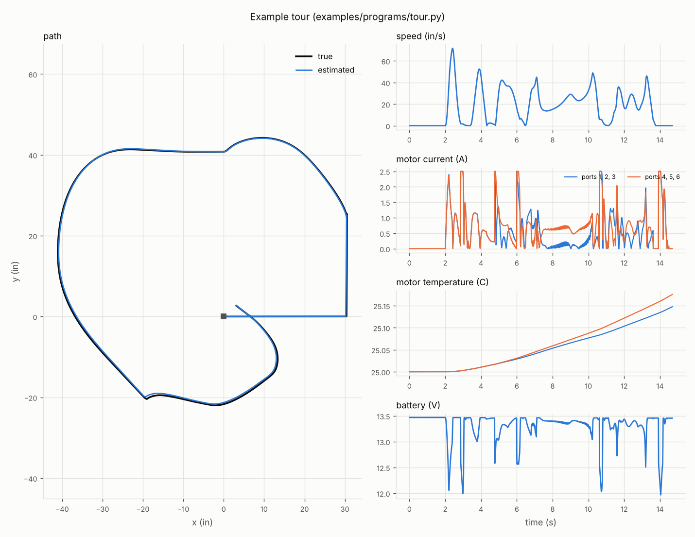

---

## 7. The browser app: `vexsim ui`
```
vexsim ui [FOLDER] [--port N] [--no-browser | --window]
vexsim shortcut [FOLDER] [--remove]
vexsim vscode [--code CODE] [--out FILE] [--no-install]
```
`vexsim ui` opens vexsim in your web browser for a folder of robot configs, fields, programs and PROS projects (default: the current folder). It can also open in a window of its own, from a shortcut, or in a panel in VS Code ([below](#a-window-of-its-own-a-shortcut-a-vs-code-panel)). You pick what to run from lists instead of typing a command line, then watch the run live. It is the same simulation as `vexsim run`, drawn by the browser.

It needs the `ui` extra: `python -m pip install -e ".[ui]"`. The page itself comes prebuilt with the package, so you don't need Node.js, and it works offline.

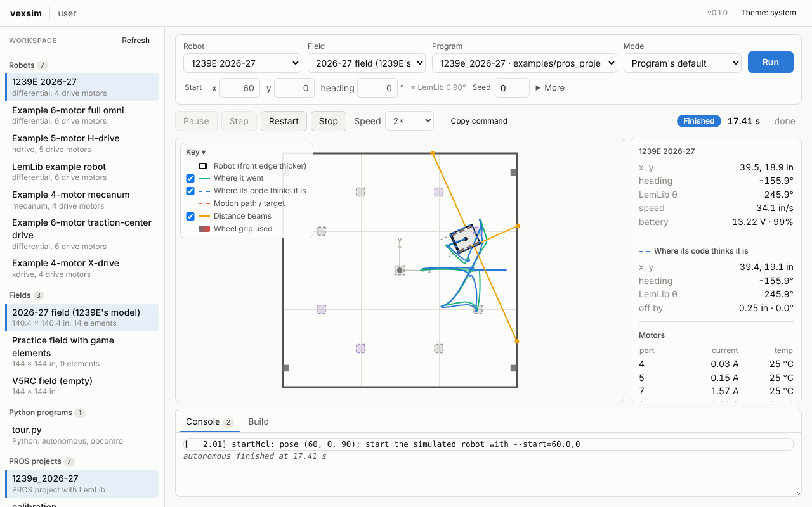

**Running something:**
1. Pick a **saved run** from the first list to fill in everything at once, start pose and environment included. This repository comes with runs for its examples, every 1239E routine among them. Saved runs live in the folder's `.vexsim/launch.yaml`, so a team can commit them; *Save*, *Save as…* and *Delete* change them. (The app rewrites that file when it saves, so comments in it aren't kept.)
2. Or set the run up yourself. The **workspace** list on the left shows everything vexsim can use in the folder, recognized by content rather than name: robots, fields, Python programs, PROS projects and their autonomous routes, scenarios, scripted inputs, telemetry logs, robot logs and MCL logs. A config that doesn't load is listed with the reason. Click an item to use it, or pick from the run bar's lists. (A scenario opens on the *Bench* page and a robot log on *Calibrate*; on those pages, and on *Analyze* and *Build*, a robot or project you click is for the page.) *Refresh* looks again after you add or change files. The **run bar** holds the robot, field, program (a Python file, a PROS project, or none, to drive it yourself), mode, start pose and seed; LemLib's θ for the start heading is shown beside it. For a PROS project with routines in `include/custom/auton.hpp`, **Routine** picks the one its `autonomous()` runs ([section 9](#picking-an-autonomous-routine)), or one of the project's routes ([section 9](#autonomous-routes)); picking one moves the start to where the routine's `setPose` puts the robot (and a route's robot and field come with it). *More* holds the noise preset, a scripted input file or a robot's log to follow (with its program's sticks and drive curve, [see below](#7-the-browser-app-vexsim-ui)), environment variables (`KEY=VALUE`, one per line, like `--env`) and the busy timeout. The browser remembers the form for each folder.

   Right-click an item in the workspace list (or click its ⋯) for its menu:
   - *Edit* opens a robot or field config in the app's editor ([below](#7-the-browser-app-vexsim-ui)); any other file opens in your editor (*Open files in* picks VS Code or Cursor; a PROS project opens at its `src/main.cpp`).
   - *Duplicate* makes a copy beside it: `name_copy.yaml`, a robot's or field's named "… (copy)" with everything else in it as it was, comments too.
   - *Delete* asks first, then deletes the file (and closes its editor, if it's open).

   A PROS project is a folder, so it isn't duplicated or deleted from here.
3. **Drag the robot to where it starts.** Before a run, the field shows the robot at its start: drag it to move it (to half inches), and drag the round handle ahead of it to turn it (to 15°; hold Shift for 0.1 in and 1°). It stays inside the walls, and turns red, with a note, if it would start on top of a field element (`vexsim run` warns about that too).
4. **Run** checks the files first; if something is wrong, the console says what, with the same messages as `vexsim validate-config`. A PROS project is built first, with the build's output in the *Build* tab. Starting a run stops the one before it.

**While it runs:**
- **Controls:** pause, step 10 ms, restart from the start with the same seed, stop, and a speed from 0.1× to 8× real time, or *Max*. *Copy command* copies the run as the equivalent `vexsim run` command. In `match` and `skills` modes, the time left in the period counts down beside the clock.
- **Driving:** with no program, or in `driver` and `match` modes, you drive: the keyboard as in the pygame viewer (below), any gamepad (its face buttons map to the V5's by position), or the on-screen controller in the readings, whose sticks you can drag and buttons press. The controller there shows what the robot reads, whatever drives it.
- **The field:** the robot where it really is (front edge thicker; a robot with a `shape` has an arrow to its front), its path, where its code thinks it is (dashed), the active motion's path and target, distance sensor beams, wheels turning red as they reach their grip limit, each wheel's sideways force (orange), mecanum rollers, wall contacts, obstacles and pieces. The key in its corner says what each mark is; its switches hide the paths, the estimate, the beams, the forces and what the robot code draws (each of its layers, too), and *Key* folds it away. The wheel zooms, dragging pans, and a double-click (or *Fit*) shows the whole field again; *Follow* keeps the robot in the middle; *Save picture* saves the field as a PNG. The pointer's field coordinates are shown in the bottom corner.
- **What the robot code draws:** robot code can draw on the field to show what it's thinking: a localizer's particles, a planned path, a target. C++ code draws with `vexsim::draw_*` ([section 9](#vexsim-extras-for-c-vexsimsimhpp)), Python programs with `bot.draw` ([section 8](#drawing-on-the-field-botdraw)); `tour.py` numbers its stops, and the 1239E port draws its MCL. Each layer of drawings can be shown or hidden in the key, and recorded runs keep them.
- **Readings** (right): true and estimated pose and how far apart they are, speed, battery, the controller, each motor's current and temperature, mechanisms' angles, IMU and GPS readings, distance sensor readings, and the brain and controller screens.
- **Console** (bottom): the program's output, the build's output, and errors with their traceback. **Problems** lists the compiler's errors and warnings and where a Python program failed, as `file:line` links that open the place in VS Code (or Cursor; *Open files in* picks); places in the console and build output are links too.

| Key | Action | Key | Action |
|---|---|---|---|
| Space | pause / resume | W / S | left stick up / down (arcade throttle) |
| `.` | one step while paused | A / D | right stick left / right (arcade turn) |
| R | restart | Up / Down | right stick up / down (tank) |
| + / - | speed | Left / Right | left stick left / right (strafe) |
| 1 2 3 4 5 | show or hide the paths, estimate, beams, forces, drawings | Shift | half stick |
| ? | every key | Q / Z, E / C | L1 / L2, R1 / R2 |
| | | I / L / K / J | X / A / B / Y |
| | | T / F / G / H | the arrows (up, left, down, right) |

Each run executes in a process of its own, so a program that crashes or hangs never takes the app down; *Stop* ends it. If you reload the page, it reconnects to the run in progress.

**After a run: replay, plots and the run history**

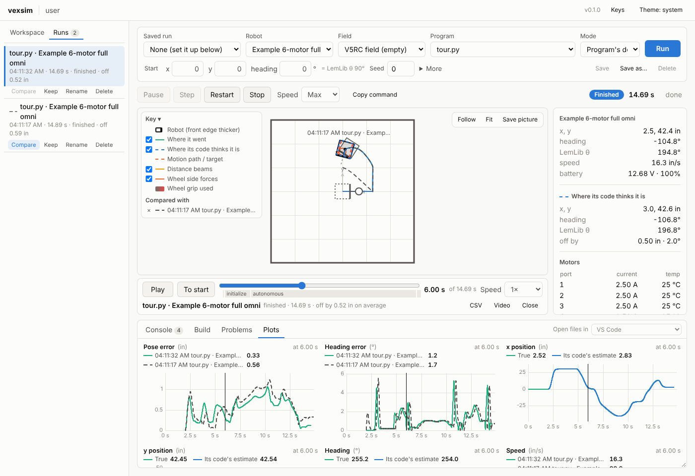

- **Every run is recorded** when it ends: when it finishes, or you stop or restart it, or it fails. Its recording then takes its place on the field, with a **timeline** under it: *Play* and *Pause*, *To start*, the scrubber with the run's phases beneath it (click one to go to its start), the time, and a playback speed. The field, the readings and the screens show the moment you scrub to. Once a run has ended, Space plays and pauses it, ← and → move half a second (with Shift, 5 s), `,` and `.` one 50 ms frame, Home and End to its start and end. *Close* goes back to the robot as the run bar sets it up.
- **Plots** (the tab beside *Console*): one chart per unit, so no chart has two scales. Pose error and heading error; x, y and heading, true (green) beside the code's estimate (blue); speed, turn rate and the battery; each motor's current, temperature and voltage; and the mechanisms' angles. Hovering reads every chart at that moment; clicking goes there. The upright line marks the moment shown on the field.
- **Runs** (the left panel's second tab) lists the recorded runs, newest first: when, how long, how each ended, and how far its code's pose was off on average. Click one to open it. That fills in the run bar as the run was set up, so *Run* repeats it, and it stops a run in progress first. *Compare* draws a run over the one on the field, in grey with its own dashes and its name, and adds it to the plots of a single quantity, up to three at once. (Grey because the field already uses as many colors as everyone, color blind or not, can tell apart.) *Keep* saves a run from the cleanup: the newest 50 stay, plus every kept one. *Rename* and *Delete* do what they say.
- **Telemetry logs** in the workspace list (files from `vexsim run --record`) open the same way, drawn with the robot and field picked in the run bar, like `vexsim replay`.
- **Exports:** *CSV* downloads the run's telemetry, in the `--record` format. *Video* plays the run from its start and saves the field as a WebM video, at the playback speed. *Save picture* saves the field as a PNG.

**A real robot's MCL log, beside its replay**

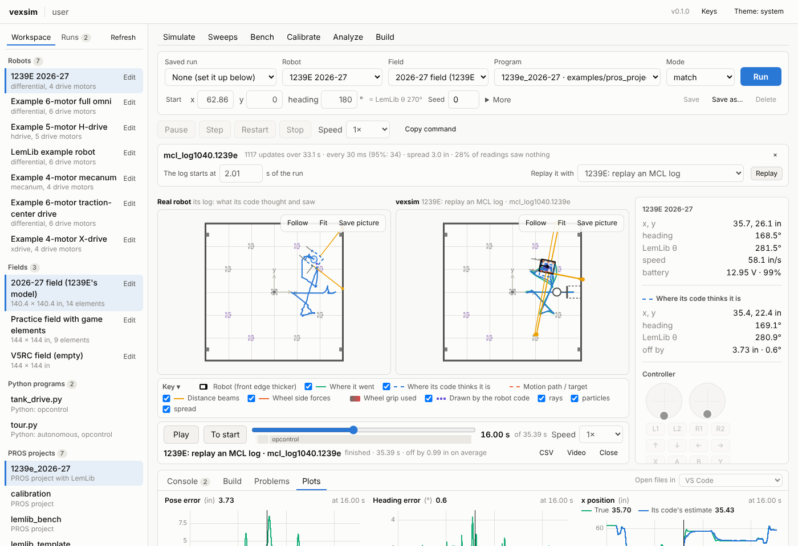

A robot that localizes with Monte Carlo localization can log every update to its SD card. vexsim reads the logs team 1239E's code wrote, before it moved to [vexsim's logger](#vexsims-logger), and its visualizer reads: a block of lines per update with each distance sensor's reading and the ray MCL cast for it, the particles it logged, the time, the estimate and the particles' spread (`vexsim/mcllog.py` has the format; any number of sensors and particles reads). Copy them from the SD card into the folder: they're listed under *MCL logs* (`examples/logs/left40_simulated.1239e` is one, written by the simulated robot).
- **Click one** to play it on the field, drawn as the team's visualizer draws it: each sensor's ray to its reading (grey: it read nothing), the logged particles, the 2-sigma ellipse of their spread, and where the robot's code thought it was, as the robot's outline (dashed) and its path. There's no truth: only the real robot knew where it was. The bar above the field says how many updates over how long, how often they came (the median and the 95th percentile), the particles' typical spread, and how many readings saw nothing. Alone, the log has its own timeline.
- **Replay it:** pick a saved run to replay it with, and *Replay*. The run starts where the log does, and a virtual driver drives it along the log's path through the program's driver control (`--follow`, [section 6](#following-a-real-robots-log)): a saved run says how the program drives from the sticks under `follow`. This repository has two: *1239E: replay an MCL log* (the team's own code, with its MCL started where the log's starts, drawing what it sees) and *Replay an MCL log (Python tank drive)* (any robot, with `tank_drive.py`). The run fills in the run bar, where *More* shows the log it follows, so *Run* repeats it.
- **Side by side:** the real robot's log on the left, the simulator on the right, on one timeline. The log's first update comes at the moment the replay began following it (or, beside another run, where its program began), shown as *The log starts at … s of the run*: change it to line the two up differently. Live, the log plays along as the replay runs; afterwards, scrub both together. Hide the true distance beams (3) to compare the two robots' MCL rays, layer for layer.

[docs/1239e_real_vs_sim.md](docs/1239e_real_vs_sim.md) compares five of 1239E's logs with their replays, number by number.

**Editing robots and fields**

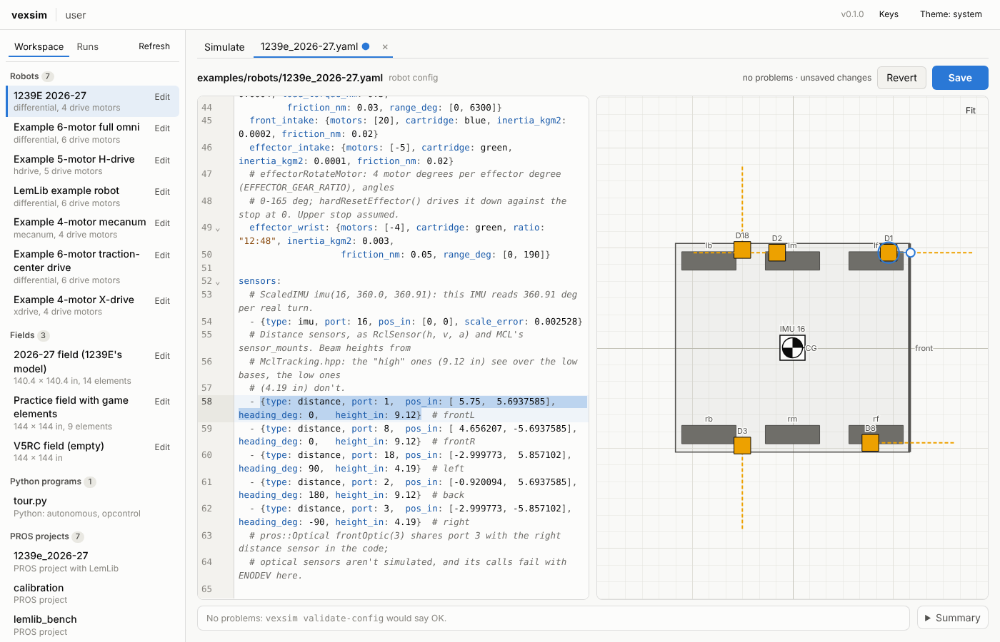

*Edit*, in a robot's or field's menu in the workspace list (right-click it, or click its ⋯), opens its config in a tab of its own, beside *Simulate*: the YAML on the left, the robot (or field) drawn from it on the right. A config that doesn't load opens the same way, from *Unreadable configs*, so you can fix it.
- **The text:** a YAML editor with line numbers, folding, search and undo. What you type is checked as you go, with the same checks as `vexsim validate-config` (section 4), and each problem is marked at its line: underlined, with a dot in the margin, and listed below the editor, where a click goes to it. *Summary* shows what `validate-config` prints about the robot or field.
- **The diagram:** a robot from above in its own frame (+x forward, to the right): its footprint (or each part of its shape), wheels, tracking wheels, distance sensors with their beams, the IMU and GPS, and its center of gravity, labelled with their names and ports. A field shows its walls, obstacles and pieces. A part with a problem is outlined red (an error) or yellow (a warning). Click a part to select its line in the text; put the cursor in a part's line to select the part.
- **Dragging** a part moves it, in 1/8 in steps on a robot and 1/2 in steps on a field (hold Shift for 0.01 in and 0.1 in); the round handle of a selected sensor, wheel or rectangular obstacle turns it, in 15° steps (Shift: 1°). The arrow keys move the selected part a step, and `[` and `]` turn it. The numbers show beside the pointer as you drag.
- **Only the numbers you change are rewritten.** A drop rewrites just those numbers in the text, in place: every comment, blank line, alignment and key order stays as it was, and a coordinate you didn't move keeps its exact value (dragging `4.656207, 5.6937585` along x leaves `5.6937585` alone). A key the file doesn't have yet, such as a sensor's `heading_deg`, is added in the mapping's own style. A value that comes from a YAML anchor or alias can only be changed in the text. Ctrl+Z undoes a drag like any edit, from the text or the diagram.
- **Copy and paste:** on a robot's diagram, Ctrl+C copies the selected wheel or sensor (or, in the Design view, the selected part of the shape) and Ctrl+V pastes a copy, selected, a step right of and below it (each paste a step further). A wheel's copy takes the next free name (`lf2`, `lf3`) and joins the motor groups its original was in; a sensor's keeps its port if that's free, else takes the first free one. The copy pastes into any robot open in the app: copy in one robot's tab, paste in another's.
- **Saving:** nothing is written until *Save* (Ctrl+S). A tab with unsaved changes has a dot, and closing it (or the page) asks first. Saving keeps the file's line endings. If the file changed on disk since you opened it, the app says so and lets you keep yours or load the file's. The workspace list and the field view pick the change up at once.

**Making a robot: *New robot…* and the Design view**

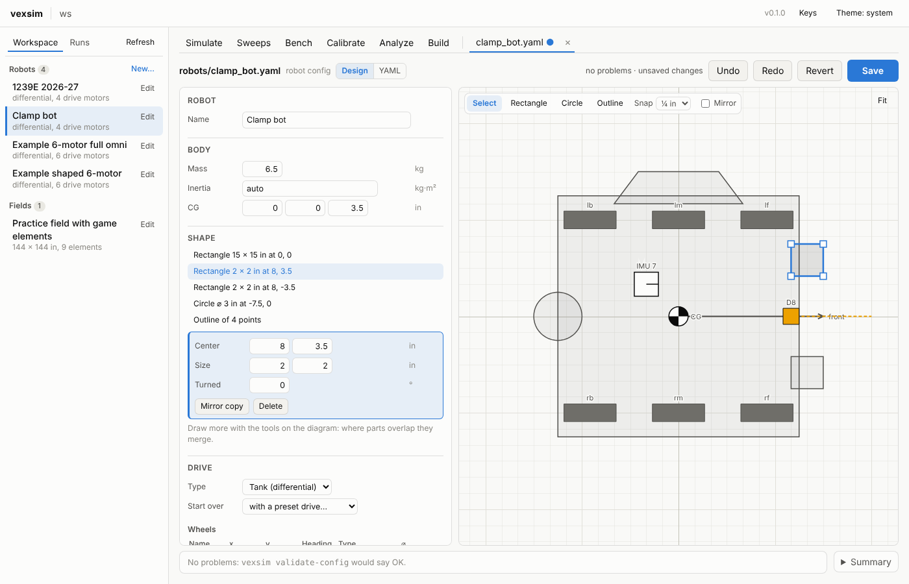

*New…*, beside *Robots* in the workspace list (or *New robot…* at the end of the run bar's robot list), makes a robot config. Give it a name and say what it starts from: a 15 × 15 in rectangle on a 4- or 6-motor tank drive, an X-drive, a mecanum drive or an H-drive, or a copy of one of your robots. Its file goes beside your other robots (never over a file). It opens in its editor's **Design view**, and the next run uses it. Any robot's editor switches between *Design* and *YAML* in its bar.
- **Drawing its shape:** the tools over the diagram draw the robot as seen from above. *Rectangle*: drag from corner to corner. *Circle*: drag from its center out. *Outline*: click its corners, then click the first one again (or press Enter, or double-click) to close it; Backspace takes the last point back, Escape stops. Where parts overlap they merge, and the robot's edge is what touches walls, field elements and pieces ([section 4](#a-robot-that-isnt-a-rectangle-shape)). *Snap* sets what drawing snaps to (⅛ to 1 in), and *Mirror* draws each new part with its mirror image across the robot's center line. With *Select*, click a part to select it: drag it to move it, or drag its square handles to reshape it (a rectangle's corners, a circle's rim, an outline's points). The arrow keys nudge it a snap step and Delete takes it away. The panel shows its exact numbers to type over, with *Mirror copy* and *Delete*. A robot with a `footprint_in` becomes a `shape` at its first change.
- **Its parts:** the panel beside the diagram has a form for each part of the config:
  - its name;
  - the body: mass, inertia and center of gravity;
  - the drive: its type, and every wheel's name, place, heading, type and diameter;
  - the motor groups: their ports (a negative port runs reversed), cartridge, gear ratio and the wheels each turns, with the wheel speed that gives. A tank drive's groups are `left` and `right`; an H-drive adds strafe groups.
  - the mechanisms;
  - the sensors: each one's port and the fields its type has.

  *Start over with a preset drive* replaces the robot's drive with one of the five. The wheels go on the robot's biggest part (its base, not an intake sticking out) and are drawn in until each is on the robot; the motors take ports the mechanisms and sensors don't use. *Add* puts a sensor on the first free port: an IMU near the middle, a tracking wheel, a distance sensor at the front looking ahead, or a GPS. Wheels, sensors and the center of gravity drag on the diagram as in the YAML view, and a part selected on the diagram is the one in view in the panel.
- **Ports:** a map of the 21 smart ports and what's on each; two things on one port are marked red (`validate-config` calls that an error).
- **It all goes into the YAML,** in place, as a drag's numbers do:
  - a value is changed where it's written;
  - a new list item copies its neighbours' style: a flow `{...}` among flow items, a block among blocks;
  - a key is renamed where it is;
  - an empty `[]` or `{}` opens into a list or mapping, its comment staying where it was.

  So every comment and blank line stays. A change that would leave the YAML unreadable (a motor on port 30, say) isn't made, and the bar above the editor says why. One that reads but is wrong (two things on a port) is made, and listed under the diagram as in the YAML view. *Undo* and *Redo* (Ctrl+Z and Ctrl+Shift+Z on the diagram) step through every change, and *YAML* shows the text, which shares their undo history. Nothing is written to the file until *Save*.

**Making autonomous routes: the autonomous maker**

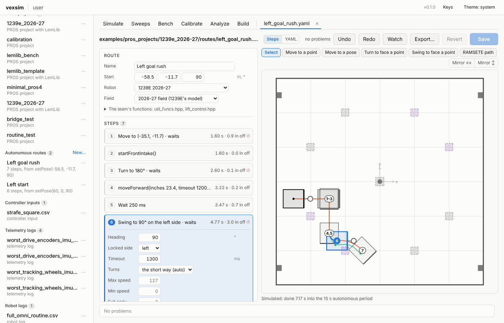

*Edit*, in a route's menu in the workspace list, opens an autonomous route ([section 9](#autonomous-routes)) in the **autonomous maker**, a tab of its own: its steps beside its field. *New…*, beside *Autonomous routes*, makes one: give it a name, and pick the PROS project it's for (one that uses LemLib), the robot and the field. Its file goes in the project's `routes/` folder (never over a file), with no steps yet, starting where the run bar's start is.
- **Its steps:** a numbered list, each step in a few words, with what the last simulated run says about it: when it ended (seconds into the autonomous period), how far from its planned end, ⏱ if a motion used up its timeout, and ⚠ if its end runs into a wall or a field element. Click a step to open its form: its target, timeout and LemLib's options (each left empty keeps LemLib's default), or a function's arguments (empty: the function's default). *Add a step* puts one after the selected step: type in its box to find one of LemLib's motions, one of vexsim's own (an arc, or a RAMSETE path through points: [section 9](#autonomous-routes)), a pause, or one of the team's functions, then pick it with ↑/↓ and Enter or a click. Any part of a name finds it, in any case, with or without its spaces and underscores: `front int`, `intake` or `sfi` find `startFrontIntake()`, `moveToPoint` finds *Move to a point*, and a header's name finds its functions. With nothing typed it lists them all. A function in one of the project's headers that the route doesn't list yet says *(adds it)*: picking it ticks its header under *The team's functions* too. A motion added here waits until it's done (`async: false`), so the route runs as it's drawn, one step after another, with a timeout for how far it goes and turns; its form's *Then* makes it go on at once instead, as LemLib's default does. Drag a step to another place in the list (or Alt+↑/↓). Ctrl+C and Ctrl+V copy a step and paste it after the selected one, in this route or another; Ctrl+D duplicates it, Delete takes it out, ↑/↓ select.
- **The field:** the robot where it starts (drag it; its round handle turns it) and where each step is planned to end: the robot's outline there and the step's number, joined to the step before by the way there. Steps that end in one place share a number (`1–3`: a move, then a turn and a pause there); click it to select them in turn. The selected step's target (a square) drags wherever the pointer goes (to 0.1 in), and its heading (a round handle) turns in 15° steps (Shift: 1°); so do the start's. The tools above the field add a step where you click: a move to a point or a pose, a turn or a swing to face it, or a RAMSETE path to it. An arc's or a path's planned trajectory is drawn whole, shaded from light to dark by its planned speed (a key in the corner says how fast); a selected path's points are diamonds to drag. The wheel zooms, dragging the field pans, a double-click shows it all.
- **Planned at once, then simulated.** The plan follows LemLib's targets: `move_to_point` ends facing the way it went, `move_to_pose` is drawn as the curve LemLib's carrot point makes, a turn stays where it is, a swing pivots on its locked side; and the team's functions move as their `// vexsim:` comments say ([section 9](#autonomous-routes)). It changes with every edit, and follows a drag as it goes. A moment after each change the route runs headless, as `vexsim route run` does (a project's first run builds it): the path the robot drove is drawn, and where each step really ended, a dot joined to its planned end.
- **Mirror ↔ and Mirror ↕** make the route for the other side of the field, across x = 0 or y = 0: a copy beside it, named *(mirrored)*, its targets and headings mirrored, its turns the other way round, its swings on the other side, and the team's functions' arguments mirrored as their comments say. What it couldn't mirror (a function that doesn't say how it moves the robot) is listed.
- **Watch** saves the route and runs it on the *Simulate* page, recorded like any run, with its timeline and plots.
- **Export…** writes the project's routes into it as routines, for the robot ([section 9](#autonomous-routes)). It saves the route first, then shows what it would write: the routines, each file it changes (new, changed or as it is), with the change, and the routes it leaves out, and why. *Export* writes it, and the run bar's routine list has the new routines.
- **It all goes into the route's YAML,** in place, as in the Design view: every comment stays. *YAML* shows the text, where a problem's place is a click away; *Undo* and *Redo* step through every change, from either view. Nothing is written to the file until *Save* (Ctrl+S).

The tabs along the top hold a page for each of the other commands: *Sweeps*, *Bench*, *Calibrate*, *Analyze* and *Build*.

**Sweeps: saved runs, many times over, measured**

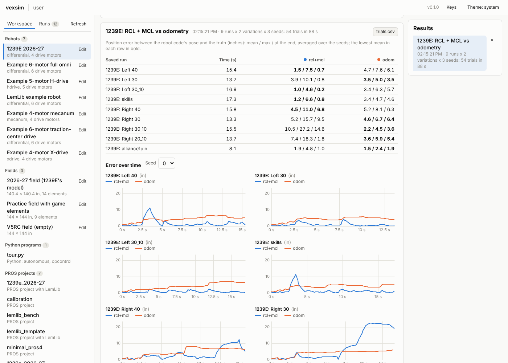

**Sweeps** runs saved runs many times over: each one once per *variation* (values of environment variables its program reads) and per *seed*, with the robot put down a little off its start each time, as a hand does. Every trial runs headless, in parallel, until its program finishes or the time limit passes, and is measured by how far the robot code's pose was from the truth while the program ran (autonomous and driver control): the mean, the maximum and the error at the end, the worst heading error, and how long the program ran.
- **This repository's sweeps are team 1239E's evaluation** ([docs/porting_1239e.md](docs/porting_1239e.md#7-evaluate-the-localization)): *1239E: localization* runs every routine in each of the four localization modes (`VEXSIM_TRACKING`) with 6 seeds, the 216 runs behind that page's table (a few minutes on a 4-core computer); *1239E: RCL + MCL vs odometry* is `evaluate_1239e.py`'s default, 54 runs. Their numbers are the script's, exactly: the same runs, from the same placements, measured the same way.
- **Making one:** pick a sweep, or *New sweep…*: a name, the saved runs (*Filter*, *All*, *None*), and under *Vary environment variables* one row per variable with its values separated by commas (every combination runs). Then the seeds (and the first one), the placement error (standard deviations in x and y, inches, and heading, degrees; a seed puts the robot down the same way for every run and variation), the time limit and the worker processes (all but one core by default). The count below says how many trials that makes. *Save* keeps it in the folder's `.vexsim/sweeps.yaml`, for a team to commit; *Run* runs what the form says, saved or not.
- **The results** fill in as trials finish: a table with a row per saved run and a column per variation (the mean / max / final error averaged over the seeds; the lowest mean in each row in bold); the error over time, a chart per saved run with a line per variation, for one seed at a time, all on one scale; and *Every trial*, with its numbers. *Watch* runs a trial again on the *Simulate* page, exactly (same seed, same placement), recorded like any run. *trials.csv* downloads the table of trials.

**Bench: benchmarks** (`vexsim bench`, [section 11](#11-benchmarking-algorithms-vexsim-bench)). Pick a scenario (or click one in the workspace list) and the page describes it: the task, the robot, what goes wrong, what each seed changes. Choose the localizers and controllers to compare, the seeds and the workers, and *Run*; a bar counts the trials. The result: each combination's success rate, final position error and localization error at the end (mean and 95th percentile), completion time and path error; a chart per metric of how often each combination does at least that well; and each combination's worst trial, which *Watch on the field* plays back on the *Simulate* page with the scenario's robot and field, plots and all. *Open the report* opens the HTML report `vexsim bench` writes (it needs matplotlib: `pip install -e ".[viz]"`), and the CSVs download. The command line that runs the same benchmark is at the bottom.

**Calibrate** (`vexsim calibration-routine` and `vexsim calibrate`, [section 12](#12-calibrating-to-your-robot)). *1. Log the routine on the robot:* pick the robot and its PROS project; the page lists the routine's maneuvers and the files it adds, the routine's two and vexsim's logger's two (new, already there, or replacing what's there), and *Add the routine* writes them. *2. Fit the simulator to the log:* robot logs in the folder are listed under *Robot logs* in the workspace list (the CSV from the SD card, or a saved terminal capture, `.txt` or `.log`, with one inside). Pick one and the parameters to fit (the wheel parameters by default, with their values now), or *Only compare*, and *Fit*. The result: the fitted values and how sure the fit is of each, the battery's resistance read off the log, the difference between simulated and logged readings before and after, and charts of each logged reading against the simulation's replay. *Add the fitted values* opens the robot's config with them under `overrides`, written in place (comments kept), for you to look over and save. To try it, `examples/logs/full_omni_routine.csv` is the routine logged in the simulator by the example full-omni robot with its wheels and battery changed (longitudinal μ 0.75, lateral μ 0.28, rolling resistance 0.14, 0.15 Ω): fitting all three wheel parameters finds them again in about half a minute.

**Analyze** (`vexsim motor-curves`, `drift` and `odometry`, [section 10](#10-analysis-commands-motor-curves-drift-odometry)): a motor's torque, current (with its limit) and output power against speed, under `move_velocity` and `move_voltage`; a differential robot's arc at fixed side speeds for up to three roller frictions, its true path beside what drive-encoder odometry believes; and a scripted drive, gentle or aggressive, with each baseline localizer's path and its position and heading errors over time.

**Build** (`vexsim build` and `vexsim doctor`): every PROS project in the folder, with *Build* and *Debug build* (`-O0 -g`, for a debugger); the compiler's errors and warnings are links, as in *Problems*. *Check the compiler* runs `vexsim doctor`.

Benchmarks, sweeps, fits and builds run as jobs, each in a process of its own (and its own worker processes), so the app stays responsive; *Cancel* stops one. They go on while you use other pages, and a page you reload picks its job up again. Their results are kept in the folder's `.vexsim/bench/`, `.vexsim/sweeps/` and `.vexsim/calibrations/` (the newest 20 of each), listed on the right of each page: click one to see it again. Set `VEXSIM_RESULTS_DIR` to keep them somewhere else.

The recordings live in the folder's `.vexsim/runs/`, one folder per run: `run.json` (what was run and how it ended), the tape the timeline plays (a frame every 50 ms of simulated time), `telemetry.csv.gz` (every 10 ms), `console.txt`, and `sd/`, the run's SD card (`/usd/`). Set `VEXSIM_RUNS_DIR` to keep them somewhere else.

**Safety:** the app can build and run code, so it is reachable only from your own computer. The server listens on 127.0.0.1 (port 8642, or a free port if that one is taken, or `--port`), and the link it prints carries a key (`?token=...`) that the browser then keeps as a cookie; the page also sends it with each request, which is how it works inside VS Code, where it gets no cookie. Keep the terminal open while you use the app; Ctrl+C stops it. (A window of its own, or a VS Code panel, stops vexsim when you close it.) The browser only reaches files inside the folder.

Every command has a page in the app, and the commands and the pygame viewer work as before. [PLAN.md, section 13](PLAN.md#13-browser-ui-phase-11) has the app's design.

### A window of its own, a shortcut, a VS Code panel
- **`vexsim ui --window`** opens the app in a window of its own, with no tabs or address bar: the app mode of Microsoft Edge (which every Windows has), Google Chrome, Chromium or Brave, on a browser profile of its own (in `%LOCALAPPDATA%\vexsim\window` on Windows, `~/.cache/vexsim/window` elsewhere), so it's apart from your browsing and keeps its size. **Closing the window stops vexsim**, 10 seconds later (a reload isn't a close). `VEXSIM_BROWSER` names the browser to use. With none of those browsers, the app opens in your default browser and stops when you close its tab.
- **`vexsim shortcut [FOLDER]`** makes shortcuts that open the folder in that window: on Windows, in the Start menu and on the desktop (they run without a console window; what vexsim would print goes to `%LOCALAPPDATA%\vexsim\ui.log`); on Linux, in the applications menu; on macOS, an app in `~/Applications`. They use the Python you ran the command with, so they work for as long as it has vexsim installed. `--remove` removes them.
- **`vexsim vscode`** installs vexsim's VS Code extension (it comes with the package; nothing is downloaded). Then **vexsim: Open the app** in the Command Palette (Ctrl+Shift+P), or **Open in vexsim** on a folder in the Explorer, opens the app in a panel beside your code. There, a build error's or a traceback's `file:line` opens in the editor at that line; *Save picture*, *Video* and the CSV files go through VS Code's save dialog; *Open the report* opens your browser; and the app's colors follow VS Code's theme. A run goes on while the panel is hidden behind another tab. Closing the panel stops vexsim; so does **vexsim: Stop the app**. While the panel has the keyboard, keys go to the app (they drive the robot): click in the editor to give VS Code its shortcuts back.
  - It runs vexsim with the Python `vexsim vscode` ran with; the **vexsim.python** setting changes that. If vexsim doesn't start, the *vexsim* output channel says why.
  - VS Code turns the extension off in a folder you haven't trusted (*Restricted Mode*), as it runs code.
  - `--code` installs it in another editor of VS Code's kind (`code-insiders`, `cursor`, `codium`). `--no-install --out FILE` only writes the `.vsix`, to install from VS Code's Extensions view (its `...` menu, *Install from VSIX...*).

---

## 8. Writing robot programs in Python
A program is a Python file with up to three **generator functions**. Each receives the `bot`, as PROS hands you the robot:

```python
from vexsim.api import delay


def initialize(bot):  # optional; this is what the default does
    imu = bot.Imu(10)
    while imu.is_calibrating():  # keep still until the IMU has calibrated
        yield delay(10)


def autonomous(bot):
    chassis = bot.chassis
    yield from chassis.move_to_point(24, 0)  # LemLib-style motions
    yield from chassis.turn_to_heading(90)
    bot.print("done at", chassis.pose)


def opcontrol(bot):  # optional; the default is arcade drive (plus strafing, if the robot can)
    while True:
        bot.chassis.arcade(
            bot.controller.get_analog("LEFT_Y"), bot.controller.get_analog("RIGHT_X")
        )
        yield delay(10)  # like pros::delay(10)
```
- `yield delay(ms)` waits like `pros::delay(ms)`; a bare `yield` waits 10 ms. Code between yields takes no simulated time.
- The IMU calibrates for about 2 s when the simulation starts. The default `initialize` waits for it; if you write your own, wait too, or the robot drives with no heading.
- A plain (non-generator) function runs once and returns.
- `bot.millis()`, `bot.battery_voltage_mv()`, `bot.print(...)` (to the console panel and the terminal) and `bot.pose` (the estimated pose) are always available.

### Drawing on the field: `bot.draw`
A program can draw on the field in the browser app ([section 7](#7-the-browser-app-vexsim-ui)), to show what it's thinking. Shapes go into named layers, each shown or hidden on its own; a layer keeps what was drawn into it until it's cleared, so clear it and draw it again whenever it changes:
```python
bot.draw.clear("plan")
for x, y in waypoints:
    bot.draw.point("plan", x, y, size=5)        # a dot, 5 pixels across at any zoom
bot.draw.line("plan", 0, 0, 24, 24, color="orange")
bot.draw.circle("plan", 24, 24, 3)               # inches
bot.draw.ellipse("plan", 24, 24, 4, 2, 30)       # half-widths along x and y, then turned 30 degrees
bot.draw.pose("plan", 24, 24, 90, color="blue")  # a dot with a heading tick
bot.draw.text("plan", 26, 26, "target")
```
Inches and degrees counter-clockwise from +x, as `bot.pose` has them. Colors are the field's palette, by name: `violet` (the default), `blue`, `orange`, `aqua`, `yellow`, `magenta`, `green`, `red`, `ink` and `muted`, so drawings show in light and dark themes alike; text is drawn in ink, with a dot of its color. A layer holds up to 2000 shapes, and a program up to 32 layers.

### Devices (PROS 4 style)
The constructors live on `bot`. Names and units follow PROS 4, so a Python prototype maps line for line onto C++. A negative port reverses the device.
```python
left = bot.MotorGroup([1, 2, 3])
right = bot.MotorGroup([-4, -5, -6])
left.move_voltage(6000)  # mV
right.move_velocity(300)  # rpm
lift = bot.Motor(7)
lift.move_absolute(720, 100)  # degrees, rpm
lift.set_brake_mode("hold")  # coast | brake | hold
imu = bot.Imu(10)
imu.get_rotation()  # degrees, CLOCKWISE positive (VEX convention)
bot.Rotation(11).get_position()  # centidegrees
bot.Distance(13).get()  # mm, 9999 if nothing is in range
gps = bot.Gps(15, 0.0, 0.15)  # like pros::Gps(port, x_offset, y_offset), meters
gps.get_position()  # (x, y) meters from the field center
bot.controller.get_analog("LEFT_Y")  # -127..127
bot.controller.get_digital_new_press("R1")
```
| Class | Methods |
|---|---|
| `Motor` | `move` (-127..127), `move_voltage`, `move_velocity`, `move_absolute`, `move_relative`, `brake`, `set_brake_mode`, `set_current_limit`, `tare_position`, `set_zero_position`, `get_position`, `get_actual_velocity`, `get_current_draw`, `get_voltage`, `get_temperature`, `get_torque`, `get_power`, `is_over_temp` |
| `MotorGroup` | every `Motor` command, applied to all its motors; getters read the first motor; `get_position_all` |
| `Imu` | `reset` (starts a ~2 s calibration), `is_calibrating`, `get_rotation`, `get_heading`, `get_gyro_rate_z`, `set_rotation`, `set_heading`, `tare_rotation` |
| `Rotation` | `get_position`, `get_angle`, `get_velocity`, `reset_position`, `set_reversed` |
| `Distance` | `get` |
| `Gps` | `initialize_full`, `set_offset`, `get_offset`, `set_position`, `set_data_rate`, `get_position`, `get_position_x`, `get_position_y`, `get_heading`, `get_heading_raw`, `get_yaw`, `get_pitch`, `get_roll`, `get_position_and_orientation`, `get_error`, `get_gyro_rate` |
| `Controller` | `get_analog`, `get_digital`, `get_digital_new_press` |

Readings come from the simulated sensors, so they lag, quantize and carry noise. Before a device's first sample, a reading returns `PROS_ERR_F` (infinity), as PROS does. `set_zero_position(p)` makes the motor's current position read `p`; the zero belongs to the motor on that port, so every object using the port sees it. The GPS follows PROS: meters, a heading clockwise from +y, and `set_offset(x, y)` with +y along the camera's direction.

### Driving any drivetrain: `bot.drive`
`bot.drive.move(forward, strafe, turn)` takes stick-style inputs (-127..127, as from `LEFT_Y`, `LEFT_X` and `RIGHT_X`): positive strafe is to the right and positive turn clockwise. Each input at 127 is the top speed in that direction alone; a combination that asks a gear group for more than its rated speed slows every group together, so the robot keeps the commanded direction. It uses voltage control, and a drivetrain that can't strafe ignores `strafe` (`bot.drive.holonomic` says whether it can). It works on every drivetrain, because the group speeds come from the robot's kinematics.

### Chassis motions: `bot.chassis`
The chassis drives the `left` and `right` gear groups, so it exists on differential drives and H-drives (X-drive and mecanum robots use `bot.drive`). It localizes with the best baseline the robot's sensors allow. Poses are inches and degrees counter-clockwise; `chassis.set_pose(x, y, heading)` re-zeros odometry, and `chassis.pose` reads it.

Each motion runs as `yield from chassis.<motion>(...)`. It returns when the motion settles or after `timeout_ms`, then stops the drive:

| Motion | What it does | Key options |
|---|---|---|
| `turn_to_heading(h)` | PID turn in place, with a small static-friction term | `max_volts`, `static_volts`, `pid`, `exit` |
| `turn_to_point(x, y)` | turn to face a point | as above |
| `move_to_point(x, y)` | LemLib `moveToPoint`: turning has priority over forward output; it stops turning near the target and may back up to settle | `forwards`, `max_volts`, `slew_volts_per_s`, `lateral`, `angular` |
| `move_to_pose(x, y, h)` | boomerang (LemLib `moveToPose`): chase a carrot point `lead` × distance behind the target, then square up | `lead` (0.6), `max_volts` (9 V), `settle_radius_in` |
| `drive(d)` | a straight line on a trapezoid or S-curve (jerk-limited) profile, with heading hold | `profile`, `max_speed_fraction`, `max_accel_in_s2`, `max_jerk_in_s3` |
| `follow(waypoints, method="pure_pursuit")` | pure pursuit along a Catmull-Rom spline through the waypoints | `lookahead_in`, `max_speed_fraction` |
| `follow(waypoints, method="ramsete")` | RAMSETE on a speed-, acceleration- and curvature-limited trajectory | `b`, `zeta`, `max_lateral_accel_in_s2` |

There are also `chassis.tank(l, r)` and `chassis.arcade(throttle, turn)` (-127..127, positive turn = clockwise, like LemLib), `chassis.apply(DriveCommand(...))` for raw volts or wheel speeds, and `chassis.stop()`.

**Your own controller:** any object with `step(pose, frame, dt) -> DriveCommand` and `done()` runs with `yield from chassis.run(my_controller, timeout_ms)`. `frame` holds every sensor reading (see [Sensors](#sensors-1)).

**Why the defaults are what they are** (measured on the full-omni example; `tests/test_control.py`): turning gets priority over forward speed, because a full-omni robot driving hard while turning slides out of the curve. Boomerang defaults to 9 V, because at 12 V it reaches the heading but ends 5–9 in to the side. RAMSETE trajectories are planned at 40 in/s² of sideways acceleration (about half the rollers' grip), since RAMSETE assumes wheels never slide. Turns add 1.5 V of static-friction feedforward, without which a P-only turn stalls about 7° short.

---

## 9. Running PROS 4 and LemLib C++ code
```
vexsim build path/to/project                                     # compile only (incremental)
vexsim run ROBOT.yaml --program path/to/project                  # build if needed, then the viewer
vexsim run ROBOT.yaml --program path/to/project --mode driver    # drive it: keyboard or gamepad
vexsim run ROBOT.yaml --program path/to/project --headless --record run.csv --screenshot end.png
```
`vexsim build` options: `--debug` (compile with `-O0 -g`, for a debugger), `--jobs N` (parallel compiles), `--cxx PATH`.

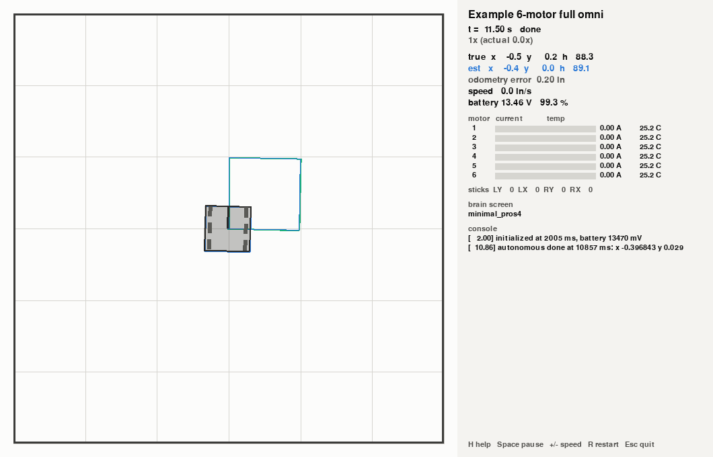

### How your project is built
- **It isn't modified.** Build output goes to the cache folder ([Install](#1-install)). Only sources whose code, included headers or flags changed are recompiled.
- **The PROS SDK in your project is skipped.** `include/api.h`, `include/pros/`, `include/liblvgl/`, `include/display/`, `firmware/` and every header a template lists as its own in `project.pros` are replaced by vexsim's PROS 4 shim. Your own headers and sources are used as they are. Includes resolve as with PROS's makefile: a source in `src/<folder>/` finds `include/<folder>/` headers by bare name.
- **The robot config must match your ports.** A call to a device the config doesn't have on that port fails with `errno = ENODEV`, as on a robot with a missing device, and the console says so:
  ```
  vexsim: port 7: the code uses a motor here, but the robot config has nothing on this port (calls fail with errno ENODEV)
  ```
- `VEXSIM` is defined (`-DVEXSIM=1`), so `#ifdef VEXSIM` marks simulator-only code.

### Picking an autonomous routine
```
vexsim routines path/to/project                                       # list them, and where each starts
vexsim run ROBOT.yaml --program path/to/project --routine right30    # run one
```
A project's **routines** are the functions its `include/custom/auton.hpp` declares that take no arguments and return nothing (`void left40();`, in any namespace), as team 1239E's are. On the robot, a selector on the brain's screen usually picks one; in vexsim you do: with `--routine NAME`, the **Routine** list in the app's run bar, or `routine:` in a saved run.

The project's `autonomous()` runs as written, setup and all, and when it calls one of the routines, the one you picked runs instead (once). The console says so:
```
vexsim: autonomous() called left40(); running right30() instead
```
Nothing in your project changes. In vexsim's build (in its cache), the files that define the routines are compiled with each routine under another name, so calls among them stay as written, and a generated file takes the routines' own names: that file is the switch. Without a pick, the project runs exactly as before.
- Without `--start`, the robot starts where the routine's `setPose(x, y, θ)` puts it, when that call's arguments are numbers; `vexsim routines` shows where.
- `autonomous()` must call the routine from another file, as a selector's table does. A call from inside the file that defines the routine doesn't go through the switch, and the run says the routine you picked didn't run.
- Every function in the header that takes no arguments counts as a routine; one that takes arguments or returns a value is listed as not a routine, with why.

### Autonomous routes
```
vexsim route check path/to/project/routes/left_start.yaml --functions   # check it; list the functions it can call
vexsim route run path/to/project/routes/left_start.yaml                 # run it headless: where each step ended
vexsim run --route path/to/project/routes/left_start.yaml               # watch it in the viewer
vexsim route export path/to/project [--dry-run] [--diff]                # write the routes into it as routines
```
A **route** is an autonomous routine written as data: a YAML file in a PROS project's `routes/` folder that names the robot and field it's simulated with, where it starts and its steps. vexsim runs it in the project's own `autonomous()`, without changing the project, and says where every step ended. Numbers are in LemLib's convention, as the robot's code has them: inches, and θ in degrees clockwise from +y. This is 1239E's `examples/pros_projects/1239e_2026-27/routes/left_start.yaml`:
```yaml
version: 1
name: Left start
robot: ../../../robots/1239e_2026-27.yaml   # relative to this file
field: ../../../fields/1239e_2026-27.yaml
start: [60, 0, 90]                          # chassis.setPose(60, 0, 90)
functions: [include/custom/util_funcs.hpp, include/custom/lift_control.hpp]
steps:
  - {call: moveForward, args: {inches: -10, timeout: 800, minSpeed: 1}}
  - {turn_to_heading: 270, timeout: 800, max_speed: 100}
  - {move_to_point: [14, 0], timeout: 1000, max_speed: 60}
  - {call: startFrontIntake}
  - {wait: 100}
  - {move_to_point: [36, 0], timeout: 1000, forwards: false, min_speed: 60, early_exit: 3, async: false}
```

| Step | Makes the call |
|---|---|
| `{move_to_point: [x, y], timeout: ms}` | `chassis.moveToPoint(x, y, ms, {...}, async)` |
| `{move_to_pose: [x, y, theta], timeout: ms}` | `chassis.moveToPose(...)` |
| `{turn_to_heading: theta, timeout: ms}`, `{turn_to_point: [x, y], timeout: ms}` | `chassis.turnToHeading(...)`, `chassis.turnToPoint(...)` |
| `{swing_to_heading: theta, locked_side: left, timeout: ms}`, `{swing_to_point: [x, y], locked_side: right, timeout: ms}` | `chassis.swingToHeading(theta, lemlib::DriveSide::LEFT, ...)`, `chassis.swingToPoint(...)` |
| `{wait: ms}` | `pros::delay(ms)` |
| `{wait_until: distance}` | `chassis.waitUntil(distance)`: inches (degrees for a turn) along the motion before it |
| `wait_until_done` | `chassis.waitUntilDone()` |
| `{call: name, args: {param: value}}` | one of the team's functions |

A motion's options are LemLib's (each left out keeps LemLib's default): `forwards`, `max_speed`, `min_speed` (0 to 127; whole numbers for turns, as LemLib takes them), `early_exit`, `lead` and `horizontal_drift` (`move_to_pose`), `direction` (`cw`, `ccw` or `auto`) and `async` (`true`, LemLib's default: the motion starts and the route goes on; LemLib queues a motion called while another runs, so it starts when that one ends).

**The team's own functions.** `functions:` lists headers, relative to the project. Every function they declare that returns `void` and takes numbers, `bool`s or values of an enum (the project's own, or LemLib's `DriveSide` and `AngularDirection`) can be a step, its arguments given by parameter name (an enum's by its value's name: `{call: setLift, args: {target: SECOND_STACK}}`). An argument left out takes its default; when a later one is given, a default that isn't a plain value (a number, `true`, an enum's value) must be given too. `vexsim route check --functions` lists them all, and why each other one can't be a step (it's overloaded, or takes a pointer, a reference, a class...).

**How it runs.** vexsim's build of the project (in its cache, beside its other builds) adds a runner: the route's headers, a table of their functions, and the project's chassis, found by its declaration (`lemlib::Chassis chassis(...);` in a header or a source file). The runner reads the steps when the run starts, so a changed step reruns at once, without a rebuild; only changing the headers rebuilds. In a project with routines ([above](#picking-an-autonomous-routine)) it runs in place of the first routine `autonomous()` calls, after the project's own setup, and the console says `vexsim: autonomous() called left40(); running the route instead`; in a project without, it runs in place of `autonomous()`. A function a header declares but no file defines is left out of the table, and a route that calls it can't run.

**Where each step ended.** A step ends when its call has returned and every LemLib motion it started has ended, so an async motion's step ends where the robot was when that motion finished, although the route went on. `vexsim route run` prints, for each step, when it ended (seconds into the autonomous period), how long it took, where the robot really was and where LemLib's odometry put it, and whether a motion used up its timeout:
```
Left start: 6 step(s), done 2.79 s into the 15 s autonomous period
  step  ends at  took (s)  robot (x, y, θ)       LemLib (x, y, θ)      what
     1    0.520     0.520  50.0, 0.0, 90.0       50.0, -0.0, 90.0      moveForward(inches=-10, timeout=800, minSpeed=1)
     2    1.320     1.310  48.3, 0.6, 273.4      48.8, 0.6, 273.4      turn_to_heading 270 max_speed 100 (used up its timeout)
     ...
```
`--json` prints the same as JSON. Before it runs, a route is checked, and `vexsim route check` says what's wrong, where: a step a header doesn't declare (with the name it's likely to be), an argument of the wrong type or a missing one, an option out of range, a target off the field, a start on top of a field element, a `wait_until` after a motion that isn't async.

In the browser app, a project's routes are listed under *Autonomous routes* in the workspace list, and in the run bar's **Routine** list: picking one sets its robot, field and start. *Edit*, in a route's menu, opens it in the **autonomous maker** ([section 7](#7-the-browser-app-vexsim-ui)), which draws where each step ends as you change it.

**How a function moves the robot.** The maker plans LemLib's motions from their targets. For the team's functions it needs a comment, just above the declaration, that says what the function does with its arguments:
```cpp
// vexsim: drive(inches)
void moveForward(float inches, int timeout, float maxSpeed=127, float minSpeed=1, bool async=true);
```
The comment is one of `drive(inches)` (straight along the heading; back if negative), `turn_by(degrees)` (in place, clockwise), `arc(radius, degrees)` (along an arc, turning clockwise through the angle), `point(x, y)` (as `move_to_point`), `pose(x, y, theta)` (as `move_to_pose`) or `none` (it doesn't move the robot), each argument one of the function's number parameters, by name, or a number (`arc(18, degrees)`). A function without one is carried on unmoved in the plan, dashed, until a run says where it ended; one whose comment doesn't read says why in its step's form. Mirroring a route follows the comments too. On the robot it's just a comment. 1239E's `moveForward` has this one.

**Export: the routes, for the robot.** `vexsim route export PROJECT` (or *Export…* in the maker) writes each of the project's routes as a C++ routine, named after the route (*Left start* is `left_start()`), into `src/vexsim_autons.cpp`, and declares them in `include/custom/auton.hpp` between two comments, `// vexsim routes: begin` and `// vexsim routes: end` (added at its end the first time; a new `auton.hpp` if there's none). Each step is the call the route runner made, so the routine drives as the route did: it starts with the route's `chassis.setPose(...)`, and a motion's options are LemLib's, as designated initializers in the order LemLib declares them:
```cpp
// Left start (routes/left_start.yaml)
void left_start() {
    chassis.setPose(60, 0, 90);
    moveForward(-10, 800, 127, 1);
    chassis.turnToHeading(270, 800, {.maxSpeed = 100});
    chassis.moveToPoint(14, 0, 1000, {.maxSpeed = 60});
    startFrontIntake();
    pros::delay(100);
    chassis.moveToPoint(36, 0, 1000, {.forwards = false, .minSpeed = 60, .earlyExitRange = 3}, false);
}
```
vexsim rewrites `src/vexsim_autons.cpp` whole on every export, so change the routes, not the file; everything else in `auton.hpp` stays as it is. Only files that change are written, so exporting the same routes again changes nothing; `--dry-run` says what would change, and `--diff` shows it. A route with errors, or whose routine's name the project already has, is left out, with why. The routines are then in vexsim's routine list, like the team's own (run one, and it runs in place of the routine `autonomous()` calls, [above](#picking-an-autonomous-routine)); for the robot to run one, call it from `autonomous()` or the team's selector.

**vexsim's own motions: arcs and RAMSETE paths.** Beside LemLib's motions, a route can use two of vexsim's, which plan the whole motion ahead, on a speed profile, and then follow the plan:
```yaml
  - {move_arc: [18, 90], timeout: 1500}                          # 90° clockwise on an 18 in radius
  - {ramsete: [[24, 24], [48, 0]], timeout: 3000, end_heading: 90, max_velocity: 40, async: false}
```
| Step | Makes the call |
|---|---|
| `{move_arc: [radius, degrees], timeout: ms}` | `motions.moveArc(radius, degrees, ms, {...}, async)`: an arc of `radius` inches, turning the robot `degrees` (clockwise positive, as LemLib's θ; negative turns the other way) |
| `{ramsete: [[x, y], ...], timeout: ms}` | `motions.ramsete({{x, y}, ...}, ms, {...}, async)`: a smooth path from where the robot is through the points: it sets off the way the robot faces and bends through each point (a Catmull-Rom curve), ending facing the way its last stretch goes, or `end_heading` |

Their options: `forwards` (`false`: backwards, the path setting off the way the robot faces away from), `max_velocity` (in/s) and `max_accel` (in/s²), each left out taking the drive's, `end_heading` (`ramsete`) and `async`. A plan keeps each side's wheels under the drive's top speed, speeds up and slows down within its acceleration, and slows for bends so it doesn't turn harder than the wheels hold (its *lateral* limit: speed² × curvature). The robot then follows it with RAMSETE, from LemLib's odometry, driving each side with the voltage a model of the drive says, plus a correction from its motors' measured speeds. A motion is over when its plan is, or at its timeout. They queue with LemLib's motions, and `wait_until`, `wait_until_done` (`waitUntil()`, `waitUntilDone()`) and `cancelMotion()` work on them as on LemLib's.

**The drive model.** How each side of the drive answers voltage: `kS` volts to get it moving, `kV` volts per in/s and `kA` per in/s², `kT` more on the outside of a turn (against the scrub of wheels sliding sideways as the robot turns), and `kP` per in/s its wheels fall behind; and the limits plans keep within. vexsim works it out for the route's robot by driving its config in the simulator, and `vexsim route check` prints it. A route's `drive:` section gives its own numbers, each one left out being vexsim's: the limits follow from the constants given (`max_velocity` is 80% of the top speed `(12 - kS) / kV`, at most the speed the motors' rated rpm turns the wheels at; `max_accel` what a third of 12 V gives; `max_lateral_accel` half the grip of the wheels in the middle of the robot, the only ones a turn doesn't already slide sideways), unless they're given too:
```yaml
drive: {kS: 1.1, kV: 0.138, kA: 0.027, kT: 1.3}   # the real robot's, from the Calibrate page
```
For the real robot, fit the model to its log: `vexsim calibrate ROBOT LOG` ([section 12](#12-calibrating-to-your-robot)) and the Calibrate page print a route's `drive:` line (the calibration routine's spins and arcs fit `kT`).


**In the maker,** *Add a step* finds them (`arc`, `ramsete`; the list says *vexsim* beside them), and the *RAMSETE path* tool adds a path to wherever the field is clicked. Each one's planned trajectory is drawn whole, shaded by its speed (the key is in the field's corner); the selected path's points are diamonds to drag, and its form lists them (*Add a point*, ×), with the arc's radius and angle, the limits (empty: the drive's, as their boxes show) and how long its plan takes, which must fit its timeout. New ones get a timeout half a second longer than their plan. Once a route has one, *Drive model* under its name shows the numbers it drives with, each one's box empty for vexsim's.

**On the robot.** Exported, a routine that uses them makes their `vexsim::Motions` first, with the drive model the route was simulated with, and the export copies vexsim's motion library into the project: `include/vexsim/motions.hpp`, `include/vexsim/trajectory.hpp` and `src/vexsim/motions.cpp`, plain C++ on LemLib's chassis, to read and change as you like:
```cpp
void sweep() {
    // vexsim's own motions, with the model of the drive the route was simulated with
    static vexsim::Motions motions(chassis, {.kS = 1.12, .kV = 0.1381, .kA = 0.0275, .kT = 1.367, .kP = 0.5524, .maxVelocity = 61.3, .maxAccel = 131.7, .maxLateralAccel = 12.9});
    chassis.setPose(60, 0, 90);
    moveForward(-10, 800, 127, 1);
    motions.ramsete({{36, 12}, {24, 36}}, 4000, {.forwards = false}, false);
    motions.moveArc(15, 90, 3000);
    chassis.waitUntilDone();
}
```
A copy the project already has is left as it is (the export says so, when it differs from vexsim's), and vexsim's own builds use it too, so the simulator runs what the robot runs; to have vexsim's again, delete it and export again. Code of your own can use the library the same way (a `Drive` number left at 0 takes a default: `kV` from the drivetrain's top speed, `kP` 4 × `kV`, and the limits as their comments say).

### What's simulated
| PROS 4 API | In the simulator |
|---|---|
| `pros::Motor`, `pros::MotorGroup` | everything: `move*`, getters (and `_all`), brake modes, current and voltage limits, encoder units, gearing, zero position. Drive motors turn the wheels; `mechanisms:` motors turn lifts, intakes and arms. |
| `pros::Imu` | rotation, heading, yaw, z gyro rate, tare/set offsets, `reset`, `is_calibrating`. Pitch and roll read 0 (flat field), acceleration 0. Clockwise-positive. |
| `pros::Rotation` | position, angle, velocity, reversal, `reset`, `set_position` |
| `pros::Distance` | distance to walls and game elements; confidence 63 and object size 400 when something is in range; object velocity 0 |
| `pros::Gps` | position (m) and heading (deg clockwise from +y) with the offset and initial position the code sets; error, raw heading, yaw, z gyro rate; it keeps its last position without a view of the code strip |
| `pros::Controller` | the master's sticks and buttons (keyboard, gamepad or `--input`), `get_digital_new_press` / `_new_release`; screen text is kept. The partner controller is not connected. |
| Tasks, `delay`, `delay_until`, mutexes, notifications, `millis`, `micros` | everything, in lockstep (below) |
| `pros::battery`, `pros::competition` | from the battery model; status per mode |
| `pros::lcd` (LLEMU), `pros::screen::print` | text lines appear in the viewer's brain-screen panel; drawing is ignored; screen buttons are never pressed |
| LVGL 9 (`liblvgl`) | a stand-in: screens, objects, labels, buttons, images (including LVGL image-converter files), event callbacks, timers and the common style setters compile and run. Nothing is drawn and no event fires. A missing function fails to compile: add it to `vexsim/bridge/cpp/include/liblvgl/lvgl.h` and `runtime/lvgl.cpp`. |
| `printf`, `std::cout`, `std::cerr` | console panel and terminal, stamped with simulated time |
| `pros::adi::*` | not simulated yet: outputs remember what was written (a `Pneumatics` reads back as extended); inputs read 0 |
| `pros::Optical`, `Vision`, `Link`, `Serial` | not simulated yet: calls fail with `ENODEV`, and the first one logs a note |
| SD card | not inserted: `pros::usd::is_installed()` reads 0 and files under `/usd/` don't open. With `--sd FOLDER`, the folder stands in for a card: `is_installed()` reads 1, and files the code opens under `/usd/` (`fopen`, C++ file streams) open in it |

**PROS 4 behaviors reproduced, so they bite in the simulator too:** plain `MotorGroup` setters (`set_brake_mode`, `tare_position`) act on the first motor only, and the `_all` versions on every motor; `set_zero_position(p)` makes the current position read `p` and belongs to the port; declaring `green` on a `blue` cartridge makes `move_velocity(100)` spin 3× faster than meant (the console warns once); reversal is per object, while brake mode, limits, units, gearing and zero belong to the port.

### How simulated time works for C++
- **Lockstep.** Every PROS task is a thread, but only one runs at a time, and simulated time stands still while it runs. Time moves on only when every task is blocked in `pros::delay`, `delay_until`, a mutex or a notification wait. Runs are identical every time, at any speed.
- **FreeRTOS scheduling:** the highest-priority ready task runs first; among equal priorities, the one that became ready first. Waking a higher-priority task switches to it at once.
- **Busy loops** are charged 1 ms of simulated time per 1000 PROS calls, so `while (pros::millis() < t) {}` works. A loop that calls nothing (`while (true) {}`) can't advance time; it is stopped after `--busy-timeout` seconds of real time, with the task's name.
- **Crashes** (a bad memory access, an uncaught exception, `abort`) end the run with the task's name and its last console lines, instead of taking the simulator down.
- **Competition functions** run in the PROS competition task. When a period ends, that task is deleted (no destructors run, and held mutexes stay held), while tasks your code created keep running. While the robot is disabled, motor commands are ignored.
- **The brain has booted at time 0:** the IMU's power-on calibration is done, so it reads 0. `imu.reset(true)` recalibrates for about 2 s; keep the robot still.

### vexsim extras for C++: `vexsim/sim.hpp`
Guard its use, since the header doesn't exist on the robot:
```cpp
#if __has_include("vexsim/sim.hpp")
#include "vexsim/sim.hpp"
#endif
...
#ifdef VEXSIM
vexsim::report_pose(pose.x, pose.y, pose.theta);   // inches, theta clockwise from +y (LemLib's)
#endif
```
- `vexsim::report_pose(x, y, theta)` shows your own odometry as the estimated pose (in the viewer, telemetry and the headless summary). LemLib's pose is read automatically.
- `vexsim::benchmark_task()` returns the task of a benchmark trial (see [C++ controllers](#c-controllers-your-pros-project)).
- `vexsim::draw_*` draws on the field in the browser app, in named layers, like `bot.draw` in Python ([section 8](#drawing-on-the-field-botdraw)): a layer keeps what was drawn into it until `draw_clear`. Points take LemLib's x and y, and angles are LemLib's too, degrees clockwise from +y:
```cpp
#ifdef VEXSIM
vexsim::draw_clear("mcl");
for (int i = 0; i < PARTICLES; i += 16) vexsim::draw_point("mcl", p[i].x, p[i].y);  // violet, 3 px
vexsim::draw_ellipse("mcl", x, y, 2 * std_x, 2 * std_y, 0, vexsim::Color::blue);     // half-widths, turn
vexsim::draw_line("rays", x0, y0, x1, y1, vexsim::Color::yellow);
vexsim::draw_circle("goal", 24, 24, 3);
vexsim::draw_pose("goal", 24, 24, 90, vexsim::Color::orange);                        // theta as LemLib's
vexsim::draw_text("goal", 26, 26, "goal");
#endif
```
  `draw_point` takes an optional size in pixels after the color. A layer is drawn as it stands whenever simulated time moves on, so clearing and redrawing it without a `pros::delay()` in between never shows it half drawn. The 1239E port draws its MCL this way (`src/custom/MclTracking.cpp`).

**Environment variables** reach your code through `getenv()`: `vexsim run --env KEY=VALUE`, or `CppProgram(..., env={...})` from Python. Nobody taps the simulated brain screen, so this is how to choose an autonomous routine:
```cpp
#ifdef VEXSIM
if (const char* name = std::getenv("AUTON")) selected = find_routine(name);
#endif
```
`VEXSIM_SEED` is always set to the simulation's seed: seed your own random numbers with it to repeat a run exactly. `VEXSIM_START` is where the run put the robot (`--start`), as LemLib has poses (`x,y,theta`), for code that must be told where it starts, such as localization started for a [replay of a log](#following-a-real-robots-log).

### LemLib
- **Built from source.** The LemLib template installs LemLib precompiled for the V5's ARM CPU, which can't run on a PC. vexsim reads LemLib's version from `project.pros`, fetches that release's source from GitHub (with git, or as a zip), and compiles it once per version and compiler. Offline, set `VEXSIM_LEMLIB_SOURCE` to a checkout. LemLib 0.5.x (for PROS 4) is tested.
- **`ASSET()` works:** every file in `static/` is embedded under the name `ASSET()` expects (`static/example.txt` is `ASSET(example_txt)`).
- **LemLib's pose shows up on its own** once `chassis.calibrate()` starts its odometry.
- **Start pose:** `chassis.setPose(x, y, theta)` is `--start x,y,(90 - theta)`. Start the simulated robot there: code that resets its pose from sensors (wall resets, a particle filter) corrects LemLib to wherever the simulated robot really is, so a wrong `--start` looks like `setPose` being ignored.
- **Edited LemLib headers work as on the robot.** If the project has a complete copy of `include/lemlib/` (or `include/fmt/`) that differs from the release's, its code compiles against its own copy while LemLib itself is built from source, and the build notes which headers differ. Edits must keep class layouts the same (access and `const` changes are fine; new data members are not).

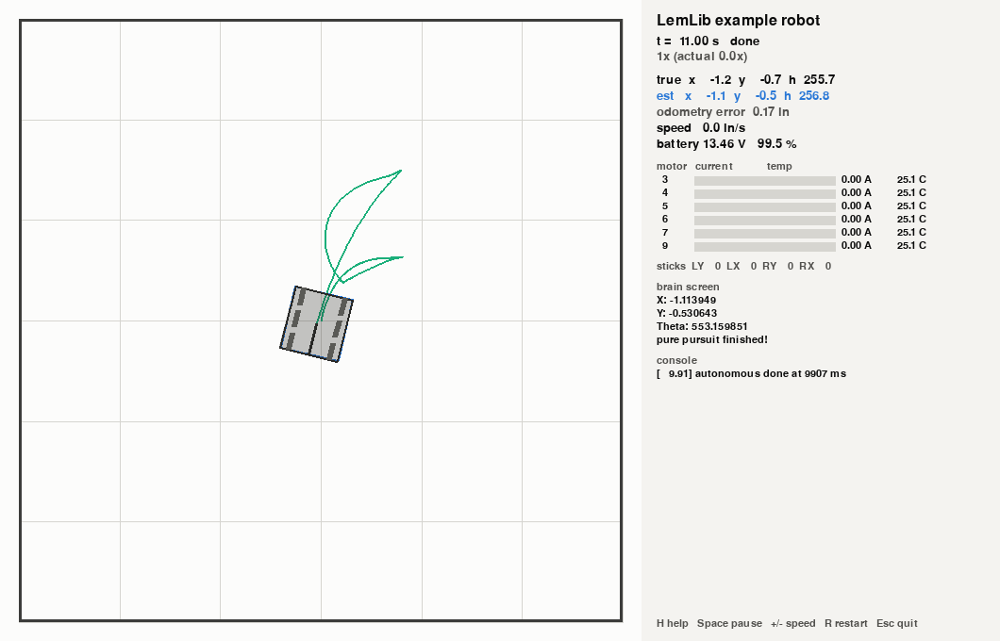

### Differences from the robot
- **Compute time is free.** A long calculation takes no simulated time; on the robot it delays every task at its priority and below.
- **Wall-clock time isn't the robot's time.** `std::chrono` and `time()` read your PC's clock. Use `pros::millis()` or `micros()`, which work the same on the robot.
- **Integer sizes.** `long` and pointers are 4 bytes on the V5, and 8 on 64-bit Linux and macOS (pointers are 8 on 64-bit Windows too). Code that stores pointers in `int` needs fixing.
- **Precompiled ARM libraries won't link.** Only LemLib is rebuilt from source; OkapiLib isn't supported.
- **newlib extras** the V5 has and PC libraries lack are provided: `infinity()`, `infinityf()`, MinGW's `isnanf`/`isinff`/`finitef`, and `std::sqrtf`-style float functions on g++ before 14.
- Not modeled: time slicing among equal-priority busy tasks, and mutex priority inheritance.

### Troubleshooting
| Message | What to do |
|---|---|
| `no C++ compiler (g++) found` | install it ([C++ toolchain](#c-toolchain-only-for-running-pros-c-code)) and run `vexsim doctor` |
| `couldn't get LemLib 0.5.6's source` | connect to the internet once per LemLib version, or set `VEXSIM_LEMLIB_SOURCE` |
| `ASSET(name) needs a file static/...` | put the file in `static/`, named so its `.` becomes `_` |
| `... defines autonomous() with C++ linkage, so it is never called` | include `main.h` in that file; it declares the competition functions `extern "C"` |
| `robot code hung: task '...' ran for 5.0 s of real time without calling pros::delay()` | add a delay to that loop; on the robot it would starve every other task |
| `port N: the code uses ... but the robot config has ...` | make the robot YAML's ports match your code |
| `pros::Optical is not simulated yet` | expected; the call returned `PROS_ERR` |
| `'lv_...' was not declared in this scope` | the LVGL stand-in lacks that function: add it, or keep that code out of simulator builds with `#ifndef VEXSIM` |

---

## 10. Analysis commands: motor curves, drift, odometry
These three are also the browser app's *Analyze* page ([section 7](#7-the-browser-app-vexsim-ui)).

**`vexsim motor-curves`** measures the simulated V5 motor on a dynamometer, under `move_velocity(max)` and `move_voltage(12000)`:
```
vexsim motor-curves --cartridge red --out red.png      # torque, current, power vs. speed
vexsim motor-curves --cartridge blue --csv             # the data as CSV
```
Options: `--cartridge red|green|blue`, `--supply-voltage` (default 12.8), `--points` (default 61).


**`vexsim drift`** drives a differential robot on an arc with fixed side speeds (fractions of rated speed) for several roller friction values, and compares the true path with what drive-encoder odometry believes. Compare it with a video of your robot to calibrate `wheel.omni.lateral_mu`:
```
vexsim drift examples/robots/full_omni_6m.yaml --left 1.0 --right 0.4 --lateral-mu 0.1,0.2,0.3 --out drift.png
```
Options: `--left`, `--right`, `--seconds`, `--lateral-mu` (up to 3 values), `--out`, `--csv`.


**`vexsim odometry`** calibrates the IMU, drives a scripted path, and runs every baseline localizer the robot's sensors allow:
```
vexsim odometry examples/robots/full_omni_6m.yaml --script aggressive --noise default --out odom.png
```
```
aggressive drive, default sensor noise, seed 0:
  drive encoders         final error  76.92 in   3.37 deg   worst  76.92 in
  drive encoders + IMU   final error  77.12 in   0.34 deg   worst  77.12 in
  tracking wheels + IMU  final error   1.65 in   0.34 deg   worst   1.65 in
```
Options: `--script gentle|aggressive`, `--noise`, `--seed`, `--out`, `--csv`.


---

## 11. Benchmarking algorithms: `vexsim bench`
A benchmark runs one task many times (seeds) for every combination of the localizers and controllers a scenario lists, in parallel processes, and writes CSVs and a self-contained HTML report. (The browser app's *Bench* page runs it too, and plays each combination's worst trial back on the field: [section 7](#7-the-browser-app-vexsim-ui).)
```
vexsim bench examples/scenarios/s_curve.yaml --seeds 100
```
```
S-curve under a mid-path shove: 400 trials in 97 s
  localizer / controller                success  final error mean/p95  loc error mean/p95
  tracking wheels + IMU / pure pursuit      47%     2.13 /  3.70 in      1.40 /  2.87 in
  tracking wheels + IMU / RAMSETE           17%     3.39 /  5.87 in      1.40 /  2.85 in
  drive encoders + IMU / pure pursuit       18%     3.58 /  6.52 in      4.56 /  7.76 in
  drive encoders + IMU / RAMSETE            18%     3.07 /  5.12 in      2.08 /  4.54 in
```
Options: `--seeds N` and `--first-seed S`; `--workers` (default CPU cores − 1); `--localizers` and `--controllers` (comma-separated subsets of the scenario's); `--out DIR` (default `bench_<scenario>`); `--no-worst` (don't re-run the worst cases).

| Output | Contents |
|---|---|
| `report.html` | settings, summary table, distribution charts, worst cases; opens offline in any browser |
| `trials.csv` | one row per trial: every metric, and what was randomized |
| `summary.csv` | per combination: success rate, timeouts, and the mean / median / p95 / max of every metric |
| `charts/*.png` | the report's charts |
| `worst_<localizer>__<controller>.csv` | the telemetry of each combination's worst seed; watch it with `vexsim replay` |

Trials are deterministic: any row of `trials.csv` reproduces exactly from its seed, in one process or many. [docs/benchmarking.md](docs/benchmarking.md) discusses an example 100-seed result, and its full report is [docs/benchmarks/s_curve_100/report.html](docs/benchmarks/s_curve_100/report.html).

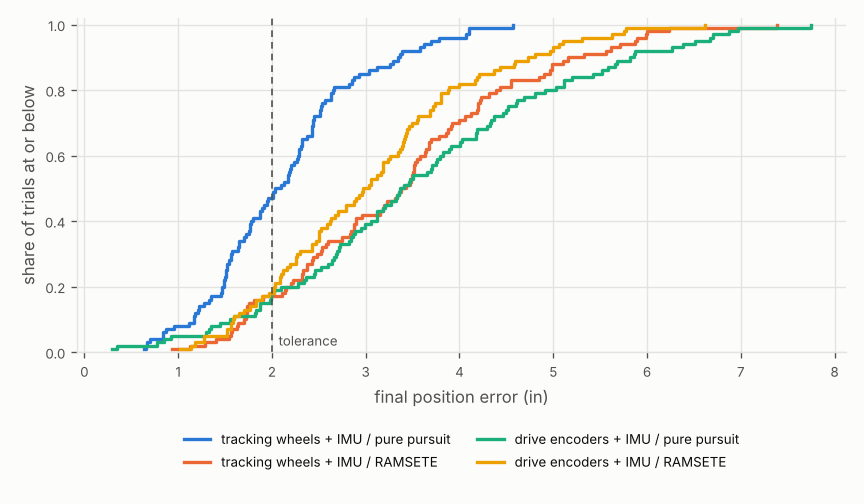

### Writing a scenario
```yaml
version: 1
name: Boomerang to a pose, 9 V vs 12 V         # shown in the report
description: ...
robot: ../robots/full_omni_6m.yaml             # paths are relative to this file
field: ../fields/v5rc_empty.yaml               # optional; game elements work
start: {x: 0, y: 0, heading: 0}                # inches, degrees CCW
noise: default                                 # one preset for every sensor (optional)
battery_soc: 1.0
time_limit_s: 6                                # per trial
settle_window_s: 0.5                           # keep recording after the controller finishes
task: {type: move_to_pose, x: 30, y: 30, heading: 90}
disturbances:
  - {type: imu_bias_step, at_s: 1.0, deg_per_s: 0.5}
randomize:
  start_xy_in: 0.5                             # std. dev. of the true start vs. the believed one
  start_heading_deg: 1.0
  battery_soc: [0.6, 1.0]                      # uniform range per seed
  params:                                      # any override key, uniform range per seed
    wheel.omni.lateral_mu: [0.15, 0.25]
localizers: [tracking wheels + IMU]            # baseline names, "all", or file.py:factory
controllers:
  - {name: boomerang 9V, kind: boomerang}
  - {name: boomerang 12V, kind: boomerang, options: {max_volts: 12}}
```

| `task.type` | Fields | Built-in controller `kind`s (first = default) |
|---|---|---|
| `move_to_point` | `x, y, forwards, tolerance_in` (1.5) | `move_to_point` |
| `move_to_pose` | `x, y, heading, tolerance_in` (2), `heading_tolerance_deg` (3) | `boomerang` |
| `turn_to_heading` | `heading, heading_tolerance_deg` (2) | `turn_pid` |
| `drive` | `distance_in, tolerance_in` (1) | `profiled_trapezoid`, `profiled_scurve` |
| `follow` | `waypoints, tolerance_in` (2, at the end) | `pure_pursuit`, `ramsete` |

| Disturbance `type` | Fields | Effect |
|---|---|---|
| `push` | `at_s, duration_s, force_n: [fx, fy]` | a force at the CG in the field frame (another robot shoving) |
| `imu_bias_step` | `at_s, deg_per_s, port` (optional) | the gyro bias jumps, as after a hard hit |
| `tracking_wheel_liftoff` | `at_s, duration_s, port` | a tracking wheel stops counting |

**Localizer names** are the baselines a robot supports: `drive encoders`, `drive encoders + IMU`, `tracking wheels + IMU`, `tracking wheels (no IMU)` and `tracking wheels + IMU + GPS` (see [Localization baselines](#localization-baselines)).

### Your own algorithms
Point the scenario at a Python file and a factory function, relative to the scenario:
```yaml
localizers: [tracking wheels + IMU, my_algos.py:make_ekf]
controllers:
  - {name: my follower, kind: my_algos.py:make_follower, options: {lookahead_in: 10}}
```
```python
# my_algos.py
# A localizer: .name, .reset(pose, frame), .update(frame) -> Pose
def make_ekf(config):
    return MyEkf(config)


# A controller: .step(pose, frame, dt) -> DriveCommand, .done()
def make_follower(task, geometry, lookahead_in=12.0):
    return MyFollower(task.waypoints, geometry, lookahead_in)
```
A localizer gets the same `SensorFrame` PROS code would read; a controller gets the localizer's estimate and returns a `DriveCommand`. Neither ever sees the true pose, which is what makes the comparison honest.

### C++ controllers: your PROS project
```yaml
controllers:
  - {name: Python boomerang, kind: boomerang}
  - {name: LemLib moveToPose, kind: pros, project: ../pros_projects/lemlib_bench}
```
The project is built once, and each trial runs its `initialize()` and `autonomous()`. `vexsim::benchmark_task()` gives the task: its `type`, the start pose odometry should assume, the target, `forwards`, `distance`, `timeout_ms`, for `follow` the path as a LemLib path file, and the controller's options through `task.option(name, fallback)`. Poses use LemLib's convention. Completion is when `autonomous()` returns, and the code's own localization shows as the localizer `robot code`. `examples/pros_projects/lemlib_bench` maps every task type to a LemLib motion.

### Metrics
| Column | Meaning |
|---|---|
| `success` | finished within tolerance (and heading tolerance) before the time limit |
| `timed_out` | the controller never reported done |
| `final_error_in`, `final_heading_error_deg` | the true end pose against the target |
| `completion_time_s`, `settle_time_s` | when the controller reported done; how long the true pose had been within tolerance |
| `overshoot_in` | point tasks: the furthest past the target along the approach |
| `path_rms_in`, `path_max_in` | follow tasks: the true path's distance to the reference |
| `loc_error_final_in`, `loc_error_max_in`, `loc_error_per_100in` | the estimate against the truth |
| `energy_j`, `peak_motor_temp_c`, `wall_contacts` | battery energy used, the hottest motor, wall hits |

The built-in Python controllers drive the `left` and `right` sides (differential drives and H-drives). Benchmark X-drive and mecanum robots with a PROS project controller, or your own Python one.

---

## 12. Calibrating to your robot
Most physics parameters are estimates: how well your wheels grip your tiles, how freely the rollers turn, how much a coasting robot slows. Calibration measures them on your robot, with no extra equipment (the steps below are also the browser app's *Calibrate* page: [section 7](#7-the-browser-app-vexsim-ui)):

1. **Generate** a drive routine for your robot and add it to your PROS project:
   ```
   vexsim calibration-routine ROBOT.yaml MY_PROS_PROJECT
   ```
   This writes `include/vexsim_calibration.hpp` and `src/vexsim_calibration.cpp`. They use only the PROS 4 C API, so they build with PROS and run unchanged in vexsim. Call the routine from `autonomous()`:
   ```cpp
   #include "vexsim_calibration.hpp"
   void autonomous() { vexsim_calibration::run(); }
   ```
2. **Run it on the robot**, in the middle of a field, on the tiles you compete on, with a charged battery. It calibrates the IMU (keep the robot still), then drives for about 7 s (9 s for drivetrains that strafe) with fixed voltages and no feedback, staying within about 4 ft of the start:

   | Step | Measures |
   |---|---|
   | launch from rest | traction limit and motor torque |
   | coast | rolling resistance |
   | reverse, then brake | back-EMF braking |
   | strafe out and back (X-drive, mecanum, H-drive) | roller resistance |
   | spin in place | roller friction and scrub |
   | fast arc, then coast | sideways sliding (drift) |

   It logs with [vexsim's logger](#vexsims-logger), which `calibration-routine` adds to the project too: to the SD card (`vexsim_0001_calibration.csv`, the next number each run), or without a card to the terminal, between `#vexsim-log begin` and `#vexsim-log end`; capture that with `pros terminal > run.txt` over USB. Either file works.
3. **Fit:**
   ```
   vexsim calibrate ROBOT.yaml vexsim_0001_calibration.csv --out calibration
   ```
   ```
   parameter                           before      after  uncertainty
   wheel.omni.longitudinal_mu             0.9     0.7527  +/-0.066%
   wheel.omni.lateral_mu                  0.2      0.278  +/-0.027%
   wheel.omni.rolling_resistance          0.1     0.1397  +/-0.03%
   battery.internal_resistance_ohm                  0.15  from battery voltage vs. current
   RMS difference, simulated vs. logged (28 replays):
     motor velocity (rpm): 40.9 -> 3.01
     ...
   ```
   Paste the printed `overrides:` block into the robot YAML. `--out` also saves it as `overrides.yaml`, with the plot and the fitted replay. Options: `--fit` (a comma-separated list of any parameters; `none` only replays and compares), `--max-iterations`, `--workers`.

   It also fits the **drive model** vexsim's own motions drive with (arcs and RAMSETE paths, [above](#autonomous-routes)) straight to the log: how each side of the real drive answers voltage. It prints the line a route's `drive:` section takes (`--out` saves it as `drive.yaml`, and the Calibrate page shows it, to copy), so those motions drive the real robot as its log says it drives:
   ```
   Drive model for vexsim's own motions (arcs, RAMSETE paths): kS 1.185 V, kV 0.1363 V per in/s, kA 0.0288 V per in/s^2, kT 1.231 V (fits 535 samples, R² 0.996); top speed 76.6 in/s
   For the robot's routes, add to them:
     drive: {kS: 1.185, kV: 0.1363, kA: 0.0288, kT: 1.231}
   ```


- **What it fits** by default: the parameters of each wheel type on the robot (omni: `longitudinal_mu`, `lateral_mu`, `rolling_resistance`; traction: `mu`, `rolling_resistance`; mecanum: `grip_mu`, `roller_mu`, `rolling_resistance`). The battery's internal resistance is read off the log, as the slope of its voltage against its current.
- **How:** the log's motor commands are replayed in the simulator at the log's times, with ideal sensors, the logged battery voltage, and the readings' age found from the motor currents. Levenberg-Marquardt adjusts the parameters (in log space, so they stay positive) until the simulated motor velocities and currents, tracking-wheel speeds and heading rates match the log, each group weighted equally.
- **Check it on another run:** `vexsim calibrate ROBOT.yaml another_run.csv --fit none`. Any program can log, with [vexsim's logger](#vexsims-logger). To compare a simulated run with a real one, record the simulated run with `vexsim run ... --headless --robot-log sim_run.csv`, or run the program with `--sd FOLDER` so its own logger writes the log there.
- **Try it without a robot:** `examples/pros_projects/calibration` is the routine for `full_omni_6m`:
  ```
  vexsim run examples/robots/full_omni_6m.yaml --program examples/pros_projects/calibration --headless > run.txt
  vexsim calibrate examples/robots/full_omni_6m.yaml run.txt
  ```

### A calibration session on a full field
The routine above needs open floor. A *session* tests each part of the robot on its own, on a field with the season's elements in place, from a program of its own in a spare slot (phase 14; the fits that read its logs come in 14.4):
```
vexsim calibration plan ROBOT.yaml FIELD.yaml --out plan              # where each test fits
vexsim calibration program ROBOT.yaml FIELD.yaml vexsim_calibration   # after: pros c n vexsim_calibration
```
- **The plan** simulates each driving test (straight, spin, arc; strafe for drives that can) over a spread of what the uncalibrated robot might be (it may roll further, stop sooner, slide or grip more than its config says) and finds a spot on the field where the robot's shape, swept along every one of those paths, stays a margin (`--margin`, 6 in) clear of the walls and of every element, those it could drive over included. A test with no room is slowed down, and failing that, the plan names what's in the way. It also picks a lane to push the robot along by hand, and spots for the slow spin (tracking wheels) and the distance sweeps. Each spot is given as distances from two walls, and drawn on a map (`plan/map_6_straight.png`).
- **The program** (`src/main.cpp` and a header for the robot, with vexsim's logger) shows the tests in order on the brain and the controller, each with what to do: a device check (every device answers; each side's wheels spin forward, the robot on its side; the IMU and tracking wheels count the right way; a hand over each distance sensor finds which is which), a free spin on its side, the IMU still and turned by hand, the push, the driving tests three times each, and the spins. A test that turns the wheels waits for the robot to be still and counts down from 3 with a rumble; any button stops every motor at once, and so does going further than the plan's simulations did. Each run is logged to the SD card.

It runs unchanged in vexsim, where `vexsim/calibration/student.py` plays the student: it reads what the program asks, presses the buttons, lays the robot on its side, puts it on each spot, pushes and turns it by hand. [docs/calibration.md](docs/calibration.md#a-calibration-session-the-plan-and-the-program) has the details.

### vexsim's logger
`vexsim logger add MY_PROS_PROJECT` copies two files into a project, `include/vexsim_log.hpp` and `src/vexsim_log.cpp`. They're the same in every project, whatever the robot, and use only the PROS 4 C API, so they build with PROS and run unchanged in vexsim:
```cpp
#include "vexsim_log.hpp"

void initialize() {
    vexsim_log::pose("lemlib", [] {  // what only your code knows, logged every 10 ms
        lemlib::Pose p = chassis.getPose();
        return vexsim_log::Pose{p.x, p.y, p.theta};
    });
}

void autonomous() {
    vexsim_log::start("Left 40");
    left40();
    vexsim_log::stop();  // or it saves itself when autonomous ends
}
```
- `start(name)` finds what is plugged into each port and logs all of it every 10 ms, in a task of its own: every motor (position, velocity, current, voltage, temperature, brake mode), rotation sensors, IMUs, distance sensors (with their confidence and the object's size), GPS sensors and the battery. `pose(name, fn)` and `value(name, fn)` add your code's own poses (as LemLib has them) and numbers, `mark(text)` notes a moment, and `info(key, value)` a line at the top of the log.
- The rows stay in memory while the robot drives, so nothing writes to the card mid-run. `stop()` saves them; a log started in autonomous saves itself when autonomous ends (even if the routine runs past it), and any log after 3 minutes (`set_limit_s`).
- Logs go to the SD card as `vexsim_0001_left_40.csv`, `vexsim_0002_...` (the number goes up each time; `vexsim_count.txt` keeps it), or without a card to the terminal, framed as above.
- In vexsim, `vexsim run --sd FOLDER` stands in for the card, so the same code writes the same files there.

[docs/calibration.md](docs/calibration.md) has the log format and more detail.

---

## 13. Porting a team's code
[docs/porting_1239e.md](docs/porting_1239e.md) ports team 1239E's 2026-27 code step by step: LemLib with distance-sensor wall resets (RCL), a 2048-particle Monte Carlo localizer (MCL), a lift and end effector, an LVGL auton selector, and nine autonomous routines. It runs with four small marked edits:
```
vexsim run examples/robots/1239e_2026-27.yaml --program examples/pros_projects/1239e_2026-27 --field examples/fields/1239e_2026-27.yaml --routine left40
python examples/scripts/evaluate_1239e.py --seeds 6 --tracking rcl+mcl,mcl,rcl,odom --plot errors.png
```
`--env VEXSIM_TRACKING=odom|rcl|mcl|rcl+mcl` switches the team's localization layers (LemLib's odometry alone, RCL's start reset, MCL, or both; both by default), and the routine prints the `--start` that matches the pose it sets. The evaluation script runs every routine in each mode and measures LemLib's pose against the truth.

[docs/1239e_real_vs_sim.md](docs/1239e_real_vs_sim.md) compared the real robot with the simulated one, from the MCL logs the team's code wrote then (it logs each routine with vexsim's logger now): it drove the path a real MCL log records, had the simulated robot write the same kind of log, and compared them. On the same paths the simulated MCL stays closer to its map than the real one: the real distance sensors are far less noisy than the simulated ones, but they miss readings at glancing angles, see objects MCL's map doesn't have, and the real MCL's updates run late.

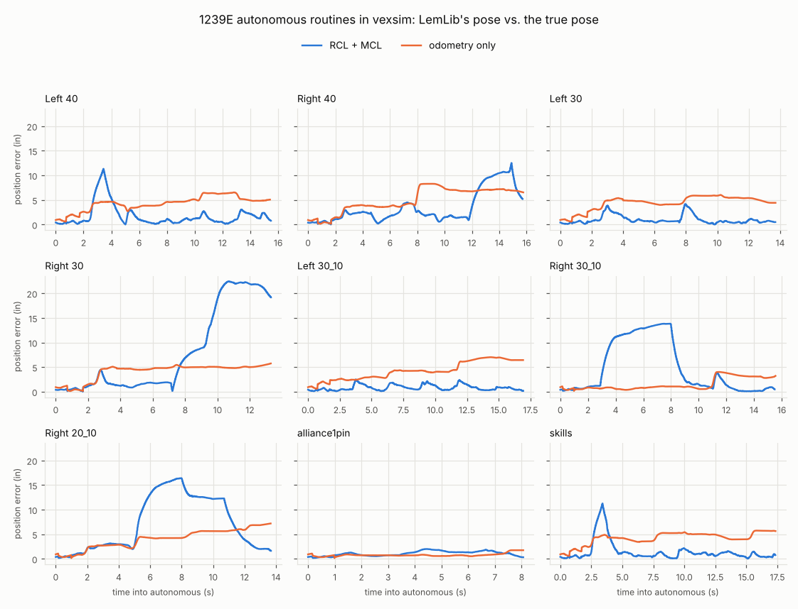

**The steps for any team's code:**
1. **Take stock** of every device, library and system call, against [what's simulated](#whats-simulated).
2. **Copy** `src/`, your own headers and `project.pros`, leaving out what PROS installs. Run `vexsim build`, and fix what doesn't compile.
3. **Make small, inert edits:** replace wall-clock timing with `pros::millis()` or `micros()`; read the routine's name from an environment variable under `#ifdef VEXSIM`; seed random numbers from `VEXSIM_SEED`; optionally, add switches for experiments (like `VEXSIM_TRACKING`).
4. **Write the robot config** from your code's ports, gearing and sensor offsets (convert `chassis.setPose` and offsets as in [Frames](#frames-and-angles)). Measure the rest, then [calibrate](#12-calibrating-to-your-robot).
5. **Write the field config**, with element heights if your sensors care about them.
6. **Run each routine** headless, and compare the pose your code believes with the truth.

---

## 14. Using vexsim as a Python library
Everything the commands do is available from Python.

**A full simulation with a program** (a Python module or a C++ project):
```python
from vexsim.algorithms.localization import Pose
from vexsim.bridge.program import CppProgram
from vexsim.config import load_field, load_robot
from vexsim.runtime.program import load_program
from vexsim.runtime.simulation import Simulation

config = load_robot("examples/robots/full_omni_6m.yaml")
program = load_program("examples/programs/tour.py")
sim = Simulation(config, program=program, seed=1, start=Pose(0, 0, 0), echo=None)
sim.start("autonomous")
sim.run_until_finished(60)
print(Pose.from_si(sim.robot.pose), sim.estimated_pose)
print(sim.recorder.pose_error("autonomous"))  # mean, max and final position and heading errors
sim.recorder.write_csv("tour.csv")

# A PROS project instead (built incrementally); env reaches getenv() in the code
program = CppProgram.from_project("examples/pros_projects/minimal_pros4", env={"MY_FLAG": "1"})
field = load_field("examples/fields/v5rc_empty.yaml")
sim = Simulation(config, program=program, field=field, start=Pose(0, 0, 90), echo=None)
sim.start("autonomous")
sim.run_until_finished(30)
sim.close()  # ends the robot code's process
print(sim.console[-3:])
```
`Simulation(config, program=None, field=None, seed=0, noise=None, start=Pose(0, 0, 0), believed_start=None, battery_soc=1.0, localizer=None, input_source=None, record=True, echo=print, walls=True)` has `start(mode)`, `run_for(seconds)`, `run_until_finished(max_seconds)` and `close()`, and exposes `robot`, `sensors`, `arena`, `world`, `recorder`, `console`, `lcd`, `reported_pose` and `estimated_pose`.

**The world loop and a robot:**
```python
from vexsim.config import load_robot
from vexsim.physics import PRIORITY_SENSOR, World
from vexsim.physics.robot import Robot

world = World(seed=1)  # 1 ms physics step
robot = world.add_system(Robot(load_robot("examples/robots/full_omni_6m.yaml")))
left, right = robot.group("left"), robot.group("right")
left.set_velocity(left.rated_speed)  # motor shaft rad/s; positive = wheels forward
right.set_velocity(0.5 * right.rated_speed)
world.every(100, lambda w: print(round(w.time, 1), robot.pose), priority=PRIORITY_SENSOR)
world.run_for(1.0)
print(robot.body_velocity, robot.contacts.normal)
```

**Sensors and your own localizer** (readings in PROS units):
```python
from vexsim.algorithms.localization import Pose, baseline_localizers
from vexsim.config import load_robot
from vexsim.devices.suite import SensorSuite
from vexsim.physics import World
from vexsim.physics.robot import Robot

config = load_robot("examples/robots/full_omni_6m.yaml")
world = World(seed=1)
robot = world.add_system(Robot(config))
sensors = SensorSuite(robot, world.rng).attach(world)  # attach after the robot
world.run_for(2.1)  # the IMU calibrates; keep still
odom = baseline_localizers(config)[-1]  # tracking wheels + IMU
odom.reset(Pose(0, 0, 0), sensors.frame(world.time))
world.every(10, lambda w: odom.update(sensors.frame(w.time)), priority=1)
robot.group("left").set_velocity(40)
robot.group("right").set_velocity(30)
world.run_for(2.0)
print(odom.pose, Pose.from_si(robot.pose))
```

**A single motor on a test rig:**
```python
from vexsim.physics import BrakeMode, PowerSystem, V5Motor, World
from vexsim.physics.rig import ShaftRig

world = World()
power = PowerSystem()  # V5 battery + brain power distribution
motor = V5Motor("blue")
power.attach(motor)
rig = world.add_system(ShaftRig(motor, load_inertia_kgm2=1e-3))
motor.brake_mode = BrakeMode.HOLD
world.every(10, lambda w: motor.set_velocity(50.0 if w.time < 1 else 0.0))
world.run_for(2.0)
print(rig.omega, motor.current, motor.temperature_c, power.bus_voltage)
```

**Benchmarks and calibration:**
```python
from vexsim.bench.runner import run_bench

result = run_bench("examples/scenarios/pose_approach.yaml", seeds=[0, 1, 2], workers=1)
print(result.combos(), result.rows[0]["final_error_in"])
```
`vexsim.calibration.log.RobotLog.read(path)`, `vexsim.calibration.fit.fit(config, log, parameters)` and `compare(config, log, overrides)` do what `vexsim calibrate` does.

---

## 15. Module reference: what each part does
```
vexsim/
  cli.py, __main__.py   the `vexsim` command
  units.py, v5.py       unit conversions; V5 hardware constants
  config/               robot and field schemas, YAML loading, validation, summaries
  core/                 clock, event scheduler, random streams
  physics/              the world loop and every physical model
  devices/              simulated sensors and motor encoders
  algorithms/           localization (odometry, GPS) and control (PID, motions, paths)
  api/                  the Python robot-program API
  runtime/              simulations, competition phases, programs, telemetry
  bridge/               PROS 4 C++ code in the loop: build, host process, shim
  bench/                Monte-Carlo benchmarks and reports
  calibration/          robot logs, the calibration routine and session, replays, fitting
  viz/                  the live viewer and every plot
  app/                  the services behind the browser app: run specs, the workspace, jobs, live runs
  ui/                   the browser app: its server, its messages, and the built page
```

### Top level
| Module | What it does |
|---|---|
| `cli.py` | Every `vexsim` command: parses arguments, loads configs, wires the pieces below together, and prints results. `main(argv)` returns the exit code. |
| `__main__.py` | Makes `python -m vexsim` work. |
| `units.py` | Conversions between VEX units and SI (`in_to_m`, `rpm_to_rad_s`, `mv_to_v`, ...). The simulator computes in SI and converts only at its boundaries. |
| `v5.py` | V5 constants: 21 smart ports, cartridge speeds (100/200/600 rpm), ±12000 mV, 11 W per motor, the 88 W motor budget, the 18 in starting size. |
| `geometry.py` | Robot shapes: `Outline`, the union of rectangles, circles and polygons. Its outside edge exactly (segments and arcs, holes included), inside tests, signed distances, the contacts of discs (`discs`: a circle in a notch touches both sides), how far it reaches, bounds, area and moments (Green's theorem), overlap with a convex polygon, and loops to draw. `polygon_problem` says what's wrong with an outline. |
| `mcllog.py` | MCL logs as 1239E's code writes them: `parse` reads the updates (each sensor's reading and ray, the particles, the time, the estimate and its spread), `MclLog` gives a log's path to follow, its summary, and each update as drawings. |
| `workers.py` | `process_pool`: worker processes for the benchmark, the calibration fit and sweeps, each of which exits when the process that made the pool ends (a cancelled job's workers don't go on simulating for nobody). |

### `config/`: robot and field configs
| Module | What it does |
|---|---|
| `robot.py` | The robot YAML schema (pydantic): `RobotConfig`, with `BodyConfig` (a `footprint_in`, or a `shape` of `RectPart`, `CirclePart` and `OutlinePart`; `body.outline` is its `Outline`), `DrivetrainConfig` (`WheelConfig`, `GearGroupConfig`), `MechanismConfig`, and the sensor configs (`ImuConfig`, `RotationConfig` with `TrackingWheelConfig`, `DistanceConfig`, `GpsConfig`). Per-field rules (port ranges, positive sizes) and `ratio_value("36:48")`. |
| `field.py` | The field YAML schema: `FieldConfig`, `ObstacleConfig`, `PieceConfig`, and `check_field` (elements inside the walls, overlapping pieces). |
| `checks.py` | Cross-field robot checks (`check_robot`): ports, footprint (or shape) containment, tipping, gearing, drivetrain layout, strafing ability, motor budget, overrides. |
| `loader.py` | `load_robot` and `load_field` (raise on errors), and `validate_robot` and `validate_field` (return a report), from a file or a mapping. |
| `yaml_io.py` | A strict YAML loader: `36:48` stays text instead of becoming the base-60 number 2208, and duplicate keys are errors. |
| `issues.py` | `ConfigIssue`, `ValidationReport` and `ConfigError`: problems with a location, a severity and a message, with "did you mean" suggestions. |
| `summary.py` | The human-readable summary `validate-config` prints (ASCII only, for Windows consoles). |

### `core/`: simulation infrastructure
| Module | What it does |
|---|---|
| `clock.py` | `SimClock`: time as integer microseconds, so long runs never drift. |
| `events.py` | `EventScheduler`: timed and periodic callbacks, fired in order of time, priority, then registration. |
| `rng.py` | `RngStreams`: independent named random streams from one seed (`world.rng.stream("sensor.imu.10")`), hashed with BLAKE2 so they match in every process. |

### `physics/`: the models
| Module | What it does |
|---|---|
| `world.py` | `World`: the fixed-step loop. Each tick fires the due events (`every`, `after`), steps every physics system (`add_system`), and advances the clock; `run_for`, `run_until`. Priorities `PRIORITY_SENSOR`, `PRIORITY_CONTROL`, `PRIORITY_RECORD`. |
| `motor.py` | `V5Motor`: the 11 W motor. The electrical model, the firmware's velocity, position and hold loops, voltage mode, brake modes, the current limit, thermal derating and power draw. `MotorSpec`, `BrakeMode`, `ControlMode`. |
| `thermal.py` | `MotorThermal`: the two-node (winding, housing) heat model and the firmware's current derating steps. |
| `battery.py` | `Battery`: open-circuit voltage against charge, internal resistance, charge counting. |
| `power.py` | `PowerSystem`: sums every motor's draw into battery current, sags the bus voltage, and shares a 20 A budget beyond 8 motors. `IdealSupply` for tests and rigs. |
| `wheel.py` | Wheel-ground contact: `OmniWheelSpec`, `TractionWheelSpec`, `MecanumWheelSpec`; smoothed Coulomb friction on three channels; the traction friction circle. |
| `chassis.py` | `NormalLoads`: each wheel's share of the weight, with weight transfer under acceleration and turning, drop-center rocking and lift-off. |
| `robot.py` | `Robot`: the drivetrain built from a config. Gear groups (`DriveGroup`), wheels, chassis, mechanisms and power; the implicit integrator; the pose, velocities and contacts; wall and obstacle contacts. |
| `kinematics.py` | `DriveKinematics`: which gear-group speeds produce a body motion (forward, sideways, turn), for any drivetrain; whether it can strafe; top speeds. |
| `mechanism.py` | `Mechanism`: a lift, intake or arm: its motors through a ratio, inertia, load, friction and hard stops. |
| `field.py` | `Walls` and `FieldSpec`: the perimeter. Footprint corners past a wall (and a shape's round edges' furthest points) are resolved with impulses (bounce, wall friction), then pushed back inside. `robot_impulses` is shared with obstacles. |
| `arena.py` | `Arena`: game elements. Robot contacts with solid obstacles, by footprint or by shape; pieces (`Pieces`) sliding, bouncing and being pushed; ray casts for sensors (`ray`, with a beam height). `Shape` is a rectangle or a circle. |
| `params.py` | `PhysicsParams` and `resolve_params`: every parameter group with the config's `overrides` applied; `check_overrides` validates the keys. |
| `rig.py` | `ShaftRig` (a motor driving an inertia), and the dynamometer behind `motor-curves` (`torque_speed_curve`, `free_speed`, `hold_speed`). |

### `devices/`: simulated sensors
| Module | What it does |
|---|---|
| `devices.py` | One class per device: `MotorDevice` (encoder counts, velocity, current, ...), `RotationDevice` (a tracking wheel's true travel, with diameter, mounting and scrub errors), `ImuDevice` (gyro bias, noise, scale error, calibration), `DistanceDevice` (a ray to walls and elements), `GpsDevice` (fixes from the code strip, its gyro between fixes). Each samples the physics on its period and publishes after its latency. `ray_to_walls`. |
| `specs.py` | Timing and error parameters per sensor type, and the `ideal`, `default`, `harsh` and `replay` presets; `sensor_spec(kind, preset, overrides)`. |
| `suite.py` | `SensorSuite`: one device per port from the config (motors included), wired into the world; `frame(time)` collects every reading. |
| `frame.py` | `SensorFrame` and the reading types: what robot code sees, in PROS units and sign conventions. |

### `algorithms/`: localization and control
| Module | What it does |
|---|---|
| `localization/base.py` | `Pose` (in, deg CCW; `from_si`, `distance_to`, `heading_error`) and the `Localizer` interface (`reset`, `update`). |
| `localization/odometry.py` | `ArcOdometry`, the arc method LemLib uses, over `RotationTracker`s (tracking wheels) or `MotorTracker`s (drive encoders), with heading from an IMU or two parallel wheels. |
| `localization/gps.py` | `GpsCorrected`: odometry pulled toward GPS fixes by a complementary filter, with latency compensation. |
| `localization/baselines.py` | `baseline_localizers(config)`: every baseline the robot's sensors support, best last. |
| `localization/runner.py` | `run_odometry`: the scripted drives (`gentle`, `aggressive`) behind `vexsim odometry`. |
| `control/base.py` | `DriveCommand` (volts or wheel speeds), `ChassisGeometry`, and the `Controller` interface. |
| `control/pid.py` | `PID` (with an integral zone, and an integral reset when the error changes sign) and LemLib-style `ExitCondition`s. |
| `control/profiles.py` | `TrapezoidProfile` and `SCurveProfile`: 1-D motion profiles. |
| `control/motions.py` | `TurnToHeading`, `MoveToPoint`, `Boomerang` (moveToPose) and `ProfiledDrive`, with LemLib-like gains. |
| `control/paths.py` | `PurePursuit`, `Ramsete`, and path tools: `spline` (Catmull-Rom), `densify`, `smooth`, `generate_trajectory`. |

### `api/`: Python robot programs
| Module | What it does |
|---|---|
| `__init__.py` | `delay(ms)`, what programs yield to wait. |
| `devices.py` | PROS-style `Motor`, `MotorGroup`, `Imu`, `Rotation`, `Distance`, `Gps` and `Controller`, backed by the simulated devices. |
| `drive.py` | `Drive`: forward, strafe and turn for any drivetrain, from its kinematics. |
| `chassis.py` | `Chassis`: LemLib-style motions as generators, tank and arcade drive, and its own odometry. |

### `runtime/`: running programs
| Module | What it does |
|---|---|
| `simulation.py` | `Simulation`: the world, robot, arena, sensors, a localizer, a program, inputs and telemetry, with the competition phases (`MODES`). `Bot` (what programs receive), `ScriptedInput` (`--input`), and the default `initialize` and `opcontrol`. |
| `program.py` | `load_program`, and the coroutine runner that turns generator functions into competition phases. |
| `recorder.py` | `Recorder`: the 10 ms telemetry log, and `pose_error` (the estimate against the truth). `Log` reads a CSV back for plots and replays. |
| `drawing.py` | What robot code draws on the field: `Drawings` (layers of shapes, from `vexsim::draw_*` commands or `bot.draw`, a `Pen`). |
| `follow.py` | `PathFollower`: the virtual driver of `--follow`, which drives along a logged path through the program's sticks and drive curve (`ExpoCurve`, LemLib's, inverted). |

### `bridge/`: PROS 4 C++ code in the loop
| Module | What it does |
|---|---|
| `build.py` | `vexsim build`: finds g++ (`find_toolchain`), stages the project without the PROS SDK, compiles incrementally with dependency tracking, embeds `static/` for `ASSET()`, builds the shared runtime, and links `robot_host`. Reads the templates in `project.pros`. |
| `lemlib.py` | Finds the project's LemLib version, fetches and caches its source, and compiles it once per version; detects edited LemLib headers. |
| `host.py` | `RobotHost`: starts `robot_host` and speaks its line protocol over pipes. Readings and `RUN <time>` go in; motor commands, console text, LCD lines, the reported pose and the next wake-up time come out. |
| `program.py` | `CppProgram`: a built project as a simulation program. It sends readings, applies commands, maps competition modes to status bits, and sets `VEXSIM_SEED`, `VEXSIM_START`, `VEXSIM_ROUTINE`, `VEXSIM_ROUTE` (a route's steps, written to a file for its runner) and `--env` variables. |
| `routines.py` | A project's autonomous routines (`find_routines`: the no-argument functions in `include/custom/auton.hpp`, read with a small C++ tokenizer, each with the file that defines it and its `setPose` start), and the switch that runs the one picked (or a route build's route): `rename_header`, force-included in each file that defines routines, renames them with `asm` labels; `switch_source` takes their own names. |
| `functions.py` | The team's functions a route can call (`find_functions`): the `void` functions a route's headers declare that take numbers, `bool`s or enum values, with their parameters' names, types and defaults, how each moves the robot (its `// vexsim:` comment, a `Hint`), and why each other one can't be called; the enums they take (`find_enums`, from the headers and the project headers they include). |
| `runner.py` | Route builds: `find_chassis` finds the project's `lemlib::Chassis` by its declaration; `runner_source` generates the build's extra file (the headers, `cpp/route/runner.cpp`, a call wrapper for each function and a table of each enum's values); `RouteRecord` reads the runner's console lines into when, and where, each step ended. |
| `doctor.py` | `vexsim doctor`: toolchain checks, and a test build and run. |
| `cpp/include/` | The PROS 4 shim headers robot code compiles against: `api.h`; `pros/*.h(pp)` (motors, IMU, rotation, distance, GPS, rtos, misc, llemu, screen, adi, and stubs for unsimulated devices); `liblvgl/` (LLEMU and the LVGL stand-in); `vexsim/sim.hpp` (`report_pose`, `benchmark_task`); `vexsim/newlib_compat.h` (newlib extras). |
| `cpp/route/runner.cpp` | The route runner, compiled into route builds: it reads the steps from the file `VEXSIM_ROUTE` names, makes LemLib's calls, vexsim's own motions' and the team's, and says on the console as each step starts and its call returns, and as each motion starts and ends. |
| `logger.py` | vexsim's logger: `logger_files` (its two files, as a project gets them) and `add_logger` (`vexsim logger add`). |
| `cpp/logger/` | vexsim's logger, `include/vexsim_log.hpp` and `src/vexsim_log.cpp`: finds the devices on every port, logs them every 10 ms with the code's own poses, numbers and marks, and saves the log to the next numbered file on the SD card or prints it. |
| `cpp/motions/` | vexsim's own motions for a LemLib chassis: `include/vexsim/trajectory.hpp` (plans: an arc, or a smooth path through points, timed on a speed profile within the drive's limits), `include/vexsim/motions.hpp` and `src/vexsim/motions.cpp` (`vexsim::Motions`: `moveArc` and `ramsete`, followed with RAMSETE and a feedforward model of the drive, queued with LemLib's motions). A LemLib project's builds can include them, a route build compiles them (unless the project has its own copy), and an export copies them into the project. |
| `cpp/runtime/` | The C++ side, linked into every build: `host.cpp` (process setup, the protocol loop, console capture, crash reports; a route build's runner in place of `autonomous()`), `scheduler.cpp` (the lockstep FreeRTOS-style scheduler: tasks, delays, mutexes, notifications, and the tasks the route runner follows: those LemLib starts for its async motions), `devices.cpp` (the PROS device C API over a device table), `lvgl.cpp` (the LVGL stand-in), `usd.cpp` (the `--sd` folder that stands in for the SD card: on Linux the robot host defines `fopen` and `fopen64` itself, on Windows the link wraps them), `defaults/` (empty competition functions, used only when the code has none, like PROS's weak defaults). |

### `bench/`: benchmarks
| Module | What it does |
|---|---|
| `scenario.py` | The scenario YAML schema: tasks, disturbances, randomization and controllers; `load_scenario`. |
| `trial.py` | One trial: builds the robot with the seed's randomization, runs the localizer and controller (or the PROS project), applies disturbances, and records. |
| `metrics.py` | `score`: the metrics, from a trial's true and estimated poses. |
| `runner.py` | `run_bench`: every seed × localizer × controller in parallel processes, then the worst-case re-runs. |
| `report.py` | `trials.csv`, `summary.csv`, the charts, and the self-contained `report.html`. |

### `calibration/`: fitting the model to a robot
| Module | What it does |
|---|---|
| `routine.py` | The calibration maneuvers (launch, coast, reverse, strafe, spin, arc) as fixed-voltage steps, scaled to the robot; `drive_tests`: the same maneuvers as a session's driving tests, each from rest, slowed where a field has less room. |
| `cpp.py` | Generates the routine as PROS 4 C++ for one robot config; it logs with vexsim's logger (`bridge/logger.py`). |
| `plan.py` | A session's field plan (`vexsim calibration plan`): each driving test simulated over a spread of the robot's parameters, and a spot found where all those paths stay a margin clear of the walls and elements (an FFT search over positions and headings); the push lane and the spins' spots; where to put the robot, from two walls; the maps. |
| `program.py` | Writes the calibration program into a PROS project (`vexsim calibration program`): the fixed `bridge/cpp/calibration/main.cpp`, and a header with the robot's devices and the plan's tests. |
| `student.py` | `Student`: a simulated student who runs the program in vexsim by what it prints: presses buttons, lays the robot on its side, puts it on its spots, pushes and turns it by hand, covers its distance sensors. |
| `log.py` | `RobotLog`: the robot-log CSV format (2: with a log's `# key: value` lines, marks, and the code's own poses and numbers; 1 reads too), read from a file or cut out of terminal output (`parse_all`: every log in it). |
| `record.py` | `RobotLogger`: writes the same log from a simulation (`--robot-log`). |
| `replay.py` | Replays a log's commands in the simulator, with ideal sensors and the logged battery voltage, at the log's reading age. |
| `fit.py` | A Levenberg-Marquardt fit of any parameters to a log; the battery's resistance from voltage against current; `compare`. |
| `feedforward.py` | The drive model vexsim's own motions drive with (`DriveModel`: kS, kV, kA, kT, kP and the limits plans keep within): `fit` to a robot log by least squares, or `characterize` a robot config by driving it in the simulator and fitting that. |

### `viz/`: viewer and plots
| Module | What it does |
|---|---|
| `viewer.py` | The pygame viewer: live simulations (`LiveSource`) and log replays (`ReplaySource`), keyboard and gamepad input, the side panel. |
| `motor_curves.py`, `drift.py`, `odometry.py`, `telemetry.py`, `calibration.py` | The plots behind `motor-curves`, `drift`, `odometry`, `plot` and `calibrate`. |

### `app/`: the services behind the browser app
| Module | What it does |
|---|---|
| `routes.py` | Autonomous routes: `read_route` and `check_route` read a route's YAML and check it against its project, robot, field and functions (`check_text` places each issue at its line, for the editor, and reads what it can of a route half typed); `runner_input` writes its steps as the runner reads them; `run_route` runs one headless (the `route` job, `vexsim route run`) and returns where each step ended, and the path driven. For the autonomous maker: `new_route_text` (*New route…*) and `mirror_text` (*Mirror*). |
| `runspec.py` | `RunSpec`: everything `vexsim run` takes (a log to follow, `Follow`, and a route included), converted to and from its arguments (`from_args`, `to_args`, `command_line`). `check` loads and checks the files (and warns, through `start_blocked`, when the robot would start on top of a field element), `build` builds a PROS project, and `program_factory` and `simulation_factory` make the program and the simulation. `vexsim run` uses them too. |
| `launch.py` | Saved runs: the workspace's `.vexsim/launch.yaml`, named run specs the app's *Saved run* list reads and writes (`read_configurations`, `write_configurations`). |
| `workspace.py` | `Workspace`: finds what vexsim can use in a folder, by content (robots, fields, scenarios, Python programs, PROS projects and their routes, inputs, telemetry logs, robot logs, MCL logs), and refuses paths outside it. |
| `jobs.py` | `JobManager`: long tasks (builds, analyses, benchmarks, fits, sweeps, route runs; `JOB_KINDS` names each kind's function), each in a process of its own, with their output, progress and the parts of their result that come early (a sweep's finished trials), cancel, and one job at a time per key (a second build of a project joins the first). |
| `results.py` | What the long jobs found, kept in the workspace's `.vexsim/bench/`, `sweeps/` and `calibrations/`: a folder per result with its `result.json` and files; the newest 20 of each kind stay. |
| `sweeps.py` | Sweeps: `.vexsim/sweeps.yaml` (`read_sweeps`, `write_sweeps`), a sweep's trials (`expand`: saved runs × variations × seeds, with placement errors drawn as `evaluate_1239e.py` draws them), one trial run headless and measured (`run_trial`, `measure`), and the sweep as a job (`run_sweep`). |
| `benchmarks.py`, `calibrate.py`, `analyze.py` | The *Bench*, *Calibrate* and *Analyze* pages' jobs: `vexsim bench`, `calibration-routine`, `calibrate`, `motor-curves`, `drift` and `odometry`, returning what their charts draw (and saving their results), with `describe_scenario` and `routine_plan` for what the pages show before a run. |
| `chartdata.py`, `jsonsafe.py` | Series thinned and rounded for the browser's charts; data made JSON-safe (no NaN, no numpy values). |
| `child.py` | `ChildProcess`: a function run in a new Python process, connected by an authenticated pipe, with its output captured. |
| `session.py`, `worker.py` | A live run. `Session` (in the server) starts a worker process, sends it commands (pause, step, speed, restart, input, stop) and numbers its messages, so a viewer that connects late catches up exactly. The worker runs the simulation at real time × speed and sends the scene, about 60 frames a second, the motion overlay, what the robot code draws, when a replay began following its log, and the console. |
| `runs.py` | The run history. `TapeRecorder` writes each run's folder when it ends (`run.json`, the tape with the robot code's drawings, the telemetry, the console); `list_runs`, `read_tape`, `telemetry_columns` and the rest read them back for the server; `prune` keeps the newest 50 and the kept ones; `replay_of` turns a telemetry log into a tape, and `mcl_tape` an MCL log into one to play beside a run. |
| `yamledit.py` | The Design view's and the autonomous maker's changes to a config's or a route's text: a `Change` sets a value of any kind (a missing key is added), adds a list item, inserts one before another, moves one (with the comments above it), removes an item or a key with its lines, or renames a key, each written in place in its neighbours' style with every comment kept. `apply` makes them, and the diagram's numbers (`configs.Edit`), in order. |
| `files.py` | The workspace list's *Duplicate*: `duplicate` copies a file beside itself, never over one, a robot's or field's named as a copy in its own text. |
| `autons.py` | Routes exported into their project (`vexsim route export`, *Export…*): `plan_export` works out the routines (`routine_source`, each step's call as `step_call` writes it) and what they change in `src/vexsim_autons.cpp` and `include/custom/auton.hpp` (`declarations`), and the routes it leaves out; `export` writes the files that change. |
| `newrobot.py` | New robots: `robot_text` writes the commented template (a rectangle on a drive preset), `create` writes it (or a copy of a robot) where no file is, and `preset_changes` puts a preset's drive on a robot: on its base, inside its shape, its motors on free ports. |
| `configs.py` | Robot and field configs for the editors: `check_text` validates YAML text as `validate-config` does and places each issue at its line and column; `patch_text` rewrites numbers in place (or adds a missing key in its mapping's style) using PyYAML's node positions, and refuses values that come through anchors, aliases or merges; `set_overrides` writes a calibration's fitted values under `overrides` the same way; `read_config` and `write_config` keep a file's line endings and byte order mark. |
| `frames.py` | A run as messages: the scene (robot and field), each frame (poses, wheels and their forces, the controller, sensors, motors, mechanisms, pieces, screens, the period's time left) and the active motion's path and target. `preview_of` gives the robot and field before any run, to drag the robot to its start. |

### `ui/`: the browser app
| Module | What it does |
|---|---|
| `server.py` | The FastAPI app behind `vexsim ui`: the workspace, previews, saved runs, live runs, the run history (tapes, telemetry, CSV, replays of logs), config editing (open, check, patch, save, with a check for changes made on disk; new robots and drive presets), the workspace's files duplicated and deleted (only those it lists, not a project's folder), jobs of every kind with their progress, the results they keep (and their files: a benchmark's report is served sandboxed), saved sweeps, scenarios and the calibration routine over HTTP, each run's messages over a WebSocket, and the page. `Guard` checks every request's key, Host and Origin. `serve` listens on 127.0.0.1 and prints the link. |
| `protocol.py` | Every message and request as a pydantic model. `python -m vexsim.ui.protocol frontend/src/protocol.ts` writes them as TypeScript for the page; a test fails while that file is stale. |
| `window.py` | `vexsim ui --window`: `find_browser` finds a browser with an app mode (or `$VEXSIM_BROWSER`), `open_window` opens the app in it on a profile of its own, else in the default browser. The server knows the app's pages by a WebSocket each holds open (`/api/presence`), and `serve(stop_when_closed=True)` stops once the last one has closed. |
| `shortcut.py` | `vexsim shortcut`: a `Shortcut` runs `vexsim ui FOLDER --window` with this Python; `make` and `remove` put it in, or take it out of, the Start menu and desktop (a `.lnk`, made through the Windows shell), the applications menu (a desktop entry) or `~/Applications` (an app). |
| `vsix.py` | `vexsim vscode`: `build` packs `vscode/` into a `.vsix` with this version and this Python as the default of its `vexsim.python` setting; `install` installs it with VS Code's command line. |
| `vscode/` | The VS Code extension, in plain JavaScript: `extension.js` runs `vexsim ui FOLDER` for a panel and does what the page asks (open a file at a line, save a file, open a report in the browser); `panel.js` is the panel's page, the app in a frame. The page knows it's in VS Code (`?embed=vscode`; `frontend/src/host.ts`). |
| `static/` | The built page (from `frontend/`, by `npm run build`), shipped with the package, and its icons (from `frontend/scripts/make_icons.py`). |

### Outside the package
| Folder | What it holds |
|---|---|
| `examples/` | robot and field configs, Python and C++ programs, inputs, scenarios, scripts ([the table above](#the-example-files)) |
| `docs/` | deep dives: [models.md](docs/models.md) (every parameter's source, measurement experiments), [conventions.md](docs/conventions.md), [programming.md](docs/programming.md), [cpp.md](docs/cpp.md), [benchmarking.md](docs/benchmarking.md) (a worked 100-seed example), [calibration.md](docs/calibration.md), [porting_1239e.md](docs/porting_1239e.md), [1239e_real_vs_sim.md](docs/1239e_real_vs_sim.md); images and an example report |
| `frontend/` | the browser app's source (React and TypeScript, the field drawn on a canvas), its unit tests (`tests/`, Vitest) and its end-to-end tests (`e2e/`, Playwright) |
| `tests/` | the test suite, including a C++ test project for the bridge (`tests/cpp/bridge_test`) |
| `PLAN.md` | the design plan and the phase history |

---

## 16. The physics models
This is a summary; [docs/models.md](docs/models.md) gives every parameter's source (VEX, a curve fit, a community report, or an estimate) and how to measure it.

### Motor
- Modeled at the motor core: `I = (V − ke·ω)/R`, clamped to the current limit; torque `kt·I` minus Coulomb and viscous friction; the cartridge multiplies torque by 36, 18 or 6 (red, green, blue). Fitted to VEX's published curve: about 2.1 N·m stall at the 2.5 A limit (red), rated speed held up to about a third of stall torque, about 12.7 W peak.
- **Firmware:** `move_velocity` is capped at rated speed and runs a feedforward plus PI loop that can use the full battery voltage, so it holds speed under load. `move_voltage` isn't speed-capped (12 V spins about 13% past rated). Position mode and `HOLD` add a position loop. A zero command stops with the brake mode: `COAST` (windings open), `BRAKE` (shorted: back-EMF braking) or `HOLD`.
- **Heat:** I²R heats a winding node that leaks to the housing, where the temperature sensor is. Above about 55 °C the firmware cuts current to 1/2, 1/4, 1/8, then 0. A stalled motor reaches the first step after about 160 s.

### Battery and power
1100 mAh, 13.5 V full to 11.2 V empty, 0.1 Ω internal resistance. Motors see the bus voltage under the total draw (plus the brain's 0.3 A) from the previous 1 ms step. Beyond 8 motors, each motor's current limit becomes 20 A ÷ N. Regeneration feeds other motors but never charges the battery.

### Wheels
Each wheel has three friction forces, each `coeff · N · tanh(velocity / smoothing)`:
- **grip**, along the wheel's grip direction: it drives the robot (`longitudinal_mu`, `mu` or `grip_mu`);
- **free**, across it: the rollers' resistance (`lateral_mu`, `roller_mu`), or a traction wheel's sideways grip;
- **rolling**: rolling resistance, so a coasting robot slows down.

Omni wheels grip along their rolling direction and roll freely across it, which is why X-drives work. Mecanum wheels grip along their ground rollers' axis (`roller_angle_deg`), so driving one pushes the robot diagonally. Traction wheels share one friction circle between grip and sideways slip, so a scrubbing wheel loses drive traction.

**Why omni robots drift:** a turn needs a sideways force of mass × speed × yaw rate, and only roller friction supplies it, up to `lateral_mu · g` (about 2 m/s²). Past that the robot slides outward, and a fast arc becomes a spiral, while drive-encoder odometry believes it traced the tight circle.

### Chassis and robot dynamics
- Each wheel sits on a stiff spring under a rigid chassis. The loads carry the weight and balance the pitch and roll moments of the ground forces below the CG: weight transfer, drop-center rocking, wheel lift-off.
- The degrees of freedom are the body's forward, sideways and yaw velocities, plus one shaft speed per gear group. Contact velocities are linear in them, and each 1 ms step solves a linearly implicit Euler update, stable even though tire friction is far stiffer than the step. Motor torques are explicit. The example robot runs about 6× faster than real time on one core.

### Walls, obstacles, pieces, mechanisms
- **Walls and solid obstacles:** footprint corners inside them are contacts, resolved with impulses: a bounce (`wall_restitution`, none below 5 cm/s) and friction (`wall_friction`); then the robot is moved out. A robot driving into a wall stalls with its wheels slipping, and an angled approach squares it up (a wall reset).
- **A robot with a `shape`** collides by its outside edge: its corners, and each round piece of the edge where it bulges most, against walls and obstacles; obstacle corners inside it; and every piece of its edge that a round goal or a piece reaches into, so something in a notch touches both sides. A shape of one rectangle moves exactly as the same footprint.
- **Pieces** slide with Coulomb ground friction, bounce off walls, obstacles, each other and the robot, and get pushed; a piece pinned against something stops the robot. They don't spin, and robots can't pick them up.
- **Mechanisms:** see [Mechanisms](#mechanisms). Friction is implicit (exact stiction), and hard stops are inelastic.

### Sensors
Every device samples on its period and publishes after its latency, in PROS units. The noise presets are `ideal` (no noise, latency or quantization, for debugging algorithms), `default` and `harsh`; `replay` is for calibration. Static errors are drawn once per device.

| Sensor | Default model |
|---|---|
| Motor encoder | 10 ms, 5 ms latency; 1800/900/300 counts per output rev (red/green/blue); velocity noise 0.5% of rated |
| Rotation (tracking wheel) | 10 ms; 0.088° resolution; 0.02° noise; per-wheel diameter error 0.5% and mounting error 0.05 in; scrub 1% of sideways travel; `harsh` adds lift-offs |
| IMU | 10 ms; a 2 s calibration that removes the gyro bias (0.3°/s); 0.05°/s rate noise; per-device scale error 0.5%, not removed by calibration; clockwise-positive |
| Distance | ~30 Hz, 10 ms latency; 20–2000 mm; σ 7.5 mm below 200 mm, 2.5% above; a ray to walls, obstacles (respecting heights) and pieces |
| GPS | 20 ms, 20 ms latency; a fix while the camera sees the code strip 0.3–4 m away, unblocked; σ 5 mm + 4 mm per meter; heading σ 0.3° |

A tracking wheel integrates the true contact velocity at its true mounting point with its true diameter. Localizers only know the configured geometry, so per-device errors show up as odometry error, as on a real robot.

### Localization baselines
| Name | Needs |
|---|---|
| drive encoders | a differential drive |
| drive encoders + IMU | + an IMU |
| tracking wheels + IMU | ≥1 vertical tracking wheel + an IMU |
| tracking wheels (no IMU) | ≥2 vertical tracking wheels |
| tracking wheels + IMU + GPS | tracking wheels + an IMU, and a GPS: odometry pulled toward GPS fixes (time constant 0.5 s), heading from the IMU |

All use the arc method, which is exact for constant-curvature motion. X-drive, mecanum and H-drive robots slide sideways on purpose, so they need tracking wheels.

---

## 17. Limits: what isn't modeled
- Robots don't pick up, carry or score pieces; mechanisms move but touch nothing.
- A robot's outline (its footprint or `shape`) is flat and fixed: it has no height, and doesn't change as mechanisms move.
- There are no other robots (a benchmark `push` disturbance stands in for a shove).
- The field is flat: no ramps, nothing to climb, no pitch or roll.
- The distance sensor is a ray (the real one has a cone of view), and its confidence is constant.
- Not simulated: ADI devices (outputs only remember what was written), the optical, vision and AI vision sensors, serial and radio links, the SD card (unless `--sd` names a folder for it), and touch input on the brain screen (LVGL runs headless).
- Compute time on the brain isn't charged, and precompiled ARM libraries other than LemLib can't run.
- Many physics parameters are estimates until you [calibrate](#12-calibrating-to-your-robot). Voltage-mode speed and thermal timing are the least certain; [docs/models.md](docs/models.md#calibrating-against-a-real-robot) lists experiments to measure them.

---

## 18. Developing vexsim
```
pytest          # every test (the C++ bridge tests skip without g++, unless VEXSIM_REQUIRE_CXX is set)
ruff check .    # lint
ruff format .   # format
```
CI (`.github/workflows/ci.yml`) runs on Windows (with MSYS2 g++) and Linux, with Python 3.11 and 3.13: lint, every test with the C++ bridge required, validation of every example config, and every example command, uploading the plots and telemetry as artifacts. A Linux job checks the browser app: types, unit tests, a fresh build that must match the committed one, and the end-to-end tests. Another, on Windows and Linux, installs the VS Code extension in a real VS Code and opens the app in its panel.

**The browser app** (`frontend/`, with Node.js 22):
```
cd frontend
npm ci          # once: the exact versions in package-lock.json
npm test        # unit tests (Vitest)
npm run build   # type-check, then build into vexsim/ui/static: commit the result with the source
npm run e2e     # end-to-end, in Chromium (Playwright): starts its own `vexsim ui` on port 8653,
                # with the Python named by VEXSIM_PYTHON (default `python`)
npm run vscode-test   # the VS Code extension, installed in a VS Code it downloads (on Linux, run
                      # it under xvfb-run); also with VEXSIM_PYTHON
```
`npm run typecheck` checks the VS Code extension (`vexsim/ui/vscode`, plain JavaScript) against VS Code's API too. The icons are drawn by `python scripts/make_icons.py` (with Pillow) into `public/icons`.
To work on the page with live reloading, run `vexsim ui --dev --no-browser` (on the default port, 8642) and open the link it prints once, for its cookie; then run `npm run dev` and open http://127.0.0.1:5173. Messages are defined once, in `vexsim/ui/protocol.py`: after changing them, run `python -m vexsim.ui.protocol frontend/src/protocol.ts`.

**Adding to vexsim:**
- *A model parameter:* add a field to the spec dataclass (`MotorSpec`, `OmniWheelSpec`, ...). It becomes an override key automatically. Document its source in `docs/models.md`.
- *A sensor type:* a config class in `config/robot.py`, a spec in `devices/specs.py` (in every preset), a device in `devices/devices.py`, the suite in `devices/suite.py`; for C++, the shim header, `runtime/devices.cpp`, and a reading line in `bridge/program.py`.
- *A PROS function:* declare it in the shim header under `vexsim/bridge/cpp/include/pros/`, implement it in `runtime/devices.cpp` or `scheduler.cpp`, and exercise it in `tests/cpp/bridge_test`.
- *A benchmark task or controller:* `bench/scenario.py` (the schema and `CONTROLLER_KINDS`) and `bench/trial.py`.
- *A long task for the browser app:* a function in `app/jobs.py` (`JOB_KINDS`), which runs in its own process and reports through its connection.
