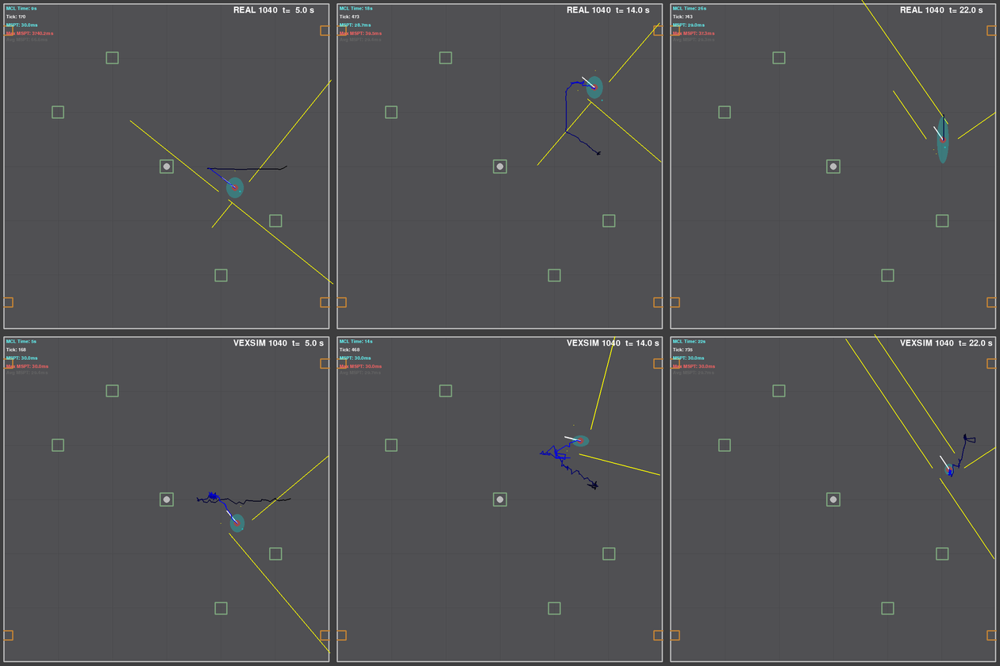
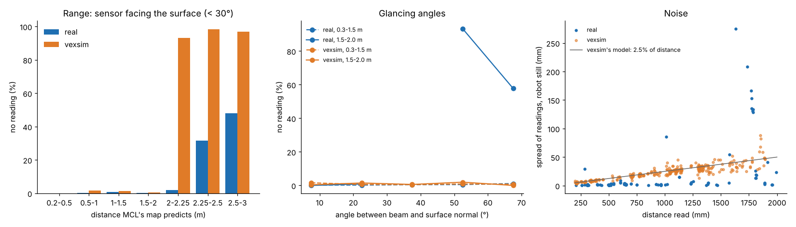
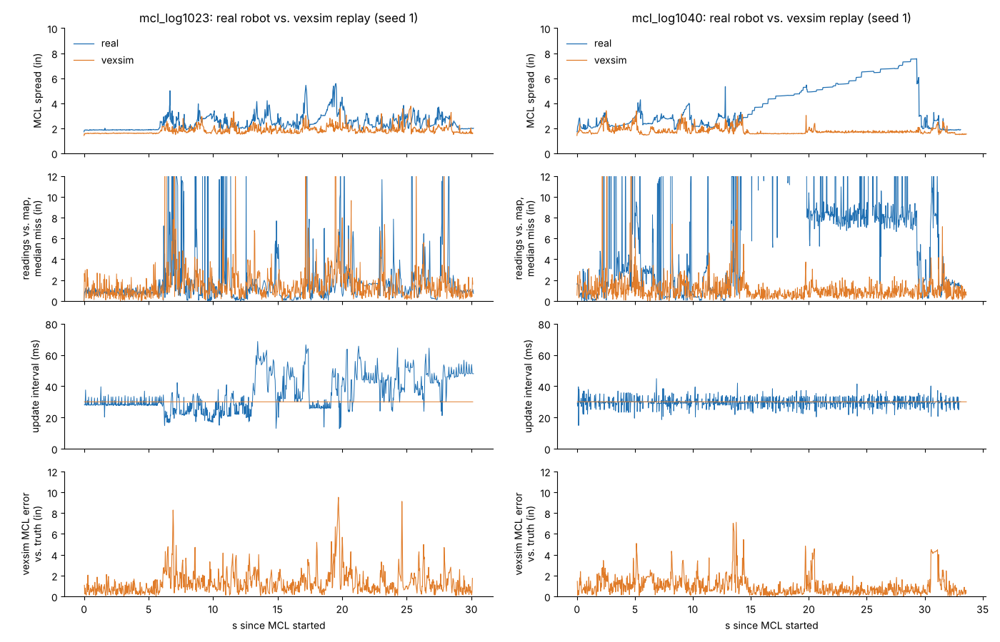

# Real robot vs. vexsim: 1239E's MCL logs

Team 1239E's robot logs every MCL update to its SD card. This compares five of those logs with the simulated robot driving the same paths, running the same code ([porting_1239e.md](porting_1239e.md)), and logging the same way. In short:

- **Where they agree:** the start reset, and readings of walls up to 2 m away. The real readings fit MCL's map to within about 20 mm, so the map and the sensor mounts are right.
- **The simulated distance sensors are much noisier than the real ones,** about 2.4% of the distance against 0.3% (23 mm against 2 mm at a typical reading). They also stop reading at 2.0 m, where the real ones read to about 2.3 m.
- **The real sensors miss what the simulated ones don't.** Beyond 1.5 m, at more than 45° off square, they mostly return nothing (68 of 90 readings; nearly all of them the back sensor's). They also see objects MCL's map doesn't have.
- **The real MCL's updates run late:** up to 69 ms apart, against the simulator's steady 30 ms.
- **So the simulated MCL looks better than the real one.** On the same paths, its estimate disagreed with its own readings by more than 3 in for 4–10% of updates; the real robot's did for 18–62%. Giving the simulated sensors the real ones' noise and range doesn't close that gap (below). What's left to model is what goes wrong for the real robot: missed readings at glancing angles, objects not on the map, and late updates.



*The team's own log visualizer, unchanged, on log 1040 (top) and the simulated robot's log of the same path (bottom). The simulated estimate jitters while the robot is still: that's the sensor noise. By 22 s the real estimate has jumped 10 in sideways while the robot sat still (see [below](#what-the-logs-show-about-the-teams-mcl)).*

## The logs
| Log | MCL ran | Start (MCL's pose after RCL's reset) | What the path looks like |
|---|---:|---|---|
| `mcl_log1023` | 30 s | (59.1, 9.9) facing −x: back and right sensors | a loop around the whole field, driver-style |
| `mcl_log1024` | 72 s | (58.1, 1.3) facing −x: back and left sensors | the routine below, then more driving near the +x wall |
| `mcl_log1025` | 33 s | (62.8, 0) facing −x: back sensor | the same routine as 1026 and 1040: to (18, 0), then straight drives and turns around (40, ±20) |
| `mcl_log1026` | 18 s | (62.7, 0) facing −x: back sensor | the same routine |
| `mcl_log1040` | 33 s | (62.9, 0) facing −x: back sensor | the same routine, then 15 s parked |

No routine in the port's copy of the code (`fb5a42a`) starts like this. Its routines start at (±60, 0) facing the near wall, with a front-sensor reset. So these logs come from newer code, or from tests. The replay doesn't need the routine: it drives the logged path.

## How the comparison works
`examples/scripts/replay_1239e_mcl_log.py` replays each log:
1. **The same start.** The simulated robot starts where the log's first estimate puts it. MCL starts with `startMcl()` and the same RCL resets, via the port's `VEXSIM_AUTON="startMcl x,y,theta,front,left,back,right"` hook.
2. **The same path.** A virtual driver holds the joysticks of the team's own `opcontrol()` tank drive. Using the simulated robot's true pose, it follows the logged MCL estimate, in time, through the inverse of the team's throttle curve, with the drive in brake mode hold. That estimate is the only record of where the real robot went, so where the real MCL was wrong, the simulated robot drives the wrong path. Where the estimate drifts sideways while the robot is still, the simulated robot stays put: a tank drive can't slide, and the heading (from the IMU) says it didn't turn.
3. **The same log.** The team's `initLog()` writes the simulated robot's log to the folder `VEXSIM_SD_DIR` names, in the same format. The team's visualizer reads it unchanged. `truth.csv` beside it says where the simulated robot really was.
4. **The same numbers from both logs.** Sensor numbers come only from well-localized updates (at least 3 readings, with a median within 1 in of what MCL's map predicts), so that a wrong estimate doesn't pass for a sensor error. Reading noise is the spread of each sensor's readings while the robot is still.

```
python examples/scripts/replay_1239e_mcl_log.py mcl_log1023.1239e mcl_log1040.1239e --seeds 3
python examples/scripts/replay_1239e_mcl_log.py mcl_log1023.1239e --brake coast   # driver-style
```
It prints a table per log (real against simulated, averaged over the seeds) and where the simulated logs are. The simulated robot followed the logged paths to a median of 2.9–3.3 in, except for 1024 and 1025, at 8 in. In those two the real estimate jumps and slides sideways (in 1024 it was lost for stretches). A tank drive can't follow either, so the simulated robot catches up only as it drives on, and part of that distance is the real MCL's error, not the replay's.

## What agrees
**The start reset.** RCL's back-sensor reset put the simulated robot within about half an inch of where it put the real one (1025, 1026, 1040: real x 62.7–62.9, simulated 62.5–63.4). The simulated spread is wider because of its noisier sensors.

**Walls up to 2 m.** Facing a wall (within 30° of square), both robots' sensors read it nearly every time (no reading under 2%). The real readings agree with MCL's map to within about 20 mm (the median for each sensor and distance), apart from the left sensor at 1.5–2 m (+53 mm). So the map's walls, at 70.2 in, are right, and so are the sensor mounts in `MclTracking.hpp`.

**MCL's update period.** Both run every 30 ms most of the time (medians 28.4–30.0 ms).

## What differs


*All five logs pooled; the simulated side is 3 seeds of each replay. Left and middle: readings from well-localized updates. Right: one point per sensor per stretch of 10 or more updates with the robot still.*

**Noise.** With the robot still, a real sensor's readings vary by 2 mm (median standard deviation, about 0.3% of the distance). vexsim's model adds 2.5% of the distance (7.5 mm under 200 mm), so its readings vary by 23 mm. It shows in the visualizer: the simulated estimate jitters by an inch while the robot sits still, and the real one doesn't move. vexsim's 2.5% comes from VEX's accuracy spec (±5% beyond 200 mm). That spec limits how far off a reading can be, not how much it varies from one reading to the next, and these sensors' errors are mostly a steady bias of a few mm.

**Range.** Facing a wall, a real sensor reads it nearly every time out to 2.25 m (1.9% no reading at 2.0–2.25 m), less often beyond (31% no reading at 2.25–2.5 m, 48% at 2.5–3 m). vexsim reads nothing beyond 2.0 m (`max_range_mm`).

**Glancing angles.** Below 1.5 m the real sensors read a wall at any angle (no reading ≤1%, up to 75° off square). At 1.5–2.0 m and past 45° they mostly miss it: 93% no reading at 45–60°, 58% at 60–75°. Those 90 readings are mostly the back sensor's, which missed 61 of its 67; the front sensors missed 3 of 11, so this may be partly the back sensor's own (its mount or what it faces). vexsim never misses because of the angle.

**Confidence.** vexsim always reports a confidence of 63, the maximum. MCL discards readings over 200 mm whose confidence is under 20, and widens its error model by 32/confidence for the rest. On the robot, confidence drops with distance and angle, so MCL there trusts some readings less and drops others; in vexsim it trusts every reading fully. The logs don't record confidence, so this is the one difference they can't measure.

**Objects that aren't on the map.** In well-localized updates, 4.3% of the real readings at 0.3–2 m were more than 150 mm short of the map (2.1% in vexsim), and many more in the stretches where MCL was off (below). At the start of 1026 and 1040, for example, the right sensor reads 0.42 m: something stands 16.6 in from it, along the +x wall. vexsim's field has only the alliance bases beyond MCL's map, which only the low sensors see.

**Update timing.** The real MCL's updates are 34–54 ms apart at the 95th percentile, up to 69 ms. In 1023 they ran at 40–60 ms for most of the last 17 s, so the loop was overrunning its 30 ms cycle (`MclTracking::startTracking` then waits only `MINPAUSE`, 10 ms). vexsim gives robot code its computing time for free, so the simulated MCL always updates every 30 ms, and its readings are never older than the real ones'.

**MCL as a whole.** Same paths, 3 seeds each:

| Log | Map misfit > 3 in (% of updates): real / vexsim | MCL spread, median / 95%: real | vexsim | vexsim MCL error vs. truth, median / 95% / max |
|---|---:|---:|---:|---:|
| 1023 | 17.6 / 10.4 | 2.3 / 3.5 in | 1.8 / 2.5 in | 1.0 / 3.9 / 9.7 in |
| 1024 | 44.9 / 4.5 | 2.5 / 7.9 | 1.6 / 2.2 | 0.7 / 2.7 / 9.6 |
| 1025 | 30.6 / 4.7 | 2.5 / 3.9 | 1.7 / 2.3 | 0.9 / 2.7 / 7.0 |
| 1026 | 18.3 / 5.6 | 2.9 / 4.1 | 1.8 / 2.4 | 1.1 / 3.0 / 7.2 |
| 1040 | 61.5 / 4.2 | 3.0 / 6.8 | 1.7 / 2.4 | 0.7 / 3.1 / 7.0 |

The misfit is the median, over an update's readings of walls and elements under 2 m, of how far each reading is from what MCL's map predicts from the logged estimate. The real robot's MCL was more spread out and disagreed with its own readings far more often. The simulated MCL stayed within an inch of the truth (median), 3–4 in at the 95th percentile. The simulator can lose track too. Replayed with the drive coasting, as a driver drives, 1023 lost track in all three seeds at the same moment: a 350°/s turn at about (−34, −37). With readings up to 40 ms old, the robot had turned up to 14° since they were taken, every particle's weight collapsed, and MCL started over from a uniform spread (`uniform_reset()`). One seed did the same twice more, at 11.0 s and 16.8 s. MCL found the robot again within 0.1 s in one seed; in the other two it spent 4% and 11% of the run more than 10 in off. That is the failure [porting_1239e.md](porting_1239e.md#9-what-the-simulation-found) found in the routines.



## Would realistic noise close the gap?
Two of the differences can be fixed today, with the robot config's [`overrides`](../README.md#overrides): the measured noise (`sensor.distance.long_noise_fraction: 0.003`, `short_noise_mm: 1.5`) and a longer range (`max_range_mm: 2300`). With both, the same replays (mean over the five logs):

| | real | vexsim | vexsim with measured noise and range |
|---|---:|---:|---:|
| reading noise, robot still | 2.0 mm | 25.2 mm | 3.4 mm |
| no reading facing a wall at 2.0–2.5 m | 17% | 96% | 45% |
| MCL spread (median) | 2.6 in | 1.7 in | 1.7 in |
| map misfit > 3 in | 35% of updates | 6% | 4% |
| vexsim MCL error vs. truth, median / 95% | | 0.9 / 3.1 in | 0.5 / 2.6 in |

The simulated sensors then match the real ones, and the simulated MCL gets better still. Noise isn't what troubles the real MCL. To reproduce the real robot's MCL, vexsim would also need to model:
- **missed readings at glancing angles** beyond about 1.5 m;
- **confidence** that falls with distance and angle;
- **objects off the map:** game elements on the field ([vexsim supports them](../README.md#walls-obstacles-pieces-mechanisms)), other robots, people at the field's edge;
- **computing time,** so that a busy MCL loop runs late, as on the brain.

## What the logs show about the team's MCL
**A still robot's estimate jumped 10 in.** In 1040 the robot parks at about (47, 22), facing 125°, from 15 s to 29 s; its readings hold steady. The front-left sensor reads 0.64 m where the map says 1.47 m: something unmapped sits about 25 in ahead. The left and back sensors read nothing, and the right one fits the map. At 19.7 s the front-right sensor, which had read nothing, starts reading 1.86 m (map: 1.27 m). Within 0.15 s, MCL moves the estimate 10.6 in sideways, to (47.6, 11.6), where that reading fits better. The front-left reading fits neither pose. The estimate stays there, its y spread growing from 5 to 7.5 in, until the robot drives away at 29.3 s, the front-left reading jumps to 1.97 m, and MCL settles on a pose that fits every reading. The robot didn't move, so the estimate was 10 in off either before the jump or after it. While MCL syncs LemLib (`autoSync`), LemLib's pose follows the estimate 5% per update. Options to try: ignore a reading far from every particle's prediction, or stop syncing LemLib while the robot is still.

**The logged estimate is one update old, and its spread includes the robot's motion.** `updateMcl()` calls `logMcl()` before `rawMcl = estimate.first`. So a block's x and y are the previous update's, its heading is already this update's, and the spread is measured around that old x and y. At full speed the robot moves about 2 in per update, which the logged spread includes. The sensor rays in the log, and in the visualizer, also start from the old pose. Logging after `rawMcl` is updated would fix all three.

**More in the log would make replays closer.** The sensors' confidence (`get_confidence()`) would show when MCL discards readings. LemLib's pose (`chassis.getPose()`) would let a replay follow odometry, which doesn't wander while the robot is still, instead of MCL's estimate.

## Reproducing this
The real logs aren't in the repository. With the five logs in a folder:
```
python examples/scripts/replay_1239e_mcl_log.py logs/mcl_log10*.1239e --seeds 3 --out replays
python mcl_visualizer.py   # the team's visualizer, its last line set to replays/mcl_log1040_s1/mcl_log1.1239e
```
To try the measured noise and range, copy `examples/robots/1239e_2026-27.yaml`, add the overrides above, and point the script's `ROBOT` at the copy.
