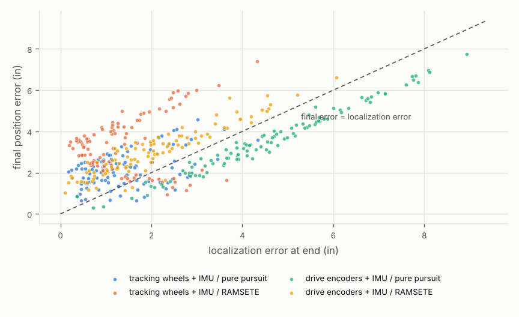

# Benchmarking algorithms

`vexsim bench` runs a scenario many times (seeds) for every combination of the localizers and controllers it lists. Controllers can be Python or your PROS C++ project. Trials run in parallel processes, and the results come out as CSVs plus a self-contained HTML report.

```
vexsim bench examples/scenarios/s_curve.yaml --seeds 100
```
| Output | Contents |
|---|---|
| `report.html` | settings, summary table, distribution charts, worst cases; opens in any browser, no internet needed |
| `trials.csv` | one row per trial: every metric, plus what was randomized (true start, battery charge, physics parameters) |
| `summary.csv` | per combination: success rate, timeouts, and mean / median / p95 / max of every metric |
| `charts/*.png` | the report's charts as images |
| `worst_<localizer>__<controller>.csv` | full telemetry of each combination's worst seed; watch it with `vexsim replay ROBOT.yaml worst_....csv` |

**Determinism.** Trials are deterministic: the same seed gives the same result in one process or many, on any run. Any row of `trials.csv` can be reproduced exactly from its seed.

**Options:** `--seeds N` and `--first-seed S` pick the seeds. `--workers` defaults to CPU cores - 1. `--localizers` and `--controllers` take comma-separated subsets of the scenario's lists. `--no-worst` skips the worst-case re-runs.

**Speed:** about 1 s of CPU per trial for the example. 400 trials take about 100 s on 4 cores.

## Example result: S-curve under a mid-path shove (100 seeds, 400 trials)
[`examples/scenarios/s_curve.yaml`](../examples/scenarios/s_curve.yaml): follow an S through four waypoints and get shoved sideways (25 N for 0.3 s) at 1.2 s. Each seed varies the robot's true start (σ 0.5 in, 1°; odometry believes it's exactly at the start), the battery charge (60–100%), and the omni roller friction (0.15–0.25).

| localizer / controller | success (≤ 2 in) | final error mean / p95 | localization error mean / p95 |
|---|---|---|---|
| tracking wheels + IMU / pure pursuit | **47%** | **2.13 / 3.70 in** | **1.40 / 2.87 in** |
| tracking wheels + IMU / RAMSETE | 17% | 3.39 / 5.87 in | 1.40 / 2.85 in |
| drive encoders + IMU / pure pursuit | 18% | 3.58 / 6.52 in | 4.56 / 7.76 in |
| drive encoders + IMU / RAMSETE | 18% | 3.07 / 5.12 in | 2.08 / 4.54 in |




**How to read this**
- **Drive encoders never see the shove.** Their points lie along the diagonal of the scatter: the robot believed it was on the path, so its final error *is* its localization error. The horizontal tracking wheel measures the sideways slide, which cuts localization error by more than half.
- **RAMSETE's misses are control misses.** With the same tracking wheels + IMU localization (1.40 in), RAMSETE ends 3.4 in off against pure pursuit's 2.1 in. Its points sit well above the diagonal: the robot knew where it was but didn't get there. RAMSETE follows a fixed schedule and reports done when the schedule ends, wherever the robot is: every trial completes at exactly 3.40 s. After the shove it has to catch up, and its catch-up speed is capped to stay within the omni rollers' sideways grip. Pure pursuit keeps chasing until it actually reaches the end. A good next experiment is to check how much of the gap that cap explains, by benchmarking RAMSETE with a higher `max_lateral_accel_in_s2` or a longer trajectory.
- **Nothing reaches 100%** within a strict 2 in tolerance after a shove and a start-placement error. The ~1.4 in floor of tracking-wheel localization comes largely from start placement: 1° of heading error grows to about 1.7 in across this roughly 100 in path.

Full report: [`benchmarks/s_curve_100/report.html`](benchmarks/s_curve_100/report.html). Download it and open it in a browser.

## Writing a scenario
```yaml
version: 1
name: Boomerang to a pose, 9 V vs 12 V         # shown in the report
description: ...
robot: ../robots/full_omni_6m.yaml             # relative to this file
field: ../fields/v5rc_empty.yaml               # optional
start: {x: 0, y: 0, heading: 0}                # inches, degrees CCW (field frame)
noise: default                                 # ideal | default | harsh for every sensor (optional)
battery_soc: 1.0
time_limit_s: 6                                # per trial; the controller is stopped after this
settle_window_s: 0.5                           # keep recording after the controller finishes
task: {type: move_to_pose, x: 30, y: 30, heading: 90}
disturbances:
  - {type: imu_bias_step, at_s: 1.0, deg_per_s: 0.5}
randomize:
  start_xy_in: 0.5                             # std. dev. of the true start vs. the believed one
  start_heading_deg: 1.0
  battery_soc: [0.6, 1.0]                      # uniform range per seed
  params:                                      # any robot override key, uniform range per seed
    wheel.omni.lateral_mu: [0.15, 0.25]
localizers: [tracking wheels + IMU]            # baseline names, "all", or file.py:factory
controllers:
  - {name: boomerang 9V, kind: boomerang}
  - {name: boomerang 12V, kind: boomerang, options: {max_volts: 12}}
```

**Fields and sensors.** A scenario's `field:` can be any field config, game elements included: the robot drives around obstacles and pushes pieces, and distance sensors see them. A robot with a GPS gets the `tracking wheels + IMU + GPS` baseline ([models.md](models.md#localization-baselines-vexsimalgorithmslocalization)), so GPS correction can be benchmarked against plain odometry.

**Tasks and their built-in controllers.** The first kind listed is the default. `options` are passed to the controller's constructor; see [programming.md](programming.md).

| `task.type` | Fields | Built-in `kind`s |
|---|---|---|
| `move_to_point` | `x, y, forwards, tolerance_in` (1.5) | `move_to_point` |
| `move_to_pose` | `x, y, heading, tolerance_in` (2), `heading_tolerance_deg` (3) | `boomerang` |
| `turn_to_heading` | `heading, heading_tolerance_deg` (2) | `turn_pid` |
| `drive` | `distance_in, tolerance_in` (1) | `profiled_trapezoid`, `profiled_scurve` |
| `follow` | `waypoints, tolerance_in` (2, at the end) | `pure_pursuit`, `ramsete` |

**Disturbances.** Times are from the start of the task.

| `type` | Fields | Effect |
|---|---|---|
| `push` | `at_s, duration_s, force_n: [fx, fy]` | external force at the CG, in the field frame (another robot shoving) |
| `imu_bias_step` | `at_s, deg_per_s, port` (optional) | the gyro bias jumps, as after a hard hit; calibration can't see it |
| `tracking_wheel_liftoff` | `at_s, duration_s, port` | a tracking wheel stops counting, e.g. over a field element |

## Your own algorithms
Point the scenario at a Python file and a factory function, relative to the scenario file:

```yaml
localizers: [tracking wheels + IMU, my_algos.py:make_ekf]
controllers:
  - {name: pure pursuit, kind: pure_pursuit}
  - {name: my follower, kind: my_algos.py:make_follower, options: {lookahead_in: 10}}
```

```python
# my_algos.py
from vexsim.algorithms.localization import Pose
from vexsim.algorithms.control.base import DriveCommand


def make_ekf(config):  # -> Localizer
    return MyEkf(config)  # needs .name, .reset(pose, frame), .update(frame) -> Pose


def make_follower(task, geometry, lookahead_in=12.0):  # -> Controller
    return MyFollower(task.waypoints, geometry, lookahead_in)  # .step(pose, frame, dt), .done()
```

**What your algorithms see.**
- A localizer receives the same `SensorFrame` PROS code would read (PROS units; see [conventions.md](conventions.md#sensor-readings)).
- A controller receives the localizer's pose estimate and returns a `DriveCommand` (volts, or wheel speed in in/s).
- Neither ever sees the true pose. That's what makes the comparison honest.

## C++ controllers: your PROS project
A controller can be a PROS project: its `autonomous()` gets the task, does its own localization, and is compared on the same seeds as the Python controllers.

```yaml
controllers:
  - {name: Python boomerang, kind: boomerang}
  - {name: LemLib moveToPose, kind: pros, project: ../pros_projects/lemlib_bench}
```
- **It runs like a match autonomous.** `vexsim bench` builds the project once, then runs `initialize()` and `autonomous()` in every trial.
- **The task comes from vexsim.** `vexsim::benchmark_task()` from `vexsim/sim.hpp` returns the type, the start pose its odometry should assume, the target, and for `follow` the reference path as a LemLib path file. Poses use the LemLib convention. Controller `options` arrive through `task.option(name, fallback)`.
- **Timing.** Completion is when `autonomous()` returns. Disturbances count from the start of `autonomous()`.
- **Localization is the code's own.** It shows as the localizer `robot code`, and its estimate is the pose the code reports (LemLib's is read automatically).

`examples/pros_projects/lemlib_bench` maps every task type to a LemLib motion, so it's a starting point for benchmarking your own LemLib settings:
```cpp
void autonomous() {
    vexsim::Task& task = vexsim::benchmark_task();
    chassis.setPose(task.start_x, task.start_y, task.start_theta);
    if (task.type == "move_to_pose")
        chassis.moveToPose(task.x, task.y, task.theta, task.timeout_ms);
    ...
    chassis.waitUntilDone();
}
```

**Example: LemLib's moveToPose against the Python boomerang** ([`examples/scenarios/lemlib_vs_python.yaml`](../examples/scenarios/lemlib_vs_python.yaml), 20 seeds). The task is the approach to (30, 30) facing 90°, on the example robot, with start placement error and varied roller friction:

| localizer / controller | success (≤ 2 in, 3°) | final error mean / p95 | completion time mean / p95 | localization error mean |
|---|---|---|---|---|
| tracking wheels + IMU / Python boomerang | 65% (4 timeouts) | 1.37 / 2.41 in | 2.87 / 6.01 s | 0.91 in |
| robot code / LemLib moveToPose | **95%** | **1.28 / 2.01 in** | 4.25 / 4.76 s | 0.92 in |

- **LemLib is slower but more reliable.** With its example gains it takes about 1.4 s longer, but it never timed out.
- **Its odometry is as good as vexsim's.** LemLib's tracking-wheel odometry matches the Python baseline's error almost exactly. The difference between the two rows is control, not localization.

## Metrics
| Column | Meaning |
|---|---|
| `success` | finished within tolerance (and heading tolerance) before the time limit |
| `timed_out` | the controller never reported done |
| `final_error_in`, `final_heading_error_deg` | true end pose against the target |
| `completion_time_s` | when the controller reported done |
| `settle_time_s` | from when the true pose stayed within tolerance to the end; empty if it never did |
| `overshoot_in` | point-like tasks: the furthest the robot went past the target along the approach |
| `path_rms_in`, `path_max_in` | follow tasks: true path's distance to the reference spline |
| `loc_error_final_in`, `loc_error_max_in` | the localizer's estimate against the truth |
| `loc_error_per_100in` | final localization error per 100 in driven |
| `energy_j`, `peak_motor_temp_c` | battery energy used; the hottest motor |
| `wall_contacts` | how many times the robot ran into a field wall during the trial; the HTML report shows its mean when any trial touched a wall |

**Drivetrains:** the built-in Python controllers drive the `left` and `right` sides, so they work on differential drives and H-drives. To benchmark an X-drive or mecanum robot, use a PROS project controller (`kind: pros`), which drives whatever motors its code drives, or your own Python controller (`file.py:factory`).
