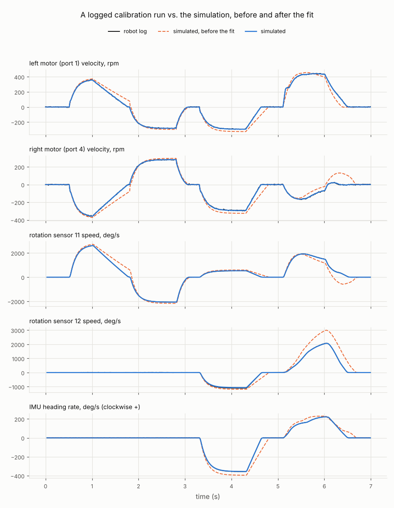

# Calibrating the simulator to your robot

Most of the physics parameters are estimates: how well your wheels grip the tiles, how freely the omni rollers turn, how much rolling resistance slows a coasting robot. They differ from robot to robot and from field to field. Calibration measures them on your robot, with no extra equipment:

1. **Generate** a short drive routine for your robot.
2. **Run** it on the real robot, which logs everything its sensors measure.
3. **Fit**: vexsim replays the log in the simulator and adjusts the parameters until the simulated sensors read what the real ones did.



The black line is the robot's log. Orange dashed is the simulation with the default parameters; blue is the fitted simulation, on top of the log.

## 1. Add the routine to a PROS project
```
vexsim calibration-routine ROBOT.yaml MY_PROS_PROJECT
```
This writes four files into the project:
- `include/vexsim_calibration.hpp`
- `src/vexsim_calibration.cpp`, which holds your robot's ports and the routine's voltages
- `include/vexsim_log.hpp` and `src/vexsim_log.cpp`: vexsim's logger, which the routine logs with (the same two files `vexsim logger add` copies into any project)

Call `vexsim_calibration::run()` from `autonomous()`, or from `opcontrol()` on a button press:
```cpp
#include "vexsim_calibration.hpp"

void autonomous() { vexsim_calibration::run(); }
```
The files use only the PROS 4 C API, so they build with the normal PROS toolchain. They also run unchanged in vexsim, so you can try the whole process before touching the robot (see [Trying it in the simulator](#trying-it-in-the-simulator)). Regenerate them whenever the robot config changes.

## 2. Run it on the robot
The routine first calibrates the IMU, so keep the robot still. Then it drives, with fixed motor voltages and no feedback, for about 7 s (9 s for drivetrains that strafe):

| Step | Measures |
|---|---|
| launch from rest | traction limit and motor torque |
| coast | rolling resistance |
| reverse, then brake | back-EMF braking |
| strafe out and back (X-drive, mecanum, H-drive) | roller resistance |
| spin in place | roller friction and scrub |
| fast arc, then coast | sideways sliding (drift) |

**Before you run it:**
- The straight maneuvers run at about 47 in/s whatever the gearing, and the robot stays within about 4 ft of where it starts. Start in the middle of a field (or 3 x 3 m of open floor), facing the longer free direction.
- The fit assumes the robot touches nothing but the floor. If it hits something, run it again.
- Use the tiles you compete on, and a charged battery.

**Getting the log:** the routine logs with vexsim's logger (`vexsim_log.hpp`, which `calibration-routine` adds to the project with it).
- **With a microSD card** in the brain, the log is saved to `vexsim_0001_calibration.csv`, then `vexsim_0002_calibration.csv` and so on: each run gets the next number (`vexsim_count.txt` on the card keeps it).
- **Without one**, it is printed to the terminal between `#vexsim-log begin` and `#vexsim-log end` lines. Capture it with `pros terminal > run.txt` over USB; a wireless connection is too slow for this.

`vexsim calibrate` accepts either file as it is.

## 3. Fit
```
vexsim calibrate ROBOT.yaml vexsim_0001_calibration.csv --out calibration
```
```
Robot log: 700 rows (7.0 s): 6 motors, 2 rotation sensors, 1 IMU
  timing: the log's readings are 10 ms old
  ...
parameter                           before      after  uncertainty
wheel.omni.longitudinal_mu             0.9     0.7527  +/-0.066%
wheel.omni.lateral_mu                  0.2      0.278  +/-0.027%
wheel.omni.rolling_resistance          0.1     0.1397  +/-0.03%
battery.internal_resistance_ohm                  0.15  from battery voltage vs. current

RMS difference, simulated vs. logged (28 replays):
  motor velocity (rpm): 40.9 -> 3.01
  motor current (A): 0.108 -> 0.00234
  tracking wheels (deg/s): 292 -> 10.5
  heading rate (deg/s): 28.7 -> 0.787

Add to the robot config:
overrides:
  wheel.omni.longitudinal_mu: 0.7527
  ...
```
(That log came from the simulator itself with known parameters: 0.75, 0.28, 0.14 and 0.15 Ω.) Paste the `overrides:` block into your robot YAML; `--out` also saves it as `overrides.yaml`, with the plot (`calibration.png`) and the fitted replay (`simulated.csv`). A fit takes about half a minute; `--workers` sets how many replays run in parallel.

**What it fits.** By default, the wheel parameters for every wheel type on the robot:

| Wheel type | Parameters |
|---|---|
| omni | `longitudinal_mu`, `lateral_mu`, `rolling_resistance` |
| traction | `mu`, `rolling_resistance` |
| mecanum | `grip_mu`, `roller_mu`, `rolling_resistance` |

`--fit` takes any comma-separated list of physics parameters instead (`vexsim validate-config` lists them), e.g. `--fit motor.free_current_a,wheel.omni.rolling_resistance`. The battery's internal resistance is read straight off the log: it is the slope of the battery's voltage against its current.

**Reading the result.**
- The uncertainty is statistical: how sharply the log pins each value down. A parameter marked "poorly determined by this log" hardly changed what the sensors read. For example, `lateral_mu` needs a horizontal tracking wheel or an IMU to show the drift.
- Compare the RMS differences after the fit with the sensors' own noise: a few rpm for motors, around 10 deg/s for tracking wheels, about 1 deg/s for the IMU. A much larger leftover means something the model doesn't capture: the robot touched something, a wheel slipped on a tile seam, or the robot config is off (mass, wheel diameters, ports). Check the plot.

## Checking the model on another run
A fit can match the run it was fitted to and still be wrong. Check it on a different run:
```
vexsim calibrate ROBOT.yaml another_run.csv --fit none
```
This replays the log with the robot config's current parameters and prints the RMS differences, with no fitting. The tests do exactly this with simulated "real" robots (`tests/test_calibration.py`). The fitted model must reproduce a run it never saw within 3° of total turn and about 0.2 in of tracking-wheel travel.

Any program can make such a log with vexsim's logger: `vexsim logger add MY_PROS_PROJECT` copies it in, then `vexsim_log::start("name")` begins a log and `vexsim_log::stop()` saves it (the README's [vexsim's logger](../README.md#vexsims-logger) has the rest). It samples every 10 ms in its own task. It doesn't know what your code commanded (unless the code tells it, with `vexsim_log::command`), so the replay drives each motor with the voltage the motor reported (see [How the replay works](#how-the-replay-works)).

To compare a program's simulated run with its real one, log the simulated run too: run it with a folder standing in for the SD card, and its own logger writes the same file there,
```
vexsim run ROBOT.yaml --program MY_PROS_PROJECT --headless --sd sim_card
```
or have the simulator record what the robot's sensors read, whatever the program does: `--robot-log sim_run.csv`.

## Trying it in the simulator
`examples/pros_projects/calibration` is the routine for `examples/robots/full_omni_6m.yaml`:
```
vexsim run examples/robots/full_omni_6m.yaml --program examples/pros_projects/calibration --headless > run.txt
vexsim calibrate examples/robots/full_omni_6m.yaml run.txt
```
Here the "robot" is the simulator with its default parameters, so the fit leaves them about where they are. To see it find different values, add overrides to a copy of the robot config before `vexsim run`, then calibrate with the original.

## The log format
CSV, one row every 10 ms, written the same way by the robot (vexsim's logger, `vexsim_log.cpp`) and by the simulator (`--robot-log`). Readings are raw, as PROS reports them for a positive port: a motor on a negative config port reads backwards, and a rotation sensor reads as if it weren't reversed.

This is format 2. Before the header, `# key: value` lines say what the log is:
```
# vexsim-log: 2
# name: Left 40
# started_ms: 2350
# mode: autonomous
# battery_pct: 98
# devices: 1 motor, 2 motor, 10 imu, 13 distance
# robot: 1239E 2026-27
time_ms,battery_mv,battery_ma,m1_cmd_mv,...
0,12620,410,...
#mark,500,intake on
```
`name` is the one `vexsim_log::start` was given, `started_ms` the brain's clock then, `mode` the competition mode it started in, `devices` what the logger found on each port; `vexsim_log::info` adds the rest. Among the rows, `#mark,<time_ms>,<text>` lines are the code's marks (`vexsim_log::mark`) and the competition mode's changes (`mode: disabled`). Format 1, the calibration routine's before the logger, is only the header and rows, with `d<p>_mm` alone for a distance sensor; it still reads.

Motors come first, every one of them (the drive's and the mechanisms'), then the other devices, each by port:

| Column | Meaning |
|---|---|
| `time_ms` | since the log started |
| `battery_mv`, `battery_ma` | `pros::battery` |
| `m<p>_cmd_mv` | the voltage command the code gave, raw direction; 0 = stopped with the brake mode; empty if unknown |
| `m<p>_cmd_rpm` | velocity command (`move_velocity`); empty if unknown |
| `m<p>_brake` | brake mode: 0 coast, 1 brake, 2 hold |
| `m<p>_deg`, `m<p>_rpm`, `m<p>_ma`, `m<p>_mv`, `m<p>_temp` | position (degrees, whatever encoder units the code set), actual velocity, current, voltage, temperature |
| `r<p>_cdeg` | rotation sensor position (centidegrees) |
| `imu<p>_deg` | IMU rotation (degrees, clockwise) |
| `d<p>_mm`, `d<p>_conf`, `d<p>_size` | distance sensor (empty when nothing is in range), its confidence (0 to 63) and the object's size (0 to 400) |
| `gps<p>_x_m`, `gps<p>_y_m`, `gps<p>_heading_deg`, `gps<p>_error_m` | GPS |
| `pose_<name>_x_in`, `pose_<name>_y_in`, `pose_<name>_theta_deg` | a pose the code logged (`vexsim_log::pose`), as LemLib has them: inches, and degrees clockwise from +y |
| `val_<name>` | a number the code logged (`vexsim_log::value`) |

## How the replay works
`vexsim/calibration/replay.py` gives the simulated robot the log's motor commands at the log's times and reads its sensors every millisecond. It differs from a normal simulation in four ways:
- **No sensor errors.** Sensors read without noise or per-device errors, which the model can't know for your particular robot.
- **Reading age.** A reading is a few ms old by the time robot code sees it: the sensor's latency, plus however long ago its last 10 ms update was. That depends on the phase between the logger's loop and the sensor, and it stays the same through a run. The replay finds it from the motor currents, which jump the moment a command changes, and compares each row with the state that long before.
- **Battery.** The motors see the battery voltage the log recorded, so battery modeling errors stay out of the fit.
- **Motors without logged commands** are driven with their logged voltage. That voltage is itself a reading, so it is applied a little early; the replay tries leads from 0 to 25 ms and keeps the one that fits. (A motor that was never driven, such as a mechanism the calibration program leaves alone, needs no commands.)
- **Measured device errors.** An IMU with a `scale_error` in the robot config reads with it, as the real one does; other sensors read as if ideal.
- **Lifted.** A free spin is replayed with the robot on its side (`lifted`): no ground force, so the wheels spin free and only the motors and gears load them.

The robot starts at rest on an endless floor, its IMU calibrated, so start every log with the robot at rest and away from walls. The fit's replays leave the distance sensors out (it doesn't compare them), which makes them faster.

The fit itself (`vexsim/calibration/fit.py`) is Levenberg-Marquardt over the logarithms of the parameters, so values stay positive and steps are relative. Each step costs one replay per parameter, for a finite-difference Jacobian.

What it compares:
- motor velocity and current for every drive motor;
- tracking-wheel speed and IMU heading rate, each over 30 ms windows.

Rates rather than positions keep the drift every open-loop replay accumulates from swamping the comparison. Each group (motor velocity, current, tracking wheels, heading rate) gets equal weight, however many sensors it has.

## A calibration session: the plan and the program
The routine above needs open floor and fits everything from one run. A session (phase 14) tests each part of the robot on its own, on a field with the season's elements in place, from a program of its own in a spare slot, so calibrating never touches the competition code:
```
vexsim calibration plan ROBOT.yaml FIELD.yaml --out plan
vexsim calibration program ROBOT.yaml FIELD.yaml vexsim_calibration   # in a project made with pros c n
```
`program` plans too (into `vexsim_calibration/plan/`), then writes the program. Put it on the robot with `pros upload --slot 8` and run it from the brain's screen; no competition switch is needed. Then collect its logs and fit them ([Collecting and fitting a session](#collecting-and-fitting-a-session)).

### The plan
`vexsim/calibration/plan.py` finds where each test that moves the robot fits:

- **Driving tests** (`routine.drive_tests`): the routine's maneuvers, each from rest on a spot of its own and ending braked. *Straight*: launch, coast, reverse, brake. *Spin*: turn in place, coast, brake. *Arc*: a fast arc, coast, brake. *Strafe* (drives that can): out and back. Each runs three times.
- **The spread.** The robot isn't calibrated yet, so each test is simulated in five variants of it: as configured; rolling further (rolling resistance x0.6, roller friction x0.7, grip x1.2, motors 10% faster, 15% lighter); stopping sooner (rolling resistance x1.5, grip x0.7, motors 10% slower, 20% heavier); sliding more (roller friction x0.5, grip x0.6); gripping more (roller friction x1.6, grip x1.4).
- **The room.** The robot's shape, swept along every variant's path, must stay `--margin` (6 in) clear of the walls and of every element, those a robot can drive over (`solid: false`) included: a log needs flat tiles. Game pieces are left out; clear them off the field first.
- **The search.** Starts on a 0.5 in grid over the field, headings every 15 degrees: for each heading, an FFT correlates the swept area with the cells too near a wall or element. Square headings win if any fits; then the spot with the most room, in the middle of it. A test with no room is tried at 85%, 70% and 55% of its speed and drive time; below that, the plan names what's in the way at its closest try, and the test is left out.
- **The push lane:** the longest of 96, 84 and 72 in that fits (3 in clear: it's pushed by hand), with tape lines where the robot's front edge starts and ends.
- **Spins in place** (they turn by the IMU, so only with one): the slow spin, 5 turns (robots with tracking wheels), and up to 3 spots for the distance sweep, one turn each (robots with distance sensors), picked one at a time to see the walls and elements at distances, in 100 mm steps, the others don't.
- **The envelope:** each driving test's most motor travel and IMU turn over the variants, times 1.15, plus 20 and 15 degrees. The program stops a run that would leave it.

Each spot is given as distances from two walls, to the half inch (the plan's pose is the one those numbers give): square to the walls, two of the robot's sides, each from the nearer wall unless only the farther one's tape line misses the elements; otherwise two of its corners. `--out` writes `plan.txt`, `plan.yaml` (each spot, its steps, scale and envelope) and a map of each (with matplotlib): the field, the robot on its spot, every variant's path, what they cover and the margin, the measurements and the push lane's tape lines. Maps are numbered as the program's menu numbers its tests.

### The program
`vexsim calibration program` writes into the project:

| File | |
|---|---|
| `src/main.cpp` | the program, the same for every robot (`vexsim/bridge/cpp/calibration/main.cpp`) |
| `include/vexsim_calibration_tests.hpp` | the robot's devices and the plan's tests: drive motors and their groups, every device's port and type, which way tracking wheels count, where each distance sensor is, each driving test's steps (raw millivolts per motor), spot and envelope |
| `include/vexsim_log.hpp`, `src/vexsim_log.cpp` | vexsim's logger |
| `include/main.h` | PROS's, if the project has none |

It writes only into an empty folder, a new PROS project (whose `main.cpp` is PROS's template) or its own; a project with code of its own is refused, and `--force` writes over a `main.cpp` that isn't the program's. It uses only the PROS 4 C API and the logger, so it builds with PROS and runs unchanged in vexsim.

The brain's screen shows the robot, the battery, the hottest drive motor, whether there's a card and how many logs are saved, then the tests in order with how many runs each has done; the controller shows the same in short. UP and DOWN choose, A starts. Each test says what to do on both screens.

| # | Test | The student | Logs |
|---|---|---|---|
| 1 | Device check | lays the robot on its side, says which way each group of wheels spun (A forward, B backward, X didn't); stands it up, turns it a quarter turn left, pushes it forward and left (tracking wheels), covers each distance sensor with a hand | `device_check` |
| 2 | Free spin | lays it on its side: the wheels run at 3, 6, 9 and 12 V for 1.5 s each, brake, then at 50% and 100% in velocity mode | `free_spin` |
| 3 | IMU, still for 60 s | puts it down flat and leaves it; the IMU calibrates first | `imu_still` |
| 4 | IMU, 10 turns by hand each way | lines it up on a tape line, turns it 10 times, lines it up again | `imu_turns_left`, `imu_turns_right` |
| 5 | Push, each way | puts its front edge on the lane's start line and pushes it to the end line, motors coasting; then back | `push_forward`, `push_back` |
| 6.. | Driving tests, 3 runs each | puts it on the test's spot | `straight`, `spin`, `arc`, `strafe` |
| | Slow spin, distance sweeps | puts it on the spot: it turns by the IMU, 5 turns at 120 deg/s, or one at 60 | `slow_spin`, `sweep_1`... |
| | Drive mode | drives it between spots: tank, half speed, sideways with the sticks' x if the drive can; B goes back | (none) |

**The device check:**
- On its side, each group's motors run forward at 3 V, as the config says. If they all turn together, the student says which way the wheels spun ("forward: the top of each wheel moves toward the robot's front", or the way that group's wheels roll); all backward means every motor in the group is reversed in the config. If they don't turn together (one fights the others), each motor runs alone, and a motor that turns the wheels backward is named, with its port as the config should have it ("motor 9 runs backward: make it -9").
- Flat again: the IMU calibrates, then the robot is turned a quarter turn left by hand (an IMU that reads it backward, or not at all, is named); tracking wheels must count the way their `heading_deg` and `reversed` say when it's pushed forward and left.
- Distance sensors: with nothing within a foot, each is covered by hand in turn, by where the config says it is ("the front left, facing forward"); whichever reads under 100 mm is the one at that spot. A sensor on the wrong port, or two swapped ("ports 1 and 8 are swapped"), is named.
- The results are the log's `check` (passed or failed) and `check_<group>`, `check_imu`, `check_tracking` and `check_distance` lines, and the screen lists what to fix.

**Safety:**
- Before each test: every device in the config answers on its port as its type (`get_plugged_type`); the battery is at 80% or more (below, it asks first); no drive motor is over 45 °C.
- A test that turns the wheels waits for the robot to be still (no wheel turning, the IMU steady, for half a second), then counts down from 3 with a rumble each second. A button or stick then cancels it.
- While it runs, any button or a stick past 20% stops every motor at once (braking, within 10 ms). So does leaving the envelope: a run stops when a drive motor's distance from where it started, plus how far it would turn braking from its speed (at 4000 deg/s², on the safe side) if it's moving away, passes the plan's travel; or when the IMU has turned further than the plan's. A spin in place stops at its turns, or if its wheels turn far more than the robot does, or it takes twice as long as it should.
- A stopped run's log is kept, its `ended` line saying why ("stopped: a button or stick", "stopped: went further than planned"); it doesn't count toward the test's runs.

**After each run** the screen says how long it took, the wheels' top speed and the total turn, and warns: wheels that lost 20 in/s within 100 ms while coasting or driving the way they turn (did it hit something?), a drive motor over 50 °C, the battery under 10.8 V, the robot moving while the IMU calibrated (the wheels turned). The IMU turns show how much more or less the IMU read than the 3600 degrees it turned (more than 5% off: not 10 turns, so it doesn't count); the push, how far the wheels say it went.

**Its logs** start with `# key: value` lines: `robot`, `field`, `program` (`vexsim calibration`), `test`, `run`, `ended`, and as they apply `spot` (x, y and heading of where it started, field inches and degrees counter-clockwise from +x), `scale`, `direction`, `turns`, `length_in`, `warning`. Each step is a mark (`launch`, `coast`, `12 V`, `velocity 50%`, `spin left`, `answer: forward`, `stopped: ...`). The program samples them itself, right after each step's command (`Sampling::manual`), as the routine does; while it waits on the student mid-test, every 10 to 50 ms.

**On the terminal**, each step is also a `#vexsim-cal` line: `menu KEY` (the menu, at KEY), `ask WHAT` (waiting for the student: `side`, `flat`, `place KEY`, `forward`, `turn left|right DEG`, `push forward|left IN`, `lane forward|back IN`, `cover PORT`, `uncover`, `open`, `still`, `line`, `ready`, `next`, `done passed|failed`, `battery PCT`, `hot PORT`, `device PORT`), `countdown`, `spin group NAME` or `spin motor PORT`, `log NAME TEST RUN`, `stopped WHY`, `saved HOW`, `problem TEXT`, `imu calibrating`, `imu ready`, `drive`.

### Trying it in vexsim
The program runs unchanged in vexsim, from its menu: `vexsim run ROBOT.yaml --program vexsim_calibration --mode driver --field FIELD.yaml --sd sd`, driven from the app's controller. `vexsim/calibration/student.py` plays the student instead, by those terminal lines: it presses the buttons, lays the robot on its side (`Robot.lifted`: the wheels spin free, nothing moves the robot) and stands it up, puts it on each spot (`Robot.place`), pushes and turns it by hand (a spring and damper on its pose), says which way the wheels it watched spun, and covers a distance sensor (`DistanceDevice.blocked_mm`: it reads 30 mm). It knows the config the program was made for, so it covers the sensor that config says is at a spot, on whichever robot is simulated: a "real" robot with its wiring changed shows what the device check catches.
```python
from vexsim.bridge.build import build_project
from vexsim.bridge.program import CppProgram
from vexsim.calibration.plan import make_plan
from vexsim.calibration.program import write_program
from vexsim.calibration.student import Student
from vexsim.config import load_field, load_robot
from vexsim.runtime.simulation import Simulation


def main():
    config, field = load_robot("robot.yaml"), load_field("field.yaml")
    plan = make_plan(config, field)  # in worker processes: hence main(), below
    write_program(config, plan, "calibration_program")
    built = build_project("calibration_program")
    student = Student(plan, config, ["device_check", "free_spin", "straight"])
    sim = Simulation(config, program=CppProgram(built.executable, env={"VEXSIM_SD_DIR": "/abs/sd"}),
                     field=field, input_source=student, start=student.start)
    student.attach(sim)
    sim.start("driver")
    sim.run_until_finished(900)  # the logs are in /abs/sd; student.runs has each run's true path


if __name__ == "__main__":  # worker processes import this file: only the first runs main()
    main()
```
The student holds the robot firmly at the end of each move, as a person lines it up on the tape (otherwise friction would leave it a couple of degrees short of 10 turns).
On 1239E's robot and field, the whole session (every test, 18 logs) takes 4.6 minutes of simulated time, about a minute and a half to run.

## Collecting and fitting a session
After the session, the logs come off the card and into a session folder, and vexsim fits them, test by test:
```
vexsim calibration collect SESSION --from-card
vexsim calibrate ROBOT.yaml SESSION --field FIELD.yaml
vexsim calibrate ROBOT.yaml SESSION --field FIELD.yaml --apply
```

### Collecting
`collect` copies the program's logs that the session doesn't have yet into `SESSION/runs/` (the same log twice is copied once; two different logs with one name are both kept, the second as `vexsim_0007_spin.2.csv`), and lists each run in `SESSION/session.yaml`: its file, test, run, when it started, how it ended, its quality, whether the fit uses it (`use`), and its warnings. Where the logs come from:
- `--from-card` finds the brain's card in this computer: the drive (`D:` to `Z:`) on Windows, under `/Volumes` on macOS, `/media` or `/run/media` on Linux, with `vexsim_NNNN_*.csv` logs at its root; with several, the one written last.
- `--from FOLDER` takes them from a folder (a copy of the card).
- `--usb` runs `pros terminal` (`--command` for another) and saves each log the program prints with no card in the brain, between `#vexsim-log begin` and `#vexsim-log end`, as it arrives, until Ctrl+C.

Each run is checked: it must be the calibration program's (`program: vexsim calibration`) and the session's robot's (the first log names it). A run that was stopped or didn't finish, a device check that failed, IMU turns more than 5% from 10 turns, and a run that "slowed suddenly" (did it hit something?) get `use: false`, their quality saying why. `use: false` is the students' to set too, to leave a run out.

### Fitting
`vexsim calibrate ROBOT.yaml SESSION` fits each test into what it measures, in an order where each fit uses the values the ones before found (`vexsim/calibration/session_fit.py`). `--workers` sets how many replays run at once (the CPUs, up to 8); a session takes under 3 minutes on 4.

| Step | From | Sets |
|---|---|---|
| Device check | the last device check | nothing: if it failed, the fit stops and lists what to fix |
| Free spin | the free spin, replayed with the robot lifted | `motor.voltage_cap` (whether voltage commands are held to rated speed), `motor.natural_free_rpm`, `free_current_a`, `coulomb_fraction`, `velocity_kp`; `sensor.motor.velocity_noise` |
| IMU | the 10 turns each way; the still log | the IMU's `scale_error`; `sensor.imu.heading_noise_deg`, `rate_noise_deg_s`, `bias_walk_deg_s` |
| Push | the push each way, replayed | each drive group's wheels' `diameter_in`; a tracking wheel's that rolls along |
| Slow spin | the slow spin, against its replay | each tracking wheel's `pos_in`, across its wheel |
| Drive | every driving run but the last, at once | the wheels' friction and rolling resistance (`wheel.omni.longitudinal_mu`, `lateral_mu`, `rolling_resistance`, or the traction or mecanum ones); `battery.internal_resistance_ohm` |
| Again | | the push, the slow spin and the drive, with the friction found |
| Distance sweeps | the sweeps, against what each sensor should have read | `sensor.distance.long_noise_fraction` (and `short_noise_mm`, with readings under 200 mm), `max_range_mm`, `glancing_miss`, `glancing_deg`, `glancing_mm`, `confidence_per_m`, `confidence_per_deg` |
| Drive model | the driving runs, as logged | kS, kV, kA, kT for the robot's routes (the printed `drive:` line) |

How each works:
- **Free spin.** Whether voltage mode is capped comes first, from the steady speeds: a free V5 motor runs about 34% faster at 12 V than at 9 V, past its rated speed; a capped one stops at rated speed (under 1.25 times its 9 V speed). Then the four motor values are fitted to the log, replayed with the robot on its side (`lifted`: nothing but the motors and gears load them). `velocity_ki` isn't: a free spin can't tell it. The speed readings' spread while each voltage holds is their noise.
- **IMU.** The scale error is the turns' reading over 3600 degrees, less 1, averaged over both ways. The noise comes from the still log's Allan variance: a reading's own noise falls as 1/τ², the rate's white noise as 1/τ, a wandering bias grows as τ; 60 s pins down the first, hardly the others (the report says so, and `--apply` leaves them).
- **Push.** The push is replayed: the simulated robot, motors coasting, pushed along the lane by a hand as fast at each moment as the log's wheels say the real one went, until its wheels turn as far as the real ones did. A plain ratio of the lane's length to the wheels' travel would be off by how much coasting wheels creep (about 2% on 1239E), which depends on the friction: hence the second round, with the friction the drive found.
- **Slow spin.** A tracking wheel rolls, per radian the robot turns, as far as it is from the center of the turn, across its wheel; the IMU says how far the robot turned (its scale error taken out). The replayed spin, with the wheel where the config says, rolls the same way about wherever the robot really turns about: the difference moves the wheel. A sideways wheel's diameter can't be measured by the push, so its position takes the config's diameter.
- **Drive.** All the driving runs but the last are fitted at once (`fit.fit_logs`: each run its own replay and timing, each weighing the same). The last run, which the fit never saw, is replayed with what it found: it **matches** if each group of readings is within 1.5 times what the sensors' noise alone leaves. That floor is measured for the run itself: its commands simulated with each sensor's noise (as the config has it, without per-device errors) against the replay without any. So it counts everything the sensor models do, a tracking wheel's scrub as it rolls included; motor current, which vexsim doesn't make noisy, gets 0.1 A.
- **Distance sweeps.** For each reading, what the sensor should have read: a ray from where the config puts it, the robot on the sweep's spot (its `spot` line) turned as the IMU says, to the walls and elements (as the sensor's height sees them; game pieces are left out, as the students cleared them). How much older the readings are than the IMU's is found too, as the age that fits best. Then:
  - *noise*: from each new reading against its neighbours (the second difference, which a slowly turning beam hardly curves), over beams within 40 degrees of square;
  - *range*: beams within 30 degrees of square come back out to here, and no further;
  - *misses*: the angle and distance past which beams miss, by likelihood over a grid, and how often, from the beams well inside that (where a small error in the robot's pose can't move a beam across the edge);
  - *confidence*: least squares of 63 less it, on how far past 0.2 m and how far off square.
  A sensor that reads more than 8% off what it should, near square, is named: its `pos_in` or `heading_deg` is likely wrong.

### Pinned down, and what --apply writes
Every value has an uncertainty (one standard deviation: from the fit's Jacobian, the runs' spread, or how many readings told) and a tolerance; the logs **pin it down** when the uncertainty is within the tolerance:

| Value | Tolerance |
|---|---|
| wheel diameters (drive and tracking) | 0.5% |
| IMU `scale_error` | 0.0005 (1.8 degrees in 10 turns) |
| tracking wheel `pos_in` | 0.1 in |
| `motor.natural_free_rpm` | 1% |
| `motor.free_current_a`, `coulomb_fraction`, `velocity_kp`, `battery.internal_resistance_ohm` | 10% |
| wheel friction and rolling resistance | 5% |
| `motor.voltage_cap` | 0.02 |
| IMU noise: heading, rate, bias walk | 20%, 25%, 50% |
| distance: `long_noise_fraction`, `short_noise_mm`; `confidence_per_m`, `confidence_per_deg` | 20%, 25%; 15% |
| distance: `max_range_mm`, `glancing_miss`, `glancing_deg`, `glancing_mm` | 100 mm, 0.1, 5 degrees, 250 mm |

`--apply` writes what the logs pin down and differs from the config's by more than half its tolerance, into the robot YAML in place (`vexsim/app/yamledit.py`): wheel diameters into each wheel, the IMU's scale error and the tracking wheels' fields into their sensors, the rest under `overrides` (a new `overrides:` section at the end if there's none). Every comment stays, and a comment at the top names the session (`# Calibrated from session SESSION on DATE`, replacing an earlier one). If the result isn't a valid config, the file is left as it was.

### The report
`SESSION/report/`:
- `report.md`: whether the held-out run matches, the warnings, what `--apply` writes, the drive model's `drive:` line, then each step: its runs, a table of each value (before, after, how well it's known, pinned or not, and why one isn't written), the RMS difference of simulated against logged before and after, its notes and warnings.
- `changes.yaml`: what `--apply` writes, by where it goes (`overrides["motor.voltage_cap"]`, `drivetrain.wheels[0].diameter_in`, `sensors[6].scale_error`), and the drive line.
- with matplotlib: `free_spin.png` (the free spin against its replay, before and after), `held_out.png` (the held-out run against its replay) and `distance.png` (each sensor's readings against what it should have read, the misses marked).

### How well it works
The tests (`tests/test_calibration_sessions.py`, `pytest -m session`; CI runs them in a job of their own) run the program in vexsim on "real" robots that differ from their configs in ways the fit isn't told: wheels 3.20 in (the config says 3.25), an IMU further off than the config says, omni friction 0.75 (vexsim's default is 0.9), roller friction 0.25, rolling resistance 0.13, voltage commands held to rated speed, and the real distance sensors (0.3% noise, 2300 mm range, 90% of beams lost past 45 degrees and 1500 mm, confidence falling 8 per meter and 0.25 per degree). The student runs the whole session, `collect` takes the card, `calibrate` fits it:

| | 1239E (no tracking wheels, 5 distance sensors) | `full_omni_6m` (two tracking wheels) | truth |
|---|---|---|---|
| wheel diameter | 3.2001 in | 3.2082 in | 3.20, 3.21 in |
| IMU scale error | 0.00502 | 0.00398 | 0.0050, 0.0040 |
| voltage cap | 1 | 1 | 1 |
| longitudinal, lateral, rolling | 0.746, 0.250, 0.130 | 0.750, 0.250, 0.130 | 0.75, 0.25, 0.13 |
| tracking wheels | | 2.0444 in; y −1.759 in; x −3.322 in | as built: 2.0444; −1.759; −3.321 |
| distance noise, range | 0.32%, 2290 mm | 0.32%, 2290 mm | 0.3%, 2300 mm |
| glancing misses | 85% past 45° and 1500 mm | 88% past 45° and 1500 mm | 90%, 45°, 1500 mm |
| confidence per m, per degree | 8.01, 0.242 | 8.23, 0.245 | 8, 0.25 |
| held-out run (motor speed; IMU rate) | 2.97 rpm (noise 2.85); 0.45 deg/s (0.50) | 3.00 rpm (3.05); 0.52 deg/s (0.46) | |

The motors (121 rpm, 0.15 A, 0.3, kp 2) and the battery (0.1 Ω) come back as vexsim's own, as they should, so `--apply` leaves them. Each fit takes under 3 minutes on 4 CPUs. A robot whose motor 9 runs backward and whose distance sensors on ports 1 and 8 are swapped stops at the device check, the error naming both.

## The autonomous check
The last test of a session is the team's own autonomous: does the calibrated simulator drive it as the real robot does? The competition program, with vexsim's logger in it (`vexsim logger add`, and `vexsim_log::start` in `autonomous()`; 1239E's code does this already), runs a routine on the real robot with a card in. Then:

1. **Before touching the robot**, put tape on the floor at two of its corners: front-left and back-right (the two furthest apart). Measure each mark from two walls: from the wall across the field's x (the `-x` or `+x` wall, as the plan's maps name them) and from one across its y.
2. **Check it** against the simulator:
```
vexsim calibration check-auton ROBOT.yaml vexsim_0007_left_40.csv --program MY_PROJECT --field FIELD.yaml --end "front-left: 23.5 from -x, 40 from +y; back-right: 35.25 from -x, 52 from +y"
```
The measurements read however they're written: `FL -x 23.5 +y 40, BR -x 35.25 +y 52` works too, and fractions (`23 1/2`). Several runs of one routine: give each log, and an `--end` for each, in order.

`vexsim/calibration/auton.py` works out where the robot ended from the two marks and the robot's shape (the corners are its outline's furthest front-left, front-right, back-left and back-right; marks further apart, or nearer, than those corners are by more than an inch get a warning). It finds the routine the log is of (the log's name without spaces and case: `Left 40` is `left40()`; or `--routine`), and runs it in vexsim from the routine's `setPose` (the log's first pose, as `--follow` takes it), with `--seeds` seeds (3), in parallel. The game pieces stay on the field (the routine moves them). Each simulated run goes on after the period ends until the robot is still, as the real one was when it was measured: on 1239E's Left 40 the robot still moves 8 in after the buzzer.

It **passes** when:
- the real end is within the pass marks of where the simulated runs ended (their mean), as a distance and as a heading; and
- through the run, the code's own pose (its first logged pose, LemLib's on 1239E), real against simulated, is on average (RMS, time from the routine's `setPose`, the mean over the seeds) within the distance mark.

The run is in the verdict because the end alone can't tell a calibrated simulator from an uncalibrated one on a routine whose motions and localization correct the robot's errors by its end. That was true of 1239E's Left 40 (below). With several real runs, their ends' mean and their RMS's mean are what's judged; each run is in the report, with the spread of the real ends against the simulated ones'.

**The pass marks** are 2 in and 2 degrees, unless the team sets its own in `.vexsim/calibration.yaml` (in the folder vexsim runs in, or the nearest one above it that has one):
```yaml
max_distance_in: 2
max_heading_deg: 4
```
or with `--max-distance` and `--max-heading`. Marks finer than a tape measure tells (0.5 in, 1 degree) get a warning. So do marks tighter than the simulated runs' own spread: a run vexsim can't tell from its own could fail them.

**The report** (`--out`, or `LOG_check/` beside the first log) has `report.md`: the verdict, each run's measured end and each seed's, how far apart they are, the run's RMS, when the code's poses first came more than the mark apart (and stayed apart for half a second: a turn a few milliseconds early is apart for a moment only), where they were furthest, how much of the run was over the mark. And with matplotlib:
- `paths.png`: the field, the real code's path and the simulated ones', and each end's outline;
- `apart.png`: how far apart they are over time, against the mark;
- `readings.png`: the IMU's turn, each drive side's wheel travel and each distance sensor's readings over time, real against simulated, to show where they part.

The command exits 0 when the check passes, 1 when it fails.

**How well it works.** 1239E's Left 40, on the simulated "real" robot of [How well it works](#how-well-it-works) (wheels 3.20 in, its IMU further off, omni friction 0.75, voltage capped, the real distance sensors), run twice, its ends measured to the quarter inch, against 3 seeds (`tests/test_calibration_sessions.py`):

| | the end, from the simulated | through the run (RMS) | at 2 in and 4 degrees |
|---|---|---|---|
| calibrated (the session's `--apply`) | 0.66 in, -0.8 degrees; 0.80 in, +1.6 degrees | 1.08 in; 1.45 in | passes |
| vexsim's default config | 1.27 in, 0.0 degrees; 0.84 in, +2.4 degrees | 2.23 in; 2.49 in | fails |

Either way Left 40 ends where the real one did: LemLib's motions, the code's MCL and the stop at the buzzer correct a robot that's slower and turns differently. The uncalibrated simulation gets there at other times, though, up to 5 in from the real one mid-routine. Left 40's end heading varies by 3 to 4 degrees run to run, real or simulated, so the team's heading mark is 4.
