# Calibrating vexsim to your robot: a step-by-step guide

vexsim simulates your robot from its *config*: a file that describes the robot's weight and shape, its wheels and motors, and its sensors. Some of what the simulation needs can't be read off the robot with a ruler: how well the wheels grip your tiles, how far the robot rolls when the motors let go, how far off your IMU reads, how your distance sensors see the walls. Calibrating measures those on the real robot:

1. You describe the robot carefully: its weight, outline, wheels and sensors.
2. vexsim writes a program of tests for your robot, and plans where on your field each test fits.
3. At the field you run the tests, one after another, from a menu on the brain. Each test saves a log to the SD card.
4. vexsim fits the logs: it finds the numbers that make the simulated robot do what the real one did, and writes them into the config.
5. You run your real autonomous, and vexsim checks that the simulated robot drives it the same way.

This guide takes you through all of it. The example all the way through is team 1239E's 2026-27 robot (six omni wheels, an IMU and five distance sensors) on 1239E's field. Every picture was made by vexsim with that robot and field: the program running in the simulator, on a simulated 1239E made a little different from its config, as a real robot is (its wheels a little smaller, its IMU further off, its tiles less grippy), and the tools fitting what it logged ([examples/scripts/calibration_guide_pictures.py](../examples/scripts/calibration_guide_pictures.py) makes them all). How the fits work is in [calibration.md](calibration.md); this guide is about doing it.

| Step | Where | How long |
|---|---|---|
| [1. What you need](#1-what-you-need) | | |
| [2. Set up the laptop](#2-set-up-the-laptop-once) | anywhere | 30 minutes, once |
| [3. Describe the robot](#3-describe-the-robot) | with the robot and a laptop | about an hour |
| [4. Make the program](#4-make-the-program-and-put-it-on-the-robot) | laptop, then the robot | 15 minutes |
| [5. The session](#5-the-session) | at the field | about an hour |
| [6. Collect and fit](#6-collect-the-logs-and-fit-them) | laptop | 10 minutes |
| [7. The report](#7-read-the-report-and-apply-it) | laptop | 15 minutes |
| [8. The autonomous check](#8-the-autonomous-check) | at the field, then the laptop | 20 minutes |

Then: [9. When to calibrate again](#9-when-to-calibrate-again), [10. A new robot](#10-a-new-robot), [11. Troubleshooting](#11-troubleshooting), [12. The checklist to print](#12-the-checklist).

## How this guide writes commands
- You type commands into a terminal: **PowerShell** on Windows, **Terminal** on macOS. Where a command is different on the two, the guide gives each. Where it gives one, it's the same on both. Paths are written with `/`, which PowerShell understands too.
- Every `vexsim` command runs **in the vexsim folder, with vexsim's environment active** ([section 2](#every-time-you-open-a-terminal)): the prompt starts with `(.venv)`.
- The commands use 1239E's files. For another robot, put your own files' names in their place:

| What | 1239E's |
|---|---|
| the robot's config | `examples/robots/1239e_2026-27.yaml` |
| the field's config | `examples/fields/1239e_2026-27.yaml` |
| the competition code (a PROS project) | `examples/pros_projects/1239e_2026-27` |
| the calibration program (made in section 4) | `calibration/vexsim_calibration` |
| the session: its logs and report (section 6), named by its date | `calibration/2026-11-07` |

---

## 1. What you need
**At the field, for the session:**
- The robot, built as it competes, with every device plugged in.
- Two charged batteries. The tests want 80% or more.
- The controller, paired with the robot.
- A microSD card in the brain, formatted FAT32 (cards of 32 GB or less usually come that way). Before a session, move any old `vexsim_...csv` logs off it: collecting takes every calibration log it finds on the card, an old session's too.
- The laptop, set up as in section 2, with a USB cable for the robot and a way to read the card (a microSD reader, or an adapter). Without a card reader, the logs can come over the USB cable instead ([section 6](#6-collect-the-logs-and-fit-them)).
- The field, with this season's elements where they belong and **every game piece taken off**: the tests drive between the elements, and a piece in the way spoils a run.
- A tape measure in inches with ⅛ in marks, painter's tape and a marker.
- A towel or a mat, to lay the robot on its side.
- The plan's maps ([section 4](#42-the-plans-maps)), printed or on a phone, and [the checklist](#12-the-checklist).
- Two people: one with the controller, who reads the screen out loud, and one who handles the robot.

**To describe the robot (section 3):** a bathroom scale, a ruler or tape measure, and (if you measure the center of gravity) a phone with a level app.

---

## 2. Set up the laptop (once)
### vexsim
vexsim needs **Python 3.11 or newer**. If you don't have it, install it from https://www.python.org/downloads/ (on Windows, tick *Add python.exe to PATH*). Then get vexsim and install it in an environment of its own:

**Windows (PowerShell)**
```powershell
cd $HOME
git clone https://github.com/jiazegao/vexsim.git
cd vexsim
py -3 -m venv .venv
.venv\Scripts\Activate.ps1
python -m pip install -e ".[viz,ui]"
```

**macOS (Terminal)**
```bash
cd ~
git clone https://github.com/jiazegao/vexsim.git
cd vexsim
python3 -m venv .venv
source .venv/bin/activate
python -m pip install -e ".[viz,ui]"
```
- No `git`? On Windows install it from https://git-scm.com; macOS offers to install it the first time you type `git`. Or download vexsim as a ZIP from its GitHub page and unzip it into your home folder as `vexsim`.
- PowerShell says *running scripts is disabled on this system*? Run this once, then the `Activate.ps1` line again:
  ```powershell
  Set-ExecutionPolicy -Scope CurrentUser RemoteSigned
  ```
- On macOS, `python3 --version` must say 3.11 or newer.

### Every time you open a terminal
Go to the vexsim folder and activate its environment:

**Windows (PowerShell)**
```powershell
cd $HOME\vexsim
.venv\Scripts\Activate.ps1
```

**macOS (Terminal)**
```bash
cd ~/vexsim
source .venv/bin/activate
```
The prompt now starts with `(.venv)`. Every `vexsim` command in this guide runs from here.

### A C++ compiler
vexsim builds PROS programs for the laptop, to run them in the simulator: your autonomous, for the check in section 8.

**Windows:** install MSYS2 from https://www.msys2.org (keep its folder, `C:\msys64`). Open *MSYS2 UCRT64* from the Start menu and run:
```
pacman -S --needed mingw-w64-ucrt-x86_64-gcc
```

**macOS:** with Homebrew (https://brew.sh):
```bash
brew install gcc
ls $(brew --prefix)/bin/g++-*
```
The last line shows the compiler's name, such as `g++-15`. Tell vexsim to use it (once, with the name it showed), then open a new terminal:
```bash
echo 'export VEXSIM_CXX=g++-15' >> ~/.zprofile
```

Then, on both:
```
vexsim doctor
```
Its three lines must each start with `[ ok ]`.

### PROS
Your team already programs the robot with PROS in VS Code. The PROS extension's terminal knows the `pros` command: in VS Code, click the PROS icon in the left bar, then *Integrated Terminal*. In that terminal, go to the vexsim folder and activate it (above), so `pros` and `vexsim` both work there. Check:
```
pros --version
vexsim --version
```

---

## 3. Describe the robot
The tests measure what a ruler can't, but they build on what the config already says. The plan keeps the robot's outline clear of the field's elements, the fit uses its weight and where its wheels are, and the autonomous check finds where the robot stopped from its corners. Take your time here: a wrong measurement makes every fit after it a little wrong.

Open the config in vexsim's app:
```
vexsim ui
```
The app opens in your browser. In the workspace list on the left, under *Robots*, right-click **1239E 2026-27** and choose *Edit*; then click **Design** in the editor's bar. You change everything below in the panel beside the drawing; save with Ctrl+S (⌘S on a Mac). The YAML file changes in place, its comments kept ([README, section 7](../README.md#7-the-browser-app-vexsim-ui) has all of the Design view).

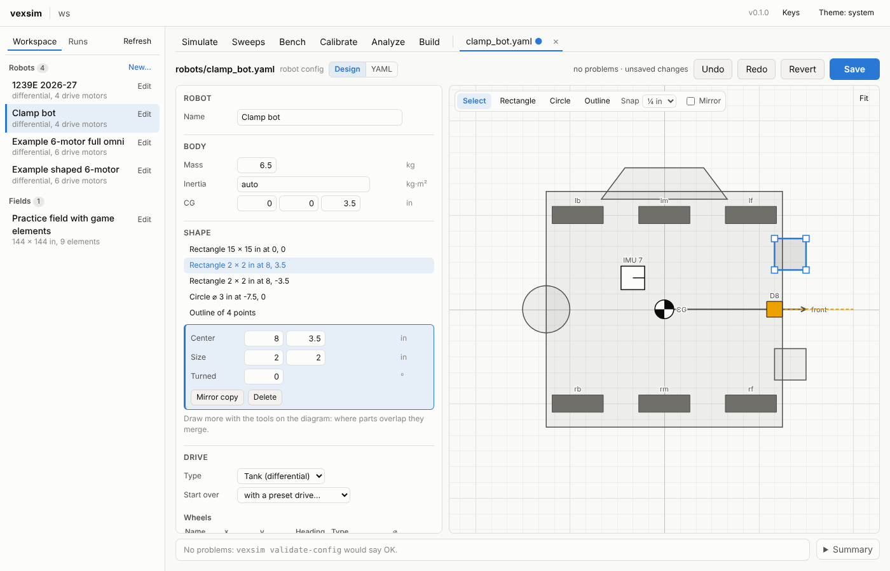

**Where things are on the robot.** Every position is in inches from the robot's *origin*: the middle of its drive, halfway between the left and right wheels and halfway between the front and back wheels. **x** is forward and **y** is to the left: behind the origin x is negative, and to the right of it y is negative.

### 3.1 Weigh it
Weigh the robot as it competes, battery in. With a bathroom scale: weigh yourself holding the robot, then yourself alone; the difference is the robot. Type it into *Body*, *Mass*, in kilograms: pounds × 0.4536.

### 3.2 Its outline
The outline is the robot seen from above: everything that can touch a wall or an element when it drives, intakes and bumpers included. Measure each part from the origin.
- Draw the drive base, and anything rectangular that sticks out, with **Rectangle**; then type its exact center (x, y) and size (length along x, width along y) into the panel.
- Draw angled parts, such as 1239E's trapezoid at the back for lining up at goals, with **Outline**: click each corner in turn, then the first one again to close it. Then type each corner's exact x and y into the panel. For example, a trapezoid that is 9 in wide where it meets a 14 in long base, 5 in wide at its end and 2 in deep has its corners at (-7, 4.5), (-9, 2.5), (-9, -2.5) and (-7, -4.5).
- Parts that overlap merge into one outline. *Mirror* draws a part and its mirror image across the robot's middle, for parts on both sides.
- The outline's furthest points to the front-left, front-right, back-left and back-right are the robot's *corners*. The autonomous check asks you to measure two of them ([section 8](#82-run-it-and-measure-where-it-stopped)). On most robots they're simply the drive base's corners.

### 3.3 The wheels and the motors
- Under *Drive*, *Wheels*, for each wheel: its x (its axle, forward of the origin), its y (the middle of the wheel, left of the origin), and its diameter (⌀) **as sold**: 3.25 in, 2.75 in, 4 in. Don't measure the diameter yourself: the push test measures how far the wheels really roll.
- Under *Drive*, *Motor groups*, for each side: its motors' *Ports*, negative for a motor your code reverses (as PROS writes them); the cartridge (blue is 600 rpm); and the gear ratio from motor to wheel: `36:48` is a 36-tooth gear on the motor driving a 48-tooth gear on the wheel. If you aren't sure which motors are reversed, the device check ([section 5.1](#51-device-check)) tells you.

### 3.4 The center of gravity (optional, 10 minutes)
The center of gravity (the CG) is the point the robot's weight balances on. Its height sets how much weight shifts onto the back wheels as the robot speeds up, and its place front to back how the weight is shared between the wheels. You can find both by tipping the robot, with a phone's level app (on an iPhone, the Measure app's *Level*):
1. Put the phone flat on a part of the robot that's level when the robot stands on the floor. It should read 0°.
2. Lift the robot's front until it balances on its back wheels by itself: hold it lightly and feel for the angle where it pulls neither way. Read the angle: **A**.
3. Lift its back the same way, balancing it on its front wheels: **B**.
4. Measure **L**, the distance from the front wheels' axle to the back wheels', and **r**, half the wheels' diameter.

Then, with a calculator:
- the CG's height = r + L ÷ (tan A + tan B)
- its x = the back axle's x + (height - r) × tan A

For example, with 1239E's wheels 10 in apart, 3.25 in wheels (r = 1.625 in), A = 62° and B = 58°: tan 62° + tan 58° = 1.881 + 1.600 = 3.481, so the height is 1.625 + 10 ÷ 3.481 = 4.50 in, and x = -5 + 2.873 × 1.881 = 0.40 in.

Type them into *Body*, *CG* (x, y and height). Most robots are balanced side to side: leave y at 0 unless one side is clearly heavier. If you skip this step, the config's guess stays.

### 3.5 The sensors
Under *Sensors*, each sensor has its port and where it is:
- **The IMU:** its port.
- **Distance sensors:** where the sensor's face is (*Position*: x, y); which way its beam points (*Heading*: 0 forward, 90 left, 180 back, -90 right); and its *Height* above the floor, to the middle of the sensor, which decides what it sees over: a low base, say. The distance sweeps check every reading against where the config says the sensor is, and the report names a sensor that's placed wrong.
- **Tracking wheels** (rotation sensors with a wheel): the wheel's place (x, y), which way it rolls (*Heading*: 0 for a wheel that tracks forward, 90 for one that tracks sideways), its *Diameter* as sold, and *Reversed* as your code has it. The device check tests which way they count, and the push and the slow spin measure their diameter and where they are.

### 3.6 Check the config
Save it, then:
```
vexsim validate-config examples/robots/1239e_2026-27.yaml --field examples/fields/1239e_2026-27.yaml
```
It prints the robot as vexsim builds it, then any problems. There must be no errors. Read the warnings, if any: each says what looks odd.

### 3.7 Check the field's config against your field
The plan puts each test between the field's elements where the field's config says they are. Check them on your field:
1. **Name the walls.** vexsim calls them the -x, +x, -y and +y walls, as your code's coordinates do: the +x wall is the one your code's x grows toward. 1239E's routines on the left side start at (60, 0) facing the +x wall. Put a strip of tape on each wall with its name. The plan's maps draw the field with the -y wall at the bottom and the +x wall on the right.
2. **Its size.** Measure inside the walls, from one wall's inside face to the opposite one's, at two or three places each way. Real fields come out under 144 in: 1239E's is 140.4 in. Put the average into the field's `size_in`.
3. **The elements.** Measure a few elements' centers from the walls: the center post, two bases. Each should be within about an inch of the config's. (`pos_in` is from the field's center: its x is the distance from the -x wall less half the field's size.) Move any that aren't, in the field's config.

You edit the field's config as you do the robot's: in the app, right-click it under *Fields* and choose *Edit*.

---

## 4. Make the program and put it on the robot
### 4.1 Make it
The calibration program is a PROS project of its own: it doesn't touch your competition code, and it goes in a spare slot on the brain (slot 8 here). In the PROS terminal, in the vexsim folder:
```
mkdir calibration
pros c n calibration/vexsim_calibration
vexsim calibration program examples/robots/1239e_2026-27.yaml examples/fields/1239e_2026-27.yaml calibration/vexsim_calibration
```
- `pros c n` makes a new, empty PROS project. It takes a minute or two.
- `vexsim calibration program` first plans the session: it simulates each driving test many times, as your robot might really be (rolling further than its config says, stopping sooner, sliding more, gripping more), and finds a spot on your field where every one of those runs stays 6 in clear of the walls and the elements. That takes a minute or two. Then it writes the program for your robot, and that plan, into the project.

It ends by listing the tests and where each one goes:
```
5. Push, each way
   Facing the +x wall (right on the map).
   Its back 15 in from the -x wall (left on the map).
   Its right side 4.5 in from the -y wall (bottom of the map).
   Tape the start line across the lane 29 in from the -x wall (left on the map).
   Tape the end line across the lane 15.4 in from the +x wall (right on the map).
   Its front edge starts on the start line; push it 96 in, to the end line.
   Room to spare: 3.5 in.

6. Straight (3 runs)
   Facing the +x wall (right on the map).
   Its back 41 in from the -x wall (left on the map).
   Its right side 43.5 in from the -y wall (bottom of the map).
   Room to spare: 11.1 in.
...
```
If a test doesn't fit anywhere on your field, it says so (*Left out, with no room on this field*) and names what's in the way. Check the field's config ([section 3.7](#37-check-the-fields-config-against-your-field)): an element in the wrong place takes up room it doesn't really have.

### 4.2 The plan's maps
The plan's maps are in `calibration/vexsim_calibration/plan/`, one for each test that needs a spot, numbered as the program's menu numbers the tests. Print them, or have them on a phone at the field.

| The push lane (map 5) | A driving test's spot (map 6) | A distance sweep's spot (map 9) |
|---|---|---|
| 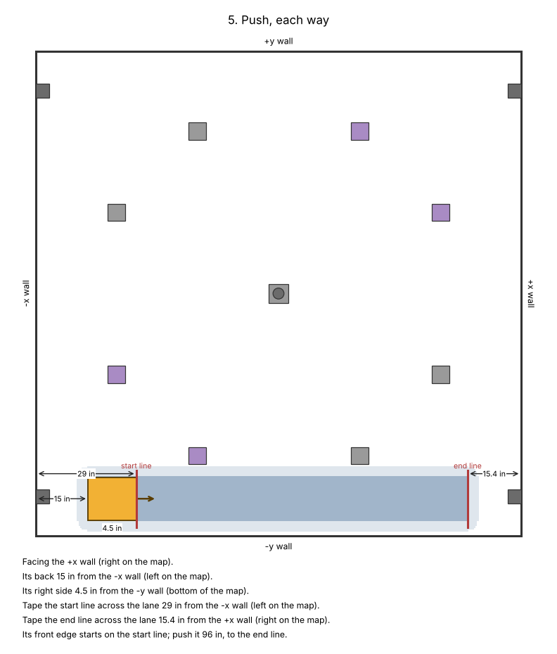 | 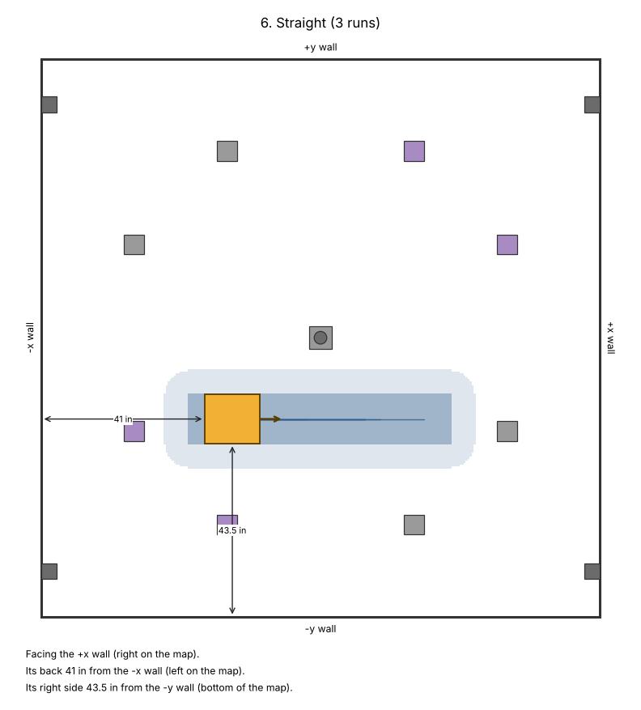 | 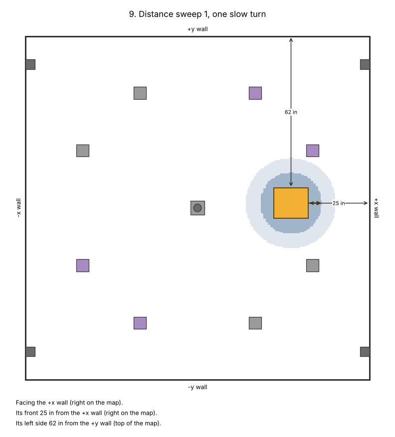 |

Each map shows:
- the robot (orange) on its spot, an arrow at its front, and the two measurements that put it there: two of its sides (or corners) from two walls;
- where the robot might go during the test (blue), and the room around that, which must be clear;
- for the push lane, the start line and the end line to tape across it.

The same measurements are on the brain's screen when you get to each test.

### 4.3 Put it on the robot
Plug the laptop into the brain (or the controller) with the USB cable, then:
```
cd calibration/vexsim_calibration
pros make
pros upload --slot 8
cd ../..
```
The brain now has the program in slot 8, as *vexsim_calibration*. Your competition program stays in its own slot.

---

## 5. The session
Before the first test (the [checklist](#12-the-checklist) has these too):
- The field: the elements in place, every game piece off, each wall labelled with its name.
- The push lane's tape lines, from map 5 ([section 5.5](#55-push-each-way)), and a straight tape line for the IMU turns, along a tile seam, away from the elements.
- A charged battery in the robot, and the card in the brain.

On the brain, run *vexsim_calibration*. It calibrates the IMU first (keep the robot still for two seconds), then shows its menu:

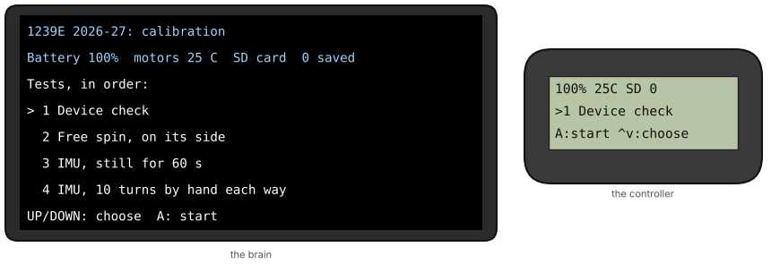

**The screens.** The brain's top two lines always show the robot's name, then the battery, the hottest drive motor, whether there's an SD card, and how many logs are saved. The controller's top line says the same in short. Below them, each step says what to do: on the brain in full, on the controller in short. The brain's bottom line says what the buttons do.

**The menu** lists the tests in order: UP and DOWN choose, A starts. Do them in order, because each fit uses what the ones before it found. A finished test says *done*, and one with runs left says how many are done (*1/3*). After a test, the menu moves on to the next one. *Drive mode*, at the end, drives the robot between spots: tank drive at half speed, the left stick for the left side and the right stick for the right. B goes back to the menu.

**Safety.** A test that turns the wheels waits until the robot is still, then counts down from 3, with a rumble each second: stand clear.

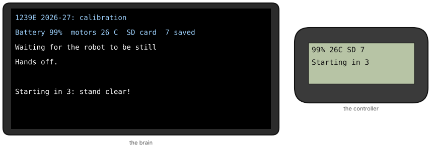

**Any button, or a stick pushed, stops every motor at once.** So does the robot going further than the plan expected. A stopped run is saved, marked as stopped, and doesn't count: run it again.

**Before each test** the program checks the robot, and stops to say so if something's wrong:

| The screen says | What to do |
|---|---|
| `Port 18: distance sensor missing` | Plug that device in (or fix its port in the config), then B and start the test again. |
| `The battery is at 64%` | Swap in a charged battery: tests on a low battery fit less well. A runs the test anyway. |
| `Motor 10 is 47 C` | Wait for it to cool below 45 °C, then A to check again. A hot motor is weaker, and the fit would learn that. |

### 5.1 Device check
Checks that every device is where the config says, and that the wheels turn and the sensors count the right way. It changes nothing, but the fit won't start until a device check has passed.
1. Lay the robot on its side on the towel, its wheels off the ground and nothing touching them. Press A.

   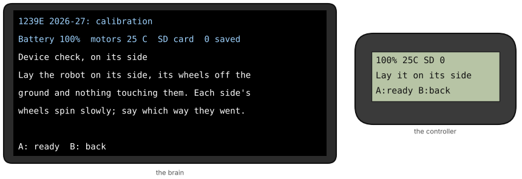
2. Each side's wheels spin slowly for 1.5 s, one side at a time, after a countdown. Watch them, then answer: did they spin forward? *Forward* means the top of each wheel moves toward the robot's front. A: yes. B: no, backward. X: they didn't turn.

   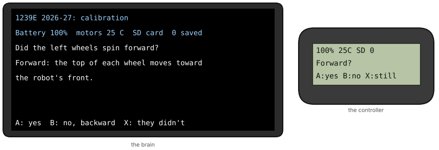

   If one motor on a side fights the others, it spins each motor alone and asks about each.
3. Stand the robot on its wheels and press A. The IMU calibrates: keep it still.
4. Turn the robot by hand about a quarter turn to the left (counter-clockwise, seen from above), then press A.

   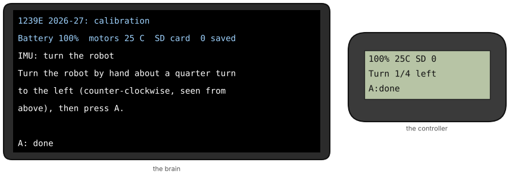
5. A robot with tracking wheels: push it straight forward about 12 in and press A; then to its left about 12 in, and A.
6. A robot with distance sensors: turn it so nothing is within a foot of any of its sensors, and press A. Then it names each sensor in turn, by where it is on the robot and its port: cover that one with your hand, close to it, and press A. When it says so, take your hand away (A).

   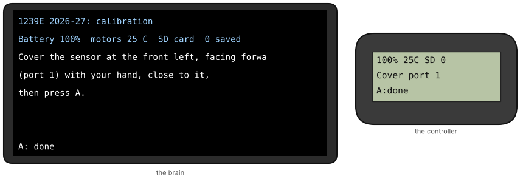
7. The result:

   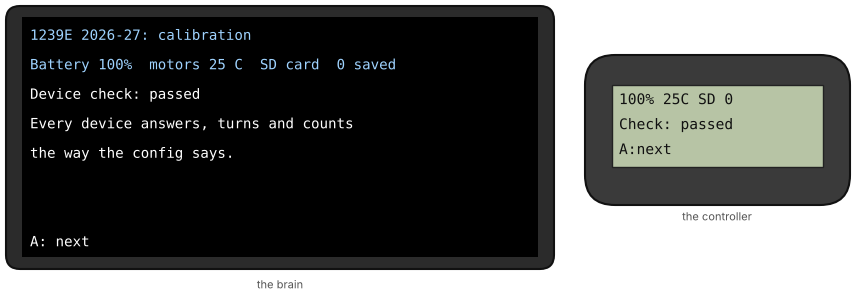

   Or what to fix. Here, a robot with motor 9 wired the other way, and the distance sensors on ports 1 and 8 swapped:

   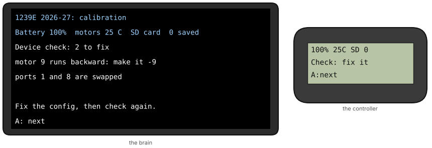

**If it says what to fix:** fix the wiring, or fix the config and then make the program again and put it on the robot ([sections 4.1 and 4.3](#41-make-it): the program has the config's ports in it). Then run the device check again. The fit uses the last one.

| The screen says | Fix |
|---|---|
| `motor 9 runs backward: make it -9` | That motor's port in the config: `9` becomes `-9` (or the other way). |
| `left: all backward: flip each motor's sign` | Every motor on that side has the wrong sign in the config. |
| `left: the motors turn, but not the wheels` | Something mechanical: a gear, a shaft or a set screw. |
| `motor 9 doesn't turn the wheels` | That motor's gear or shaft, or its cable. |
| `left: the motors fight each other` | Each motor turned the wheels forward alone, but not together: check the gears and the motors' cartridges. |
| `IMU: it reads turns backward` | The IMU is mounted upside down: turn it over. |
| `IMU: it saw only 4 deg: is it on port 16?` | The IMU's port in the config, or the robot wasn't turned. |
| `tracking wheel 11 counts backward: flip reversed` | That sensor's `reversed` in the config. |
| `tracking wheel 11 didn't turn: on the floor?` | The wheel doesn't touch the floor, or its port is wrong. |
| `ports 1 and 8 are swapped` | Swap those two ports in the config, or their cables. |
| `the sensor at the front left, facing forward is on port 8, not 1` | That sensor's port in the config. |
| `port 1: nothing read close: plugged in?` | Cover the sensor closer, or check its port. |
| `port 1: more than one read close` | Cover one sensor at a time, with nothing else near the robot. |

### 5.2 Free spin
Measures the motors: how fast they run with nothing to push, and the current they draw.
1. Lay the robot on its side again, its wheels free, and press A. After the countdown the wheels spin up to full speed, in steps, for about 12 s. Hands off.

   
2. Stand it back on its wheels and press A.

### 5.3 IMU, still for 60 s
Measures how the IMU drifts when nothing moves. Put the robot down flat where nobody will bump it, and press A. It calibrates the IMU, then counts down 60 s: don't touch the robot, or anything it stands on. Any button stops it. Then it says how far the IMU drifted, and A goes on.


### 5.4 IMU, 10 turns by hand each way
Measures how far off the IMU reads a turn.
1. Line the robot up along the tape line, one side flat against it, and press A.

   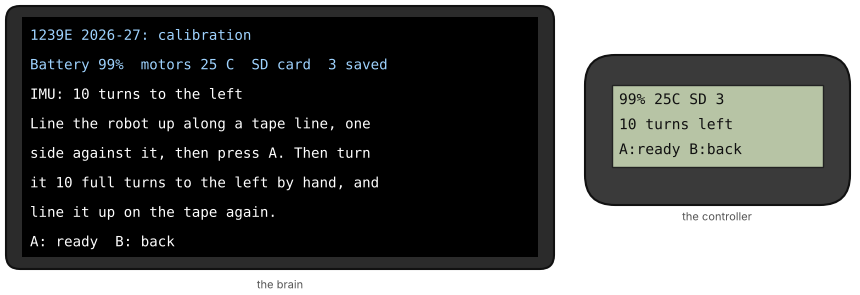
2. Turn it 10 full turns to the left by hand, slowly and smoothly, counting out loud. Line it up along the tape line again, exactly as it started, and press A.

   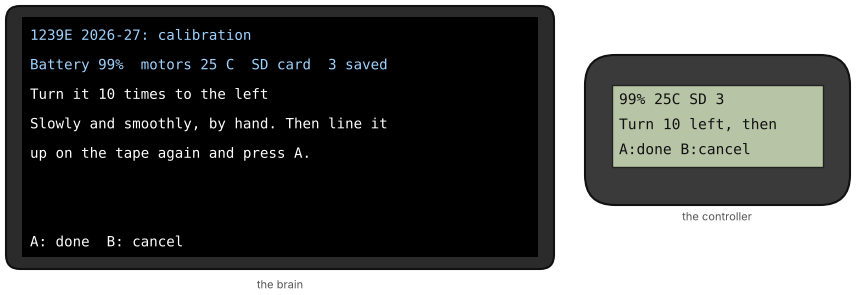
3. It shows what the IMU read. Every IMU reads turns a little more or less than they really are: the one in these pictures reads 0.5% more.

   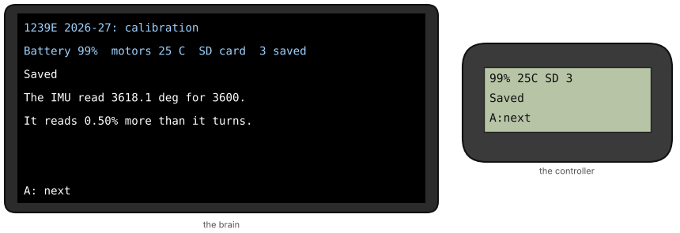
4. Then the same, 10 turns to the right.

Lining it up well matters: a robot left 2° off its line reads as an IMU 0.06% off. If the screen says `That's not 10 turns: count, and run it again.`, the count was off; it asks for that way again.

### 5.5 Push, each way
Measures how far the wheels really roll in a turn: their real size.
1. Tape the lane from map 5, before you start: the start line and the end line across the lane, each at the distance the map gives from its wall, square to the wall (a tile seam helps).
2. Put the robot on the lane as the map and the screen say: facing the +x wall, its right side 4.5 in from the -y wall, its front edge on the start line. Press A.

   
3. Push it by hand, slowly and straight, without lifting it, until its front edge is on the end line. Press A.

   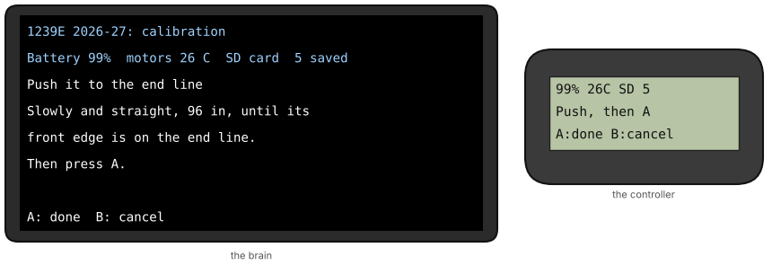
4. It shows how far the wheels say it went. A little off is normal: that's what the push measures.

   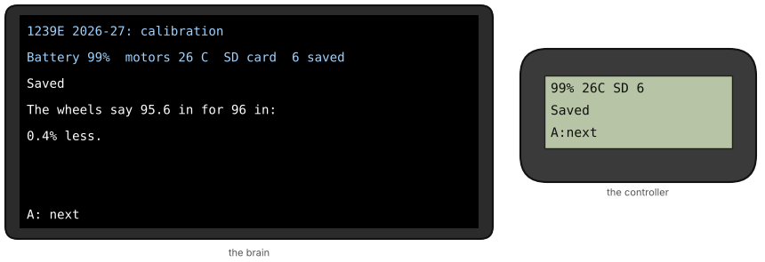

   More than about 5% off? Check the config's gear ratio and wheel size, and the tape lines.
5. Then push it back to the start line the same way, front edge on the line.

### 5.6 The driving tests: straight, spin and arc
Measure how the wheels grip, roll and slide. Each test starts from its own spot on the plan, and runs three times.
1. Carry the robot to its spot, or drive it there in the menu's *Drive mode*. Put it on the spot as the screen and the map say: facing that wall, its sides those distances from those walls, square to the walls, measured to the half inch. Press A, and stand clear.

   
2. It waits until the robot is still, counts down, then drives by itself for a few seconds: the straight test speeds up, coasts, reverses and brakes; the spin turns in place; the arc drives a fast curve.
3. Then it says how the run went. A: put it back on its spot for the next run. B: back to the menu.

   

What a run can say:

| The screen says | What to do |
|---|---|
| `Stopped: a button or stick.` | Run it again. |
| `Stopped: went further than planned.` | The robot went further than any of the plan's simulations. Check its spot, and run it again. If it happens again, the config is far from the robot: check its weight, gear ratio and wheel size, then make the program again (section 4). |
| `Stopped: turned further than planned.` | The same. |
| `It slowed suddenly: did it hit something?` | Check that nothing's in its path, and run it again. The fit leaves this run out. |
| `Motor 10 is hot: let it cool.` | Wait a few minutes before the next run. |
| `The battery sagged to 10.6 V: charge it.` | Swap in a charged battery. |
| `It moved while the IMU calibrated: redo IMU.` | The robot moved while the IMU calibrated: run *IMU, still for 60 s* again, which calibrates it again, then this test. |

### 5.7 Distance sweeps (and the slow spin)
Each distance sweep is one slow turn on a spot of its own, the distance sensors reading the walls and the elements all the way around. Put the robot on its spot from the map, press A, and stand clear: it turns once, by itself.

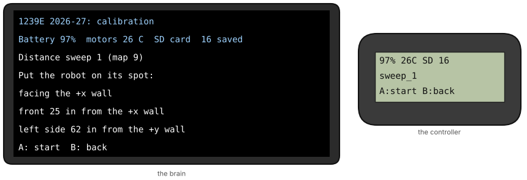

A robot with tracking wheels also has a *slow spin*: five turns on a spot, which finds where each tracking wheel is.

### 5.8 When every test is done
Every test in the menu says *done*. Stop the program, then take the card out of the brain: each log was saved as its run ended.

---

## 6. Collect the logs and fit them
### 6.1 Collect the logs
Put the brain's card in the laptop, then:
```
vexsim calibration collect calibration/2026-11-07 --from-card
```
It finds the card, copies the session's logs into `calibration/2026-11-07/runs/`, checks each, and lists them in `calibration/2026-11-07/session.yaml`:
```
the card: E:\
vexsim_0001_device_check.csv: device_check, run 1: good
vexsim_0002_free_spin.csv: free_spin, run 1: good
...
vexsim_0018_sweep_2.csv: sweep_2, run 1: good

18 new run(s); 18 in calibration/2026-11-07/session.yaml for 1239E 2026-27.
  device_check: 1 used
  free_spin: 1 used
  imu_still: 1 used
  imu_turns: 2 used
  push: 2 used
  straight: 3 used
  spin: 3 used
  arc: 3 used
  sweep_1: 1 used
  sweep_2: 1 used
```
- **It doesn't find the card?** Give it the card's folder:

  **Windows:** the card's drive letter, as File Explorer shows it:
  ```powershell
  vexsim calibration collect calibration/2026-11-07 --from E:\
  ```
  **macOS:** the card's name, as Finder shows it:
  ```bash
  vexsim calibration collect calibration/2026-11-07 --from "/Volumes/NO NAME"
  ```
- **No card?** The logs can come over the USB cable instead, as the program sends them: plug the brain into the laptop, run this before the first test, and press Ctrl+C when the session is done. It runs `pros terminal` and saves each log as it arrives. The cable has to stay in the brain all session, wherever the robot drives (the controller's wireless link is too slow for logs), so a card is much easier.
  ```
  vexsim calibration collect calibration/2026-11-07 --usb
  ```
- **Another visit, the same session?** Collect into the same folder again: it adds only the logs it doesn't have.
- **Leaving a run out.** A run that was stopped, a failed device check, IMU turns that weren't 10, and a run that slowed suddenly are left out by themselves: `use: false` in `session.yaml`, its `quality` saying why. If you know a run went wrong (someone bumped the robot), open `session.yaml` and change that run's `use: true` to `use: false`.

### 6.2 Fit them
```
vexsim calibrate examples/robots/1239e_2026-27.yaml calibration/2026-11-07 --field examples/fields/1239e_2026-27.yaml
```
It fits the tests one by one, each using what the ones before it found (about 3 minutes, and the laptop works hard). It writes a report into `calibration/2026-11-07/report/`, and prints what it found:
```
Calibration session calibration/2026-11-07: 18 runs of 1239E 2026-27
  free spin
  ...
  distance sweeps

1. Free spin: the motors
   motor.voltage_cap: 0 -> 1
   motor.natural_free_rpm: 121 -> 121  (not written: the same as the config's, as near as the logs tell)
   ...

3. Push: wheel diameters
   wheels.left.diameter_in: 3.25 -> 3.2
   wheels.right.diameter_in: 3.25 -> 3.2

4. Drive: friction and rolling resistance
   wheel.omni.longitudinal_mu: 0.9 -> 0.7458
   wheel.omni.lateral_mu: 0.2 -> 0.25
   wheel.omni.rolling_resistance: 0.1 -> 0.13
   ...

The held-out run (vexsim_0016_arc.csv) matches within the sensors' noise.

Drive model for vexsim's own motions: kS 2.011 V, kV 0.1227 V per in/s, kA 0.0256 V per in/s^2, kT 1.477 V (fits 1638 samples, R² 0.997); top speed 75.4 in/s
For the robot's routes, add to them:
  drive: {kS: 2.011, kV: 0.1227, kA: 0.0256, kT: 1.477}

wrote calibration/2026-11-07/report/report.md (and changes.yaml, with the plots)
16 change(s) to write: vexsim calibrate examples/robots/1239e_2026-27.yaml calibration/2026-11-07 --apply
```
It doesn't change the config yet: read the report first. If it stops with `error: the device check (...) found what to fix first`, fix what it lists ([section 5.1](#51-device-check)), run the device check again and collect its log.

---

## 7. Read the report and apply it
Open `calibration/2026-11-07/report/report.md`: in VS Code, open the file, then right-click its tab and choose *Open Preview*. [A whole example](img/guide/report_example.md) is the one this guide's pictures come from.

**First, the held-out run.** The fit uses every driving run but the last. Then it simulates that last run, which it never saw, and compares it with the real one. If they match within what the sensors' noise alone would leave, the calibrated simulator predicts a run it wasn't fitted to:

> The held-out run (vexsim_0016_arc.csv), which the fit didn't use, matches within the sensors' noise: motor velocity 2.974 rpm (noise 2.847), motor current 0.0001985 A (noise 0.1), heading rate 0.4454 deg/s (noise 0.4956).

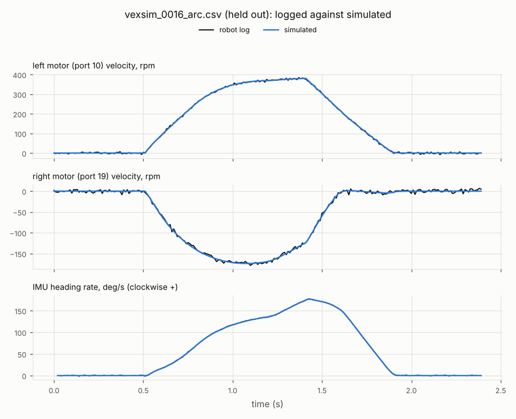

**Then what `--apply` writes:** each value the logs pin down that differs from the config. **The drive model** is a line for routes you make in vexsim's autonomous maker (below). **Then each test**, with its plot, and a table of its values: before, after, how well the logs know each (±, one standard deviation), whether that's *pinned down* (known within its tolerance: 0.5% for a wheel's size, for example), and why a value isn't written.

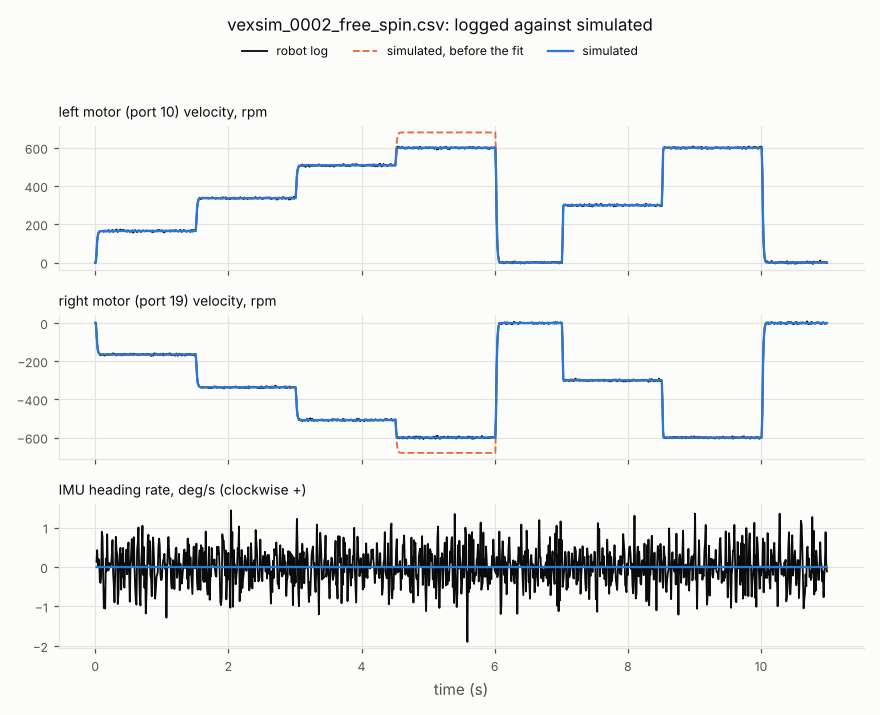

Above, vexsim's default motors (dashed) ran past 600 rpm at 12 V, where this robot's stopped at 600: the report says *voltage commands are held to rated speed*, and the fit sets that.

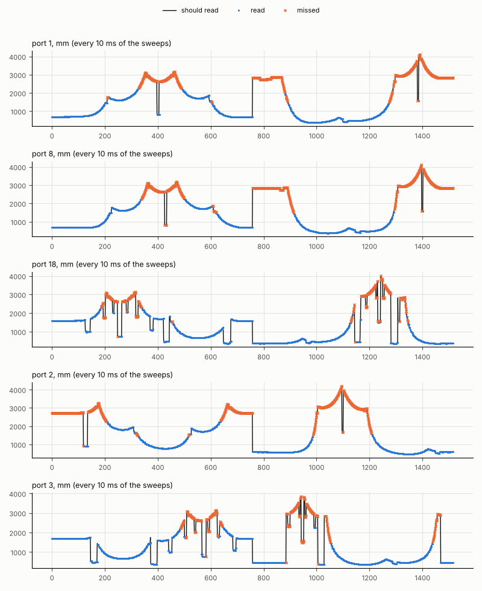

What to look for:

| In the report | It means | What to do |
|---|---|---|
| The held-out run *matches* | The calibrated simulator predicts a run it didn't see. | Apply it (below). |
| The held-out run *DOESN'T match* | That run isn't like the others, or the robot does something vexsim doesn't model. | Look at `held_out.png`: where do they part? A bumped run: leave it out (`use: false`, [section 6.1](#61-collect-the-logs)) and fit again. Something rubbing, a loose wheel: fix the robot and run the driving tests again. |
| A value isn't pinned down | The logs can't tell it well enough. | Nothing: `--apply` leaves it as it is. |
| A sensor *off what it should* by more than a few percent | That distance sensor isn't where the config says, or doesn't point that way. | Measure its place and direction again ([section 3.5](#35-the-sensors)). |
| A wheel's size more than 3% from what it's sold as | Most likely the gear ratio or the wheel size in the config. | Check them. |

### 7.1 Apply it
```
vexsim calibrate examples/robots/1239e_2026-27.yaml calibration/2026-11-07 --field examples/fields/1239e_2026-27.yaml --apply
```
It fits again (the same result) and writes the values into the robot's config, every comment kept, with a line at the top naming the session:
```yaml
# Calibrated from session 2026-11-07 on 2026-11-07 (vexsim calibrate --apply)
```
The wheels' sizes go into the wheels, the IMU's error into the IMU, and the rest into the config's `overrides:` section. VS Code's *Source Control* shows what changed.

### 7.2 For routes made in vexsim's maker
The fit also measures how the real drive answers voltage, for the motions vexsim's autonomous maker drives (arcs and paths). If you make routes there, add the printed line to each route's file:
```yaml
drive: {kS: 2.011, kV: 0.1227, kA: 0.0256, kT: 1.477}
```

---

## 8. The autonomous check
Does the calibrated simulator drive your autonomous like the real robot? Run a routine on the real robot, measure where it stops, and let vexsim run the same routine and compare.

### 8.1 Your competition code logs its autonomous (once)
1239E's code has this already. For another PROS project, add vexsim's logger with its path in place of 1239E's:
```
vexsim logger add examples/pros_projects/1239e_2026-27
```
It copies two files into the project and prints what to add to `src/main.cpp`. For a LemLib project:
```cpp
#include "vexsim_log.hpp"

void initialize() {
    // ... your code, then: LemLib's pose, logged with everything else
    vexsim_log::pose("lemlib", [] {
        lemlib::Pose p = chassis.getPose();
        return vexsim_log::Pose{p.x, p.y, p.theta};
    });
}

void autonomous() {
    vexsim_log::start("Left 40");  // the routine's name: vexsim runs left40()
    left40();
}
```
- The log's name is the routine's: vexsim finds the routine by it (`Left 40` is `left40()`).
- The log saves itself when autonomous ends. It goes to the card as `vexsim_0001_left_40.csv`, the number going up each run.
- Then build and upload the competition program to its usual slot, as you always do.

### 8.2 Run it and measure where it stopped
1. The card in the brain. Put the robot at the routine's start, exactly as you do at a match.
2. Run the autonomous as at a match: with a competition switch or field control.
3. When the robot stops, **don't touch it.** Put a small piece of tape on the floor at two of its corners, front-left and back-right (they're furthest apart), each with the tape's corner exactly at the robot's corner.
4. Now move the robot away, and measure each tape corner from two walls: from the -x or +x wall, whichever is nearer, and from the -y or +y wall. Measure square to the wall (along a tile seam), to the quarter inch. Write each down like this:
   ```
   front-left: 27.25 from +x, 56.5 from +y; back-right: 19.75 from +x, 39.25 from +y
   ```
5. Run it again, and measure again: two or three runs show how much the real robot varies.

### 8.3 Check it
Make a folder `auton` in `calibration`, and copy the new logs from the card into it (with File Explorer or Finder). Then, one `--end` for each log, in the same order:
```
vexsim calibration check-auton examples/robots/1239e_2026-27.yaml calibration/auton/vexsim_0001_left_40.csv calibration/auton/vexsim_0002_left_40.csv --program examples/pros_projects/1239e_2026-27 --field examples/fields/1239e_2026-27.yaml --end "front-left: 27.25 from +x, 56.5 from +y; back-right: 19.75 from +x, 39.25 from +y" --end "front-left: 26 from +x, 55.5 from +y; back-right: 19.25 from +x, 38 from +y"
```
It builds your code for the laptop, runs the routine in vexsim three times from where your code set the robot's pose, and compares:
```
Pass marks: 2 in, 2 degrees (vexsim's defaults)
  left40, from 60, 0, 0 deg; 3 seeds
  seed 0: ended at 46.96, 23.19, 207.6 deg
  seed 1: ended at 47.33, 22.76, 206.6 deg
  seed 2: ended at 47.35, 22.26, 202.5 deg

vexsim_0001_left_40.csv: ended at 46.70, 22.33, 204.7 deg (measured); 0.66 in and -0.8 deg from the simulated end
  through the run: 1.08 in from the simulated runs (RMS); first over the mark at 2.9 s
vexsim_0002_left_40.csv: ended at 47.58, 23.45, 207.1 deg (measured); 0.80 in and +1.6 deg from the simulated end
  through the run: 1.45 in from the simulated runs (RMS); first over the mark at 2.6 s
simulated: ended at 47.22, 22.73, 205.6 deg (the seeds' mean)
warning: the simulated runs alone end up to 0.5 in and 3.1 degrees from their mean: marks tighter than that (2 in, 2 degrees) can fail a run vexsim can't tell from its own

wrote calibration/auton/vexsim_0001_left_40_check/report.md (with its plots)
PASSED: the simulated left40 matches the real one, within the marks.
```
**It passes** when both are true:
- the real robot stopped within the pass marks of where the simulated ones did: 2 in and 2 degrees, unless your team sets its own (below);
- and through the routine, the code's pose (LemLib's, on 1239E) stayed on average within the distance mark of the simulated runs'.

Its report is in `calibration/auton/vexsim_0001_left_40_check/`: `report.md`, and these plots.

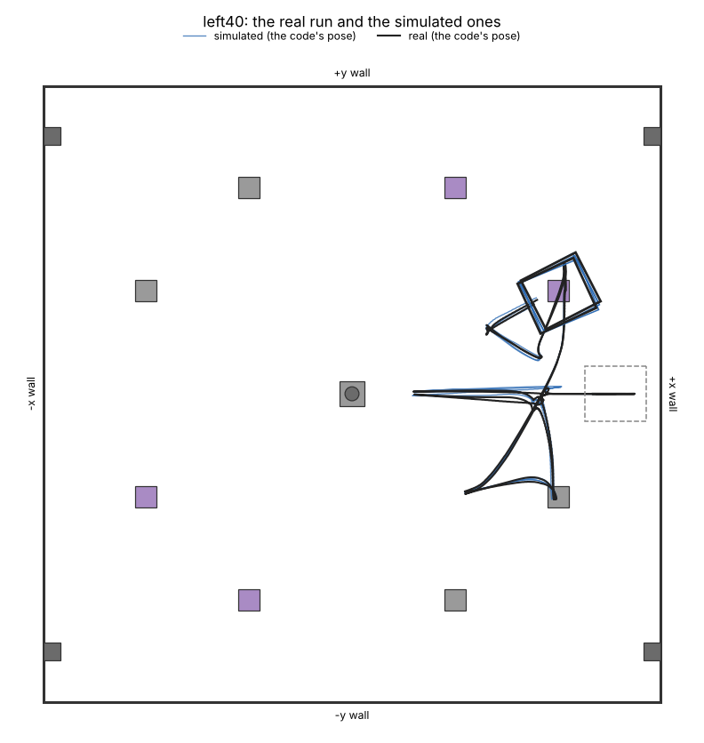

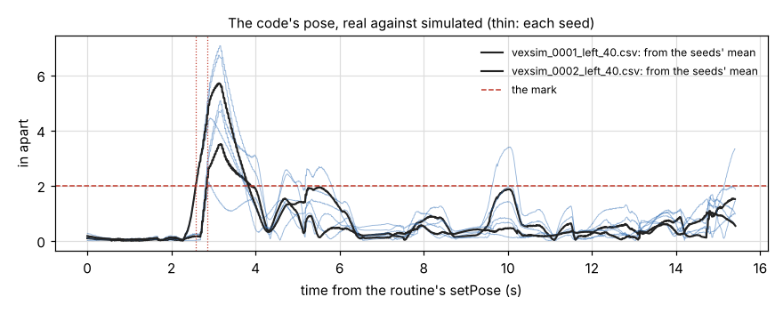

Here the runs are more than 2 in apart for about a second from 2.6 s, at a fast turn (a turn a few milliseconds early puts them inches apart for a moment), and close the rest of the way.

The warning says that the simulated runs, on their own, end up to 3.1 degrees apart: a 2 degree mark could fail a run that vexsim couldn't tell from its own. That's why 1239E's heading mark is 4 (below).

### 8.4 Your team's pass marks
Set them in a file `calibration.yaml` in a folder `.vexsim` in the vexsim folder (make the folder if it isn't there):
```yaml
max_distance_in: 2
max_heading_deg: 4
```
Or for one check, add `--max-distance 2 --max-heading 4` to the command. Marks finer than a tape measure can tell (0.5 in, 1 degree) get a warning. In vexsim, 1239E's Left 40 ends 3 to 4 degrees differently from run to run, so 1239E's heading mark is 4. The first line of the check's output says which marks it used, and where they came from.

### 8.5 If it fails
Read the report: when do the real and the simulated runs part?
- **At the first fast move:** the drive isn't calibrated well. Did the held-out run match? Run the driving tests again.
- **At a turn:** the IMU's turns (run *IMU, 10 turns by hand each way* again, lining up carefully), or how the wheels slide in a turn.
- **When a mechanism moves, or the robot pushes a game element or a wall:** vexsim doesn't calibrate mechanisms, and its contacts are simpler than the real ones. That part of the routine may never match closely.
- **The end is off, but the run is close all the way:** check the measurements: the tape corners, and the walls' names. A wall named wrong puts the end feet away, not inches.
- **A warning says the simulated runs alone end further apart than the marks:** the marks are tighter than the routine itself repeats. Loosen them.
- **A warning says the real runs end further apart than the simulated ones:** something varies on the real robot that the simulation doesn't have: how it was placed at the start, the battery, the field. Place it carefully, with a charged battery, and run it again.

---

## 9. When to calibrate again
Run a whole new session, in a new folder named by its date, when:
- you play on new tiles, or at another venue: the grip is the tiles';
- the wheels change: new ones, another kind or another size;
- the robot gains or loses more than about 0.5 kg, or its weight moves (a new mechanism);
- the drive changes: motors, cartridges or gear ratio;
- a sensor moves, or is replaced (a new IMU reads differently);
- the autonomous check fails where it used to pass.

`--apply` writes the new values over the old ones.

## 10. A new robot
For a robot like 1239E's next one (about the same outline, with two tracking wheels):
1. In the app, click *New…* beside *Robots*, give it a name, and start it from **a copy of** *1239E 2026-27*. The outline comes across: change what's different.
2. If the drive is different, *Start over with a preset drive*, then fix the wheels and motor groups ([section 3.3](#33-the-wheels-and-the-motors)).
3. Add its tracking wheels: under *Sensors*, *Add*, then *Tracking wheel*; then each one's port, place, direction and diameter ([section 3.5](#35-the-sensors)). Move, add or delete distance sensors to match the robot.
4. Weigh it, find its CG and check the config ([sections 3.1 to 3.6](#3-describe-the-robot)).
5. Then sections 4 to 8, as for any robot. With tracking wheels, the device check also pushes the robot forward and to its left, to check they count the right way; the push measures the forward one's size; and a *slow spin* (five turns on a spot) finds where each one is.

## 11. Troubleshooting
| Problem | What to do |
|---|---|
| `vexsim` or `python` isn't found | Activate vexsim's environment ([section 2](#every-time-you-open-a-terminal)): the prompt must start with `(.venv)`. |
| `pros` isn't found | Use the PROS extension's *Integrated Terminal* in VS Code ([section 2](#pros)). |
| `vexsim doctor` says the compiler is missing | Install it ([section 2](#a-c-compiler)). On macOS, check the `VEXSIM_CXX` line, and open a new terminal. |
| `vexsim calibration program` says the folder has code of its own | It goes in a project of its own: make a new one with `pros c n`. |
| The brain's status line says *no card* | Put the card in, or check it's FAT32. The logs can come over USB instead ([section 6.1](#61-collect-the-logs)). |
| The status line's count of saved logs doesn't go up | The card is full, locked or missing: copy the logs off and delete them from the card. |
| The robot ends a driving test far from where the map shows | Check the spot's measurements, and the walls' names. |
| `collect` says *not the calibration program's log; left out* | A log from your competition code: that's fine, it's left out. |
| `collect` says a log is another robot's, and leaves it out | A session holds one robot's logs: collect each robot's into a session of its own. |
| `calibrate` says the session has no device check, free spin, push or driving runs | Run that test and collect its logs: the fit needs each of them. |
| `calibrate` says the session is one robot's and the config another's | Give the config of the robot the session ran on. |
| `calibrate` stops at the device check | Fix what it says ([section 5.1](#51-device-check)), run the device check again, and collect. |
| `calibrate` can't find the field | Add `--field` and the field's config. |
| The held-out run doesn't match | See [section 7](#7-read-the-report-and-apply-it). |
| `check-auton` warns that the two tape marks are further from each other, or nearer, than those corners are | They're more than an inch off the robot's corners' spacing: measure again, and check which corners you marked ([section 3.2](#32-its-outline)). |
| `check-auton` warns that a log has no pose of its code's | Add `vexsim_log::pose` to the code ([section 8.1](#81-your-competition-code-logs-its-autonomous-once)): without it, only the end is compared. |
| `check-auton` can't find the routine | Name it: `--routine left40`. |
| The check fails | See [section 8.5](#85-if-it-fails). |

---

## 12. The checklist
Print this section for the session (select it in your browser and print the selection, or copy it into a document).

**At home**
- [ ] The config: weight, outline, wheels, motors, CG and sensors; `vexsim validate-config` shows no errors
- [ ] The field's config checked against the field: walls named, size, elements
- [ ] The program made, built and uploaded to slot 8; the maps printed
- [ ] Old logs moved off the SD card, and the card in the brain

**At the field, before the first test**
- [ ] The elements in place, every game piece off the field
- [ ] Each wall labelled: -x, +x, -y, +y
- [ ] The push lane taped from map 5: the start line ____ in from the ____ wall, the end line ____ in from the ____ wall
- [ ] A straight tape line for the IMU turns
- [ ] A charged battery in (80% or more), a second one charged
- [ ] The controller connected; the brain's status line says *SD card*

**The tests** (the menu says *done* after each)
- [ ] 1. Device check: *passed* (on its side, then flat)
- [ ] 2. Free spin (on its side)
- [ ] 3. IMU, still for 60 s (hands off)
- [ ] 4. IMU, 10 turns each way (count them; line it up exactly)
- [ ] 5. Push, each way (slowly, straight, front edge on the lines)
- [ ] Straight, spin, arc: 3 runs each (each run: measure the spot, then stand clear)
- [ ] Distance sweeps (and the slow spin, with tracking wheels)

**After**
- [ ] `vexsim calibration collect calibration/DATE --from-card`
- [ ] `vexsim calibrate ROBOT.yaml calibration/DATE --field FIELD.yaml`: does the held-out run match?
- [ ] Read the report, then `--apply`
- [ ] The autonomous check: run it, tape two corners, measure them, `vexsim calibration check-auton ...`: passed?
