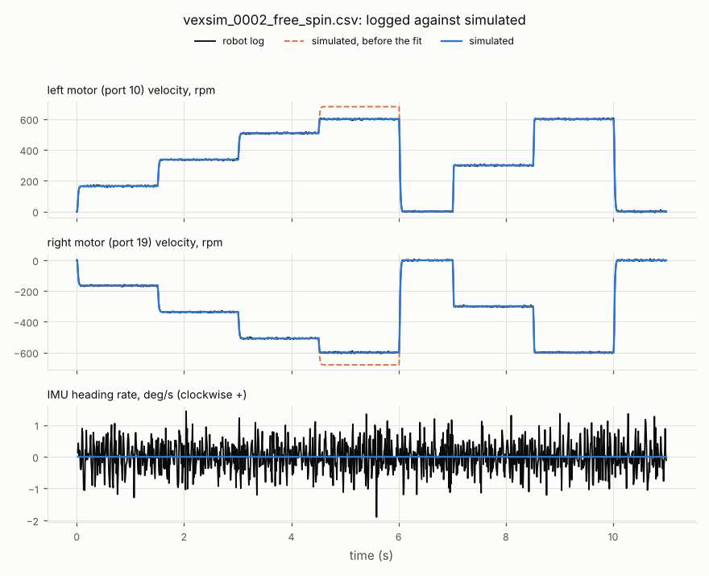
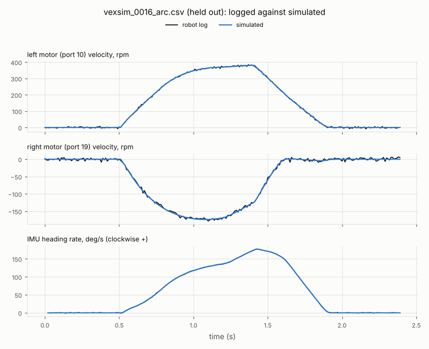
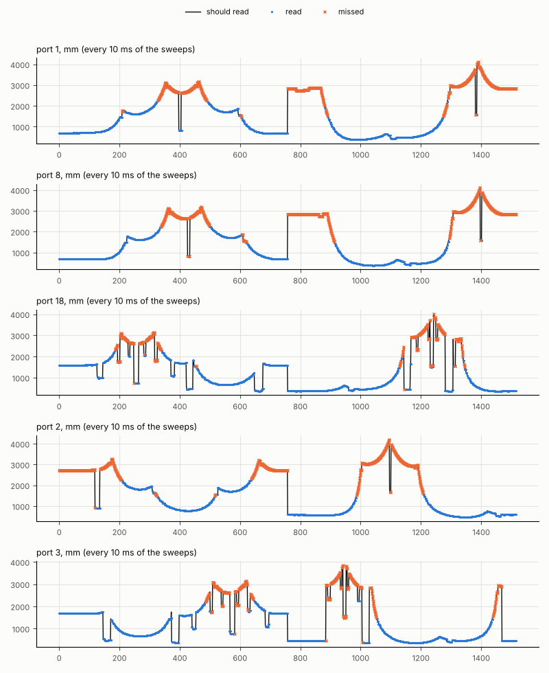

# Calibration of 1239E 2026-27

Session `2026-11-07`, fitted by `vexsim calibrate` on 2026-11-07.

The held-out run (vexsim_0016_arc.csv), which the fit didn't use, matches within the sensors' noise: motor velocity 2.974 rpm (noise 2.847), motor current 0.0001985 A (noise 0.1), heading rate 0.4454 deg/s (noise 0.4956).

## What --apply writes

| Where | Value |
|---|---:|
| `overrides["motor.voltage_cap"]` | 1 |
| `sensors[0].scale_error` | 0.00502 |
| `drivetrain.wheels[0].diameter_in` | 3.2001 |
| `drivetrain.wheels[1].diameter_in` | 3.2001 |
| `drivetrain.wheels[2].diameter_in` | 3.2001 |
| `drivetrain.wheels[3].diameter_in` | 3.2001 |
| `drivetrain.wheels[4].diameter_in` | 3.2001 |
| `drivetrain.wheels[5].diameter_in` | 3.2001 |
| `overrides["wheel.omni.longitudinal_mu"]` | 0.7458 |
| `overrides["wheel.omni.lateral_mu"]` | 0.25 |
| `overrides["wheel.omni.rolling_resistance"]` | 0.13 |
| `overrides["sensor.distance.long_noise_fraction"]` | 0.0032 |
| `overrides["sensor.distance.max_range_mm"]` | 2290 |
| `overrides["sensor.distance.glancing_miss"]` | 0.85 |
| `overrides["sensor.distance.confidence_per_m"]` | 8.013 |
| `overrides["sensor.distance.confidence_per_deg"]` | 0.242 |

Write them into the robot config with `vexsim calibrate ROBOT.yaml SESSION --apply` (its comments stay).

## The drive model, for the robot's routes

kS 2.011 V, kV 0.1227 V per in/s, kA 0.0256 V per in/s^2, kT 1.477 V (fits 1638 samples, R² 0.997); top speed 75.4 in/s. Add to the robot's routes:

    drive: {kS: 2.011, kV: 0.1227, kA: 0.0256, kT: 1.477}

## 1. Free spin: the motors

From `vexsim_0002_free_spin.csv`.

| Value | Before | After | Known to | Pinned down | |
|---|---:|---:|---:|:---:|---|
| `motor.voltage_cap` | 0 | 1 | ±0 | yes |  |
| `motor.natural_free_rpm` | 121 | 121 | ±0.01985 | yes | not written: the same as the config's, as near as the logs tell |
| `motor.free_current_a` | 0.15 | 0.1504 | ±0.001005 | yes | not written: the same as the config's, as near as the logs tell |
| `motor.coulomb_fraction` | 0.3 | 0.2981 | ±0.004473 | yes | not written: the same as the config's, as near as the logs tell |
| `motor.velocity_kp` | 2 | 2.026 | ±0.0531 | yes | not written: the same as the config's, as near as the logs tell |
| `sensor.motor.velocity_noise` | 0.005 | 0.00477 | ±0.0001061 | yes | not written: the same as the config's, as near as the logs tell |

Simulated against logged (RMS), before → after: motor velocity 29.63 → 2.972 rpm, motor current 0.01453 → 0.004429 A, heading rate 0.4824 → 0.4824 deg/s.

- at 12 V the motors ran at 100% of their rated speed, only 1.18 times their 9 V speed: voltage commands are held to rated speed (motor.voltage_cap 1)
- velocity_ki isn't fitted: a free spin can't tell it (it acts only under a changing load)

## 2. IMU: scale error, noise and drift

From `vexsim_0003_imu_still.csv`, `vexsim_0004_imu_turns_left.csv`, `vexsim_0005_imu_turns_right.csv`.

| Value | Before | After | Known to | Pinned down | |
|---|---:|---:|---:|:---:|---|
| `sensors.16.scale_error` | 0.002528 | 0.00502 | ±0.0001964 | yes | left: +0.502%, right: +0.501% |
| `sensor.imu.heading_noise_deg` | 0.01 | 0.0102 | ±0.0001171 | yes | not written: the same as the config's, as near as the logs tell |
| `sensor.imu.rate_noise_deg_s` | 0.05 | 0.0416 | ±0.03236 | no | not written: the logs don't pin it down (+/-0.0324) |
| `sensor.imu.bias_walk_deg_s` | 0.0005 | 9.11e-05 | ±0.005335 | no | not written: the logs don't pin it down (+/-0.00533) |

- IMU 16 drifted -0.37 deg in 60 s standing still

## 3. Push: wheel diameters

From `vexsim_0006_push_forward.csv`, `vexsim_0007_push_back.csv`.

| Value | Before | After | Known to | Pinned down | |
|---|---:|---:|---:|:---:|---|
| `wheels.left.diameter_in` | 3.25 | 3.2 | ±3.668e-06 | yes |  |
| `wheels.right.diameter_in` | 3.25 | 3.2 | ±3.668e-06 | yes |  |

## 4. Drive: friction and rolling resistance

From `vexsim_0008_straight.csv`, `vexsim_0009_straight.csv`, `vexsim_0010_straight.csv`, `vexsim_0011_spin.csv`, `vexsim_0012_spin.csv`, `vexsim_0013_spin.csv`, `vexsim_0014_arc.csv`, `vexsim_0015_arc.csv`.

| Value | Before | After | Known to | Pinned down | |
|---|---:|---:|---:|:---:|---|
| `wheel.omni.longitudinal_mu` | 0.9 | 0.7458 | ±0.006756 | yes |  |
| `wheel.omni.lateral_mu` | 0.2 | 0.25 | ±5.347e-05 | yes |  |
| `wheel.omni.rolling_resistance` | 0.1 | 0.13 | ±3.361e-05 | yes |  |
| `battery.internal_resistance_ohm` | 0.1 | 0.1001 | ±0.005005 | yes | not written: the same as the config's, as near as the logs tell; voltage vs current |

Simulated against logged (RMS), before → after: motor velocity 26.58 → 3.014 rpm, motor current 0.0825 → 0.0002276 A, heading rate 27.28 → 0.4658 deg/s.

- held out vexsim_0016_arc.csv: motor velocity 2.97 (noise 2.8), motor current 0.000199 (noise 0.1), heading rate 0.445 (noise 0.5)

## 5. Distance sweeps: the distance sensors

From `vexsim_0017_sweep_1.csv`, `vexsim_0018_sweep_2.csv`.

| Value | Before | After | Known to | Pinned down | |
|---|---:|---:|---:|:---:|---|
| `sensor.distance.long_noise_fraction` | 0.025 | 0.0032 | ±0.0001174 | yes | 1050 readings |
| `sensor.distance.max_range_mm` | 2000 | 2290 | ±25 | yes |  |
| `sensor.distance.glancing_miss` | 0 | 0.85 | ±0.03336 | yes | of 114 readings |
| `sensor.distance.glancing_deg` | 45 | 45 | ±1.25 | yes | not written: the same as the config's, as near as the logs tell |
| `sensor.distance.glancing_mm` | 1500 | 1500 | ±50 | yes | not written: the same as the config's, as near as the logs tell |
| `sensor.distance.confidence_per_m` | 0 | 8.013 | ±0.05722 | yes |  |
| `sensor.distance.confidence_per_deg` | 0 | 0.242 | ±0.001779 | yes |  |

- port 1: 187 readings near square, 0.3% off what it should
- port 8: 184 readings near square, 0.3% off what it should
- port 18: 236 readings near square, 0.3% off what it should
- port 2: 184 readings near square, 0.3% off what it should
- port 3: 234 readings near square, 0.3% off what it should
- too few readings under 200 mm to tell short_noise_mm: it stays as it is
- beams near square came back to 2265 mm and none past 2305 mm

