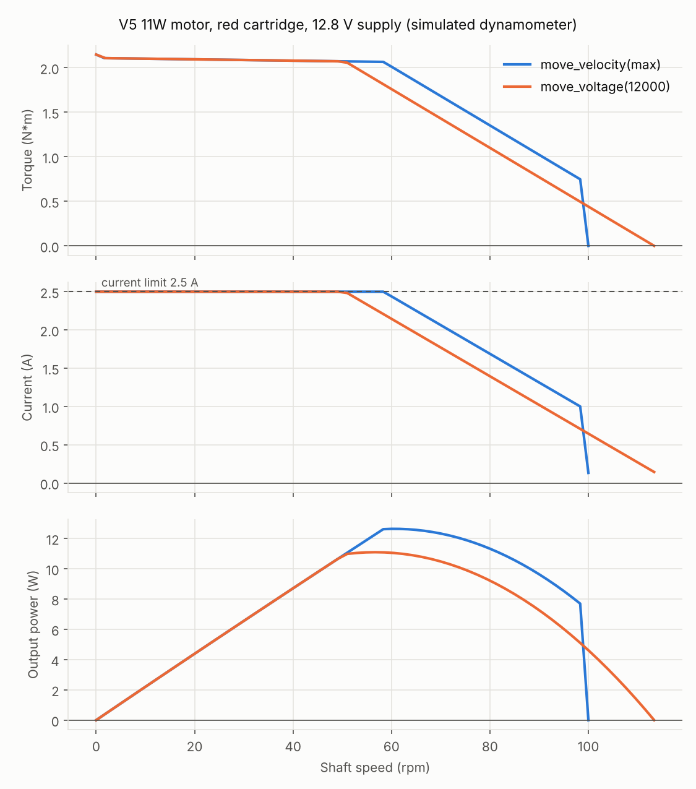
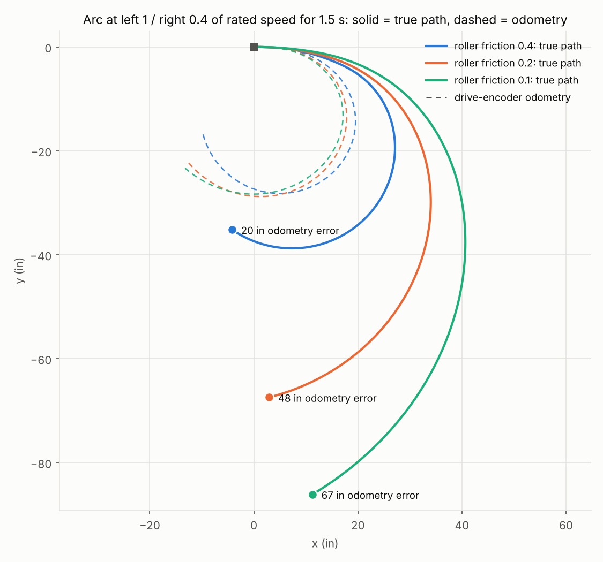
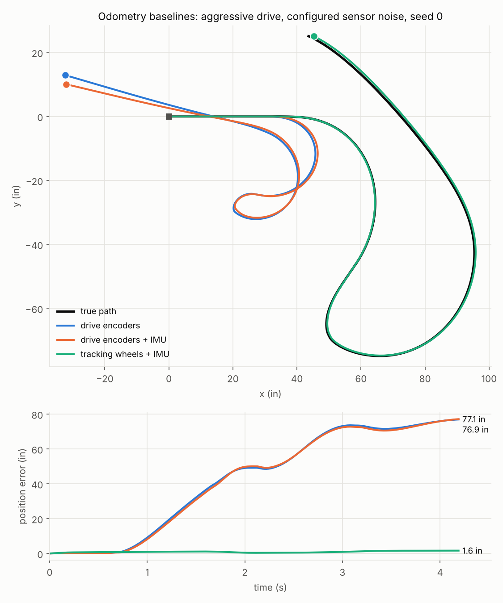

# Physics models

Every parameter below is labeled by where it comes from:
- **VEX**: published by VEX.
- **Fit**: derived from VEX's published curves by community curve-fitting.
- **Community**: reported on the VEX Forum, not official.
- **Estimate**: our assumption.

Estimates are calibration targets for Phase 10. All of them can be changed per robot through `overrides:` in the robot YAML, e.g. `motor.free_current_a: 0.2`. Run `vexsim validate-config` to see the accepted keys.

## V5 Smart Motor (11W): `vexsim/physics/motor.py`



`vexsim motor-curves --cartridge red --out docs/img/motor_curves_red.png` regenerates this chart. Use `--csv` for the numbers.

### Electrical and mechanical model
The model works at the motor core, before the cartridge. It ignores inductance, because the electrical time constant is far below the 1 ms step.
```
I           = (V - ke * w_core) / R        clamped to the effective current limit
torque_core = kt * I - (coulomb * tanh(w_core / w_s) + viscous * w_core)
torque_out  = G * torque_core,   w_core = G * w_out,   G = 36 / 18 / 6 (red / green / blue)
```
- `kt` and `ke` are fitted separately. `kt` / `ke` ≈ 0.88 absorbs gearbox efficiency.
- The motor reports its electrical draw (`V * I`) to the power system.
- I²R heat goes into the thermal model.

### Calibration targets (red cartridge, output side, 12.8 V)
| Quantity | Value | Source |
|---|---|---|
| Natural (uncapped) free speed | 121 rpm | Fit ([VEX Forum][fit]) |
| Natural stall torque | 3.99 N·m | Fit |
| Natural stall current | 4.69 A | Fit |
| No-load current | 0.15 A | Estimate |
| Coulomb share of no-load friction | 30% | Estimate |
| Current limit | 2.5 A (default and maximum) | VEX / PROS |
| Rotor inertia (core) | 2.0e-6 kg·m² | Estimate |

**Derived constants (core):**
- R = 2.729 Ω
- kt = 0.02386 N·m/A
- ke = 0.02716 V·s/rad
- Coulomb friction 1.07e-3 N·m
- viscous friction 5.5e-6 N·m·s

**Reflected rotor inertia at the output:**
| Cartridge | Inertia |
|---|---|
| red | 2.6e-3 kg·m² |
| green | 6.5e-4 kg·m² |
| blue | 7.2e-5 kg·m² |

### What the fit reproduces (checked in `tests/test_motor.py`)
| VEX statement ([KB][kb]) | Model |
|---|---|
| Stall torque 2.1 N·m (red); 1.05 green, 0.35 blue | 2.15 / 1.07 / 0.36 N·m (within 2.3%) |
| Holds full speed up to ~35% of stall torque | holds 100 rpm up to 0.71 N·m (34%) |
| Peak power ~12.75 W; 11 W+ across ~30% of the speed range | 12.6 W peak; above 11 W across about 30% of the range |
| Free speed is software-limited for motor-to-motor consistency | `move_velocity` capped at 100/200/600 rpm; speed holds on a low battery |

### Firmware behavior modeled
- **Velocity mode (`move_velocity`).** The target is clamped to rated speed. A feedforward plus PI loop runs every step, using a velocity estimate filtered at 2 ms. It can drive up to the full battery voltage, which is what lets it hold rated speed under load.
  - The integral term only accumulates near steady state, while acceleration is below 0.25 rated speeds per second. It only exists to reject load torque, and integrating during the approach would wind up.
  - Result: overshoot ≤ 1.5% and settling in 0.05–0.5 s for drivetrain-like loads (4–40× rotor inertia).
  - A load step of 30% of stall torque recovers fully in about 0.4 s.
  - Gains are an **estimate**; VEX does not publish the internal controller.
- **Voltage mode (`move_voltage`).** Applies the commanded voltage, ±12 V, limited by the battery. It is **not speed-capped**, so 12 V spins about 13% past rated speed (113 rpm on the red cartridge).
  - **Unverified**, and the first thing to measure on a real robot (see below).
- **Position mode and hold.** A position P loop (15 /s) produces a velocity target, which feeds the velocity loop above. `HOLD` captures the position at the moment the motor stops, holds it within 1° under half of stall torque, and springs back after overshooting.
- **Zero commands.** `move_voltage(0)` and `move_velocity(0)` stop the motor using its brake mode.
  - The PROS docs state this for `brake()` and velocity 0. For voltage 0 it's an **assumption**, to be verified in Phase 7.
- **Brake modes:**
  - `COAST`: windings open, so zero current.
  - `BRAKE`: windings shorted, so back-EMF brakes the motor, with a time constant of about 0.13 s at typical loads.
  - `HOLD`: closed-loop hold of the stopped position.

## Thermal model and derating: `vexsim/physics/thermal.py`
The model has two nodes:
- **Winding:** I²R heat enters here (heat capacity 12 J/K).
- **Housing/PCB:** where the temperature sensor sits (50 J/K).

Thermal resistances are 1.5 K/W from winding to housing and 4 K/W from housing to ambient, with ambient at 25 °C.

| Behavior | Value | Source |
|---|---|---|
| Derating steps | current × 1/2, 1/4, 1/8, then 0 | Community ([VEX Forum][derate]) |
| First step | 55 °C sensor temperature | Community (observed, not exact) |
| Spacing between steps | 5 °C | Estimate |
| Thermal capacities and resistances | see above | Estimate |
| Sensor reads the PCB / average, with lag | housing node, lagging the winding | Community |

With these values, a fully stalled motor (17 W of heat) reaches the first derating step after about 160 s, then cycles at the 50% step around 55 °C. Cruising unloaded stays near ambient.

## Battery: `vexsim/physics/battery.py`
| Quantity | Value | Source |
|---|---|---|
| Capacity | 1100 mAh | VEX |
| Nominal voltage | 12.8 V (4 LiFePO4 cells in series) | VEX |
| Open-circuit curve | 13.5 V full, 13.1 V at 50%, 12.6 V at 10%, 11.2 V empty | Estimate (generic LiFePO4 shape) |
| Internal resistance (cells + BMS + wiring) | 0.10 Ω | Estimate |

State of charge is tracked by counting charge, and the sim never charges the battery.

## Power distribution: `vexsim/physics/power.py`
- **Bus voltage:** the battery's terminal voltage under the total draw, plus the brain's 0.3 A (**estimate**). Motors see the previous step's bus voltage. That 1 ms lag stands in for bus capacitance and avoids an algebraic loop.
- **Current sharing:** with more than 8 motors plugged in, each motor's current limit becomes 20 A ÷ N. Community-reported ([VEX Forum][share]), not official.
- **Regeneration:** a motor generating power can feed other motors on the bus, but never charges the battery.

## Wheel contact: `vexsim/physics/wheel.py`
Each wheel produces three forces. Each is smoothed Coulomb friction, `coeff * N * tanh(x / x_s)`, of one contact velocity:

| Channel | Velocity | Force |
|---|---|---|
| grip (slip) | `s = w_wheel * r * cos(g) - a . v` | along the grip direction `a` (drives the robot) |
| free | `f . v + w_wheel * r * sin(g)` | across it (resists sliding, or turning the rollers) |
| rolling | `w_wheel * r` | resists wheel rotation (coast-down losses) |

- `v` is the ground velocity of the contact point.
- The grip direction `a` is the rolling direction turned by the roller angle `g`. The free direction `f` is `a` turned another 90°.
- Omni and traction wheels have `g = 0`, so `a` is the rolling direction and `f` points along the axle.

**Omni wheels.** The main wheel grips along the rolling direction and the rollers roll freely across it. The two are mechanically separate, so the channels are independent. An omni wheel rolling sideways on its rollers keeps full drive traction, which is how X-drives work.

**Mecanum wheels** are the same with `g = ±45°` (`roller_angle_deg` in the config). A mecanum wheel grips along its ground rollers' axis and rolls freely across it. Driving it pushes the robot diagonally, and four of them in the usual layout add up to driving, strafing or turning.
- Strafing turns every wheel at full speed and the rollers at about 1.4x that, so the rollers' resistance loads the motors. On 12 V the example robot strafes at about 86% of its forward speed.
- Driving straight, the rollers don't turn at all.

**Traction wheels** grip the same in every direction, so their grip and free channels share one friction circle:
```
F = mu * N * tanh(|c| / x_s) * c / |c|,   c = (grip slip, sideways slip)
```
- A wheel sliding sideways (turning scrub) loses drive traction. A wheel spinning in place loses its sideways grip.
- The circle's Jacobian is a symmetric, positive-definite 2x2 block, so the integrator stays stable (see [Robot dynamics](#robot-dynamics-vexsimphysicsrobotpy)).
- A smoothed model creeps slowly under any sideways force below breakaway (about 2 cm/s at 60% of breakaway). Real tires do too, a little.

| Omni parameter (`wheel.omni.*`) | Default | Source |
|---|---|---|
| `longitudinal_mu`: main wheel traction on tiles | 0.9 | Estimate |
| `slip_velocity_m_s`: traction smoothing | 0.03 | Estimate |
| `lateral_mu`: roller friction when sliding sideways | 0.2 | Estimate; **controls drift** |
| `lateral_velocity_m_s`: roller smoothing | 0.02 | Estimate |
| `rolling_resistance`: lumped coast-down loss (foam, bearings, chain) | 0.10 | Estimate, sized so coast mode glides about 5 ft from full speed |
| `mass_kg`: per wheel, for spin inertia | 0.06 | Estimate |

| Traction parameter (`wheel.traction.*`) | Default | Source |
|---|---|---|
| `mu`: tread on tiles, any direction | 1.1 | Estimate |
| `slip_velocity_m_s`: smoothing | 0.03 | Estimate |
| `rolling_resistance` | 0.12 | Estimate (more tread deforms than on an omni) |
| `rolling_velocity_m_s` | 0.02 | Estimate |
| `mass_kg` | 0.07 | Estimate |

| Mecanum parameter (`wheel.mecanum.*`) | Default | Source |
|---|---|---|
| `grip_mu`: roller rubber on tiles, along the roller axes | 0.8 | Estimate |
| `slip_velocity_m_s` | 0.03 | Estimate |
| `roller_mu`: resistance of the free-turning rollers | 0.15 | Estimate; **controls strafe speed and drift** |
| `roller_velocity_m_s` | 0.02 | Estimate |
| `rolling_resistance` | 0.12 | Estimate |
| `rolling_velocity_m_s` | 0.02 | Estimate |
| `mass_kg`: per wheel, rollers included | 0.15 | Estimate |



`vexsim drift examples/robots/full_omni_6m.yaml --out drift.png` regenerates this chart.

**Why omni robots drift.** In a turn the robot needs a sideways force of mass × speed × yaw rate. Only roller friction can supply it, up to `lateral_mu * g` of acceleration (about 2 m/s² by default). Past that the robot slides outward. Each instant the wheels push the robot along its new, rotated heading, and the sideways momentum it already had is only weakly resisted. So a sustained fast arc grows into a wide spiral, and the motors keep feeding it energy. Energy accounting is checked in `tests/test_drive.py`. Drive-encoder odometry sees only wheel rotation, so it believes the robot traced the tight kinematic circle.

**Traction wheels in the middle** (`examples/robots/traction_6m.yaml`) supply that sideways force by grip instead. In the same fast arc the robot's turning radius is about a quarter of the all-omni robot's, close to the kinematic circle. The wheels sit on the turning center line, so turning in place doesn't scrub them. Traction wheels at the corners do scrub. Turning in place then has to slide them sideways, which is slower and draws more current.

**H-drives** strafe with one wheel against the roller friction of all the others. A strafe wheel level with the rest carries a fifth of the weight, and its grip barely beats that friction. That is why real H-drives lower or spring-load the strafe wheel. `examples/robots/hdrive_5m.yaml` lowers it 0.04 in (`drop_in`), at the cost of launch traction on the corner wheels.

## Chassis and normal loads: `vexsim/physics/chassis.py`
- Each wheel sits on a vertical spring under a rigid chassis plane: `chassis.wheel_stiffness_n_per_m`, default 2e4 N/m (an estimate covering the tire and foam).
- Every step the plane is solved so the loads carry the weight and balance the pitch and roll moments of the previous step's ground forces acting below the CG.
- This gives weight transfer, with rear wheels gaining load under acceleration (`sum(N*x) = -h*Fx`), drop-center rocking, and wheel lift-off.
- While all wheels touch the ground the loads are linear in the horizontal force, so that map is precomputed. Lift-off falls back to an active-set solve.

## Robot dynamics: `vexsim/physics/robot.py`
**Degrees of freedom**
- The CG's body-frame velocity and yaw rate: `u, v, w`.
- One shaft speed per gear group. All wheels in a group turn together.

**Contact forces**
- Every contact velocity is a fixed linear function of the velocity vector, `c = C @ qdot`.
- The generalized contact forces are `-C.T @ F(c)`, with Jacobian `-C.T @ D @ C`. `D` is diagonal, except for one 2x2 friction-circle block per traction wheel. That Jacobian is symmetric and dissipative.

**Integration**
- Each 1 ms step solves the linearly implicit Euler update `(M - dt*J) dq = dt*Q`. Tire friction has time constants near 0.15 ms, so a plain explicit step would blow up; this one stays stable with no substeps.
- Motor torques, rotating-frame terms and external forces are explicit.

**Walls:** after each step, the field walls push the footprint back inside ([below](#field-walls-vexsimphysicsfieldpy)).

**Motor direction:** a negative port means the motor's raw positive direction drives its group backward. Group commands apply that sign, as a PROS 4 `MotorGroup` does.

**Speed:** about 170 µs per simulated millisecond for the 6-motor example, so about 6× faster than real time on one core.

**What the tests check** (`tests/test_drive.py`):
- top speed matches the gearing within 1%
- launch acceleration is limited by traction (μg), with the wheels spinning
- turning in place matches kinematics within 1%, with the center fixed
- slow arcs follow kinematics, fast arcs drift outward, and drift grows monotonically as roller friction drops
- sideways pushes break away at the roller friction limit
- per drivetrain (`tests/test_drivetrains.py`):
  - an X-drive drives √2 times faster than its wheels' surface speed, and strafes and turns cleanly
  - a mecanum drive strafes the right way, slower than it drives forward
  - an H-drive strafes, and needs its strafe wheel loaded
  - traction wheels drift less, resist sideways pushes, scrub at the corners, and their friction circle's Jacobian matches finite differences
- no energy is created under random commands
- runs are deterministic

## Mechanisms: `vexsim/physics/mechanism.py`
Lifts, intakes and arms: motors that drive something other than the wheels (`mechanisms:` in the robot config, [conventions.md](conventions.md#robot-config-semantics)). Each mechanism is one rotating output (a lift's spool, a roller, an arm's pivot), geared to its motors and integrated at the motor shaft like a gear group:

    J dw/dt = sum of motor torques - G * (load + friction)

- `J` is the motors' rotor inertia plus the load's (`inertia_kgm2`, at the output), and `G` the output speed over the motor speed (`ratio`).
- `load_torque_nm` is a constant torque pulling the output toward negative angles, such as a lift's weight times its spool radius. It is constant, so an arm whose gravity torque changes with angle is approximated by its average.
- `friction_nm` is Coulomb friction at the output, applied implicitly: a load lighter than the friction stays put, without creeping or chattering at the 1 ms step.
- **Hard stops** (`range_deg`, output degrees from the starting position) end the travel inelastically. A motor pushing into a stop stalls there at its current limit, which is what code that homes a mechanism by driving into a stop relies on. The motors' encoders follow the output, stops included.

The motors are full V5 motors: firmware control loops, brake modes, current limits, thermal derating, and a share of the battery. A mechanism doesn't push the chassis; its mass belongs in the body's. Every mechanism motor is a device on its port, so robot code drives it as on the robot, and telemetry records each output angle (`<name>_deg`).

Not modeled: what a mechanism carries or touches. An intake spins, but picks nothing up.

**What the tests check** (`tests/test_mechanisms.py`):
- a lift raises, holds its height with the hold brake mode, and falls back onto its bottom stop when coasting
- a heavier load raises more slowly
- a mechanism driven into a stop stays there with its motors stalled at the current limit
- the gear ratio sets the output speed
- friction holds a load lighter than itself, and not a heavier one
- mechanism motors are devices and draw from the battery; port conflicts and stops that don't contain the start are config errors

## Field walls: `vexsim/physics/field.py`
The robot's footprint (`body.footprint_in`) collides with the field perimeter (`size_in` in the field config). Each step, after the robot moves:
1. Every footprint corner past a wall is a contact.
2. **Impulses** on the body settle the contacts, the way rigid-body engines handle hard impacts. A few sweeps (sequential impulses) resolve two or three contacts at once, such as both front corners or a field corner.
   - **Normal:** stop the corner's approach, then bounce it back at `wall_restitution` times the impact speed. Impacts below 5 cm/s don't bounce, so a robot pushed against a wall stays there.
   - **Friction:** oppose the corner's sliding along the wall, up to `wall_friction` times the normal impulse.
3. The robot moves straight back inside the walls, so it never ends a step in a wall. It overlaps a wall by at most one step of travel (about 2 mm at full speed) before the correction.

The impulses act on the body. The wheels follow through tire friction over the next steps, so:
- a robot driving into a wall stalls with its wheels spinning;
- an angled approach rotates the robot flat against the wall, which is what a wall reset relies on.

| Field parameter (`field.*`) | Default | Source |
|---|---|---|
| `wall_restitution`: rebound speed / impact speed | 0.2 | Estimate (aluminum frame on polycarbonate walls) |
| `wall_friction`: robot sliding along a wall | 0.3 | Estimate |

`Simulation` adds the walls of its field config; pass `walls=False` for an endless floor. `vexsim drift` and `vexsim odometry` run without walls.

**What the tests check** (`tests/test_walls.py`):
- a head-on hit stops flush with the wall, overlapping it by under 2 mm, with the wheels spinning
- approaches at 5° to 30° square up to within 0.5°
- a field corner contains the robot
- bounces follow `wall_restitution`, and slow touches don't bounce
- wall friction slows sliding along a wall
- away from the walls, the physics is exactly unchanged

## Game elements: `vexsim/physics/arena.py`
A field config can list elements ([conventions.md](conventions.md#field-elements)):
- **Obstacles** are fixed rectangles and circles: goals, barriers.
- **Pieces** are discs that slide on the tiles: balls, rings and cylinders, by their outer diameter. Each has a mass, a ground friction coefficient and a restitution.

**The robot and obstacles.** The footprint collides with obstacles as with the walls, using the same impulses (`field.wall_restitution`, `field.wall_friction`). A contact is any of:
- a footprint corner inside an obstacle;
- an obstacle corner inside the footprint;
- the footprint's nearest point to a circle.

So the robot stops flush against a barrier, squares up against its face, and pivots onto the nearer face when it meets a corner off center.

**Pieces.** Each step, after the robot moves:
1. **Move.** Ground friction slows each piece (Coulomb, `friction * g`), and it moves.
2. **Find contacts.** Contacts between a piece and a wall, an obstacle, another piece or the robot are found.
3. **Impulses.** Sequential impulses settle the contacts with the piece's restitution and the field's wall friction. A piece pinned against a wall or an obstacle counts as fixed while the robot pushes it into that, so the robot stalls instead of squeezing through.
4. **Separate.** Nothing may overlap. Pieces move out of the robot, then out of walls, obstacles and each other; whatever still overlaps the robot pushes it back.

Pieces don't spin. Robots can't drive over or pick them up: intakes and scoring are future work. While every piece is at rest and no robot is near one, a step skips them, so a field full of pieces costs nothing extra.

**Low elements.** An obstacle with `solid: false` is low enough to drive over, like a goal base the robot straddles. Robots and pieces pass over it; only sensors see it.

**Sensors.** Distance sensors see obstacles and pieces. An obstacle with a `height_in` is seen only by distance sensors whose beam (`height_in` in the robot config) is lower than its top; a sensor without a height, or an obstacle without one, sees or blocks everything. A GPS camera's view of the code strip is blocked by obstacles, not by pieces.

**What the tests check** (`tests/test_elements.py`):
- the robot stops flush at a barrier and squares up, at a round goal, and against a corner
- a pushed piece moves ahead of the robot; pushed into a wall, both stop, without overlap or creep
- a sliding piece stops after `v^2 / (2 mu g)`, bounces off a wall with its restitution, and two equal elastic pieces swap velocities
- a field whose pieces are out of reach drives exactly like an empty one
- distance sensors see obstacles and pieces, and obstacles block the GPS
- a low element blocks only the beams below its top; robots and pieces pass over elements that aren't solid

## Sensors: `vexsim/devices/`
**Timing and units**
- Every device is sampled on its own period, at sensor priority, so controllers in the same tick see fresh data.
- Each reading becomes visible `latency_ms` later.
- Readings use **PROS units and sign conventions**; see [conventions.md](conventions.md#sensor-readings). Python algorithms therefore see exactly what PROS code sees.

**Presets and randomness**
- Each sensor picks a preset with `noise: ideal | default | harsh`. `ideal` means no noise, latency or quantization, for debugging algorithms.
- `sensor.<type>.<field>` overrides apply on top of the preset.
- Per-device static errors are drawn once from the stream `sensor.<type>.<port>.static`. Per-sample noise uses `sensor.<type>.<port>`. Adding or removing a sensor never changes another sensor's noise.

**Default values**
| Sensor | Default model | Source |
|---|---|---|
| Motor encoder | 10 ms; 50 counts per motor-core rev (1800/900/300 per output rev); velocity noise 0.5% of rated | counts: PROS; rest estimates |
| Rotation sensor | 10 ms; 0.088° resolution; 0.02° noise; per-wheel diameter error 0.5% and mounting error 0.05 in; scrub 1% of sideways travel | 10 ms: [PROS][rot]; 0.088°: retailer spec sheet ([RS][rot-rs]); rest estimates |
| IMU | 10 ms; 2 s calibration; gyro bias 0.3°/s, removed by calibration; 0.05°/s rate noise; per-device scale error 0.5%, **not** removed by calibration | calibration and scale behavior: [VEX API][imu]; drift level: [VEX Forum][imu-drift]; rest estimates |
| Distance | ~30 Hz; 20–2000 mm; σ 7.5 mm below 200 mm, 2.5% above; sees walls, obstacles and pieces | range and accuracy (±15 mm / ±5%, taken as ~2σ): [VEX][dist]; rate: VEX Forum |
| GPS | 20 ms, 20 ms latency; fix while its camera sees the code strip 0.3–4 m away; position σ 5 mm + 4 mm per meter to the strip; heading σ 0.3° | update rate "at worst 20 Hz": VEX Forum; rest estimates |

**Rotation sensor (tracking wheel).** The wheel's rotation is integrated every physics step from the true contact velocity at its *true* mounting point with its *true* diameter. The localizer only knows the configured geometry, so per-device errors show up as odometry error, as on a real robot. The harsh preset adds random lift-off moments, when the wheel stops counting.

**IMU.**
- Calibration averages the raw gyro over 2 s and subtracts that from then on.
- A still robot is left with a few tenths of a degree per minute of drift. That's checked over 20 seeds, matching the VEX Forum's "normal".
- A robot that *moves* during calibration gets a large phantom turn rate, as in VEX's warning.
- Heading is clockwise-positive, as in VEX.
- An IMU's own scale error, if measured, can be given in the robot config (`scale_error`); it then replaces the random per-device draw, under every preset.

### GPS
The V5 GPS Sensor is a camera that reads the code strip around the field perimeter.
- **Fix.** The sensor has a fix while its camera's line of sight meets a wall between `min_range_m` (0.3 m) and `max_range_m` (4 m) away, unblocked by an obstacle. Closer, it sees too little strip; farther, the strip is too small to read. Both limits are estimates.
- **Noise.** Position noise grows with the distance to the strip it reads; heading noise is constant. The error it reports (`get_error`) is that position σ.
- **Without a fix.** Its internal gyro carries the heading, the position holds at the last fix, and the reported error grows by 5 cm per second (an estimate). Before its first fix, readings come from the pose the code gave (`set_position`), else `PROS_ERR_F`.
- **Units and frame.** Meters from the field center, heading degrees clockwise from +y, as PROS reports them ([conventions.md](conventions.md#sensor-readings)). The reading is the sensor's own position; the robot code applies its offset (`set_offset`), as on the robot.

VEX publishes no accuracy figures, so every number above is an estimate. Compare a logged run (calibration below) to tune them.

## Localization baselines: `vexsim/algorithms/localization/`
**Interface:** `Localizer.reset(pose, frame)` and `Localizer.update(frame) -> Pose`. Poses are in inches and degrees, counter-clockwise, in the field frame.

**`ArcOdometry`** is the standard arc method used by LemLib-style odometry. Between updates the robot moves along a circular arc:
- a vertical tracker at lateral offset `y` that rolled `dV` means the center moved `dV + y*dθ` forward;
- a horizontal tracker at longitudinal offset `x` that rolled `dH` means it moved `dH - x*dθ` sideways;
- each becomes an arc chord rotated by the mid-step heading.

Heading comes from the IMU, or from two parallel vertical wheels. It's exact for constant-curvature motion (tested to 0.01 in).

**Baselines built from a config** (`baseline_localizers`):
| Name | Needs |
|---|---|
| drive encoders | differential drive |
| drive encoders + IMU | + IMU |
| tracking wheels + IMU | ≥1 vertical tracking wheel + IMU |
| tracking wheels (no IMU) | ≥2 vertical tracking wheels |
| tracking wheels + IMU + GPS | tracking wheels + IMU, and a GPS |

X-drive, mecanum and H-drive robots slide sideways on purpose, so drive encoders can't follow them. Give them a vertical and a horizontal tracking wheel (as in the examples) for the tracking-wheel baseline.



`vexsim odometry examples/robots/full_omni_6m.yaml --out odom.png` regenerates this chart. It calibrates, drives a scripted path (`--script gentle|aggressive`) and compares every baseline the robot supports. Use `--noise ideal|default|harsh` to apply one preset to every sensor.

**Typical results on the example robot:**
- On the aggressive drive, drive encoders end 70–80 in off, because they can't see the sideways slide. Adding an IMU doesn't help, since the slide is the problem, not the heading.
- Tracking wheels + IMU end 1–3 in off with default noise and 0.01 in with ideal sensors.
- While the robot moves, the estimate trails it by the sensor latency (about an inch at 60 in/s).

**GPS correction** (`GpsCorrected`) is a complementary filter: every fresh GPS fix pulls the odometry position a fraction `dt / 0.5 s` of the way toward the GPS. Position errors then decay over about half a second while GPS noise averages out; heading stays with the IMU. A fix shows where the robot was 30 ms earlier, so it is compared with the odometry from then. Fixes with a reported error above 5 cm are ignored. On the aggressive drive it cuts the tracking-wheel baseline's final error by about half (`tests/test_gps.py`), and on long runs it keeps odometry drift from growing.

## Calibrating against a real robot
`vexsim calibrate` fits the wheel parameters (and the battery's resistance) to a log of your robot driving a short routine; [calibration.md](calibration.md) walks through it. The quick experiments below measure other estimates directly.

1. **Voltage-mode free speed.** Run `move_voltage(12000)` on a motor with nothing attached and log `get_actual_velocity()` for 3 s.
   - About 113% of rated speed confirms the model.
   - About 100% means voltage mode is also capped, so set the cap in the model.
2. **Thermal timing.** Stall a motor against a hard stop with `move_velocity(max)` and log `get_temperature()` and `is_over_temp()` every second until it derates. Fit the thermal capacities and the derating onset.
3. **Battery sag.** Log `pros::battery::get_voltage()` and `get_current()` while all drive motors push against a wall. Fit the internal resistance.
4. **Velocity loop.** Step `move_velocity` from 0 to max on the robot's drivetrain and log the velocity. Fit `velocity_kp` and `velocity_ki`.
5. **Roller friction (`wheel.omni.lateral_mu`).** Hook a luggage scale to the side of the robot at about CG height and pull it sideways across the tiles at a slow, steady speed. Divide the force by the robot's weight. Cross-check with `vexsim drift` against a video of the same arc on the real robot.
6. **Coast-down (`wheel.omni.rolling_resistance`).** Drive at full speed, release in coast mode, and measure how far the robot glides. Adjust until the sim's coast distance matches.
7. **Launch traction (`wheel.omni.longitudinal_mu`).** Log `get_actual_velocity()` during a full-power launch. If the wheels spin, the acceleration is about `longitudinal_mu * g`.
8. **IMU scale error (`sensor.imu.scale_error`).** Spin the robot 10 full turns in place and compare `get_rotation()` with 3600°. Most teams then correct it in code; to simulate your sensor as-is, set the override to the measured fraction.
9. **Tracking wheel diameter.** Push the robot exactly 10 ft in a straight line and compare the distance the tracking wheel reports. That gives the effective diameter to put in the robot config.
10. **Traction grip (`wheel.traction.mu`).** Pull a traction-wheel robot sideways with a luggage scale, as in item 5. With traction wheels only in the middle, the reading combines their grip with the omni wheels' roller friction, weighted by the loads each set carries.
11. **Mecanum rollers (`wheel.mecanum.roller_mu`).** Log the drive speed on `move_voltage(12000)` straight ahead and strafing. Raise `roller_mu` until the sim's strafe/forward ratio matches.
12. **Wall bounce (`field.wall_restitution`).** Film the robot coasting into a wall at a known speed, then measure the rebound speed from the video.

[fit]: https://www.vexforum.com/t/v5-smart-motor-estimating-performance-parameters/135200
[kb]: https://kb.vex.com/hc/en-us/articles/360044325872-Understanding-V5-Smart-Motor-Performance
[derate]: https://www.vexforum.com/t/v5-overheating-threshold/64984
[share]: https://www.vexforum.com/t/10-motor-current-limiting-question/113733
[rot]: https://pros.cs.purdue.edu/v5/pros-4/group__c-rotation.html
[rot-rs]: https://uk.rs-online.com/web/p/stem-electronic-components/2097751
[imu]: https://api.vex.com/v5/home/blocks/inertial_gyro.html
[imu-drift]: https://www.vexforum.com/t/what-is-the-normal-drift-of-an-inertial-sensor/139591
[dist]: https://www.vexrobotics.com/276-4852.html
